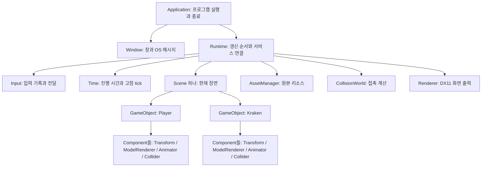
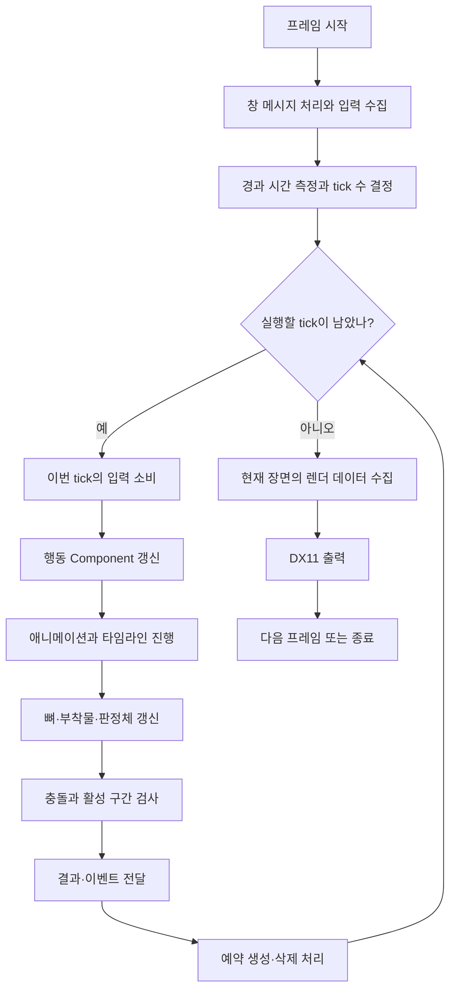

# 전체 구조부터 이해하기

출발 질문은 “버튼을 누르면 캐릭터가 움직이고 크라켄과 접촉한 결과가 화면에 나오기까지 누가 무엇을 맡는가?”다. 아래 그림은 목표 구조다. 모든 모듈이 이미 구현됐다는 뜻은 아니다.

## 세 가지 책임

| 구분 | 책임 | 예 |
| --- | --- | --- |
| 게임 | 무엇을 할지 결정 | 캐릭터의 행동 선택, 크라켄의 반격 결정 |
| 엔진 프레임워크 | 객체의 수명과 실행 순서 관리 | 입력 전달, 객체 갱신, 충돌·렌더 호출 |
| 기반 모듈 | 데이터를 계산하거나 장치 사용 | 모델 읽기, 포즈 계산, 충돌 검사, DX11 출력 |

## 최상위 소유 관계

화살표는 소유·관리 관계다. Component는 자신이 붙은 GameObject를 참조할 수 있지만 소유하지 않는다. 부모와 자식이 서로를 삭제하지 않는다.

게임 전용 행동 Component는 입력과 결과를 읽어 행동을 결정한다. Scene은 객체를 관리하며, Renderer는 전달된 현재 상태를 그린다. 모듈 분리를 이유로 범용 서비스 컨테이너나 자동 등록 시스템을 만들지 않는다.

## 모듈 간 데이터 관계

| 모듈 | 받는 것 | 내보내는 것 |
| --- | --- | --- |
| Input | 키·마우스 메시지 | 다음 tick에서 소비할 입력 |
| Time | 실제 경과 시간, 정지·배속 요청 | 이번 tick이 진행할 시간 |
| Scene / GameObject | 생성·변경·삭제 요청 | 현재 객체, 위치, Component 상태 |
| Animator / Timeline | 클립, 재생 요청, 시간 | 뼈 자세, 재생 위치, 통과한 마커·구간 |
| CollisionWorld | 판정체의 위치·형상·활성 구간 | 접촉 대상과 시점 |
| Renderer | 카메라, 메시·재질, 위치, 뼈 자세 | 화면 |
| AssetManager | 경로·식별자 | 공유할 모델·텍스처·클립 원본 |

모델 원본은 여러 객체가 공유할 수 있다. 재생 위치와 현재 자세는 객체마다 다르다. 공유 원본과 실행 상태를 분리한다.

## 한 프레임의 흐름

화살표는 실행 순서다. 렌더 프레임 하나에서 고정 tick은 0회 이상 실행될 수 있다.

## 꼭 지켜야 할 연결 계약

- 입력 수집과 소비를 나눈다. tick 사이의 짧은 입력을 보관하고 한 번만 전달한다.
- 애니메이션과 판정 구간은 같은 시뮬레이션 시간 기준을 사용한다.
- 한 tick에 시작·종료 마커가 모두 지나가도 그 사이의 판정 구간을 검사한다.
- 갱신 도중 객체를 즉시 삭제하지 않는다. 삭제 예약 후 안전한 경계에서 정리한다.
- 시간 정지·배속 변경은 정한 갱신 경계에서 적용한다.
- 충돌 결과는 사실을 제공한다. 피해량과 반응 선택은 게임 계층의 책임이다.

## 단계 0에서 확인할 것

실제 DX11·모델·충돌 구현 없이도 입력 → 시간 → 객체 → 애니메이션 → 충돌 → 렌더 순서를 출력하는 작은 실행 골격을 만든다. Application 하나의 명시적인 함수 호출로 시작한다. Scene·GameObject·Component의 실제 구현과 두 객체 구성은 단계 1에서 진행한다. 단계 0에서는 고정 tick도 아직 구현하지 않는다. 출력은 실제 기능 검증과 구분해 `placeholder`라고 표시한다. 없는 기능이 작동한 것처럼 성공 로그를 작성하지 않는다.
