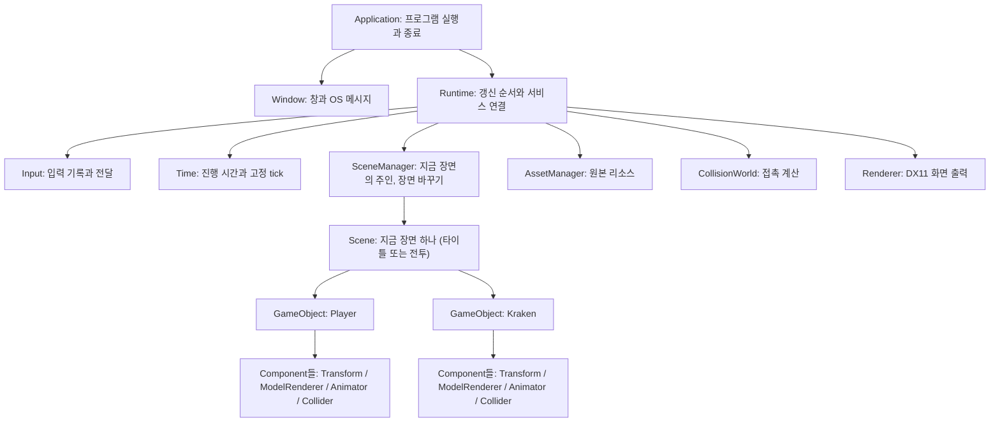
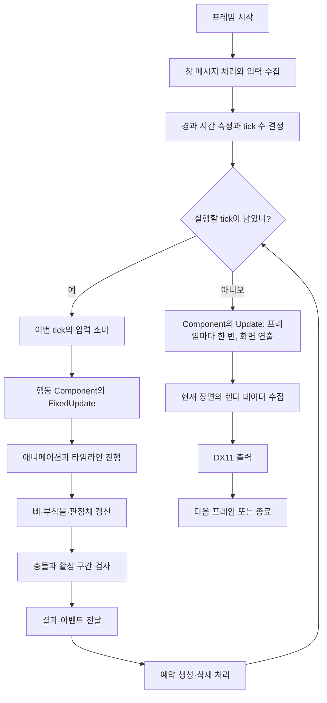

# 전체 구조부터 이해하기

출발 질문은 “버튼을 누르면 캐릭터가 움직이고 크라켄과 접촉한 결과가 화면에 나오기까지 누가 무엇을 맡는가?”다. 아래 그림은 목표 구조다. 모든 모듈이 이미 구현됐다는 뜻은 아니다.

## 세 가지 책임

| 구분 | 책임 | 예 |
| --- | --- | --- |
| 게임 | 무엇을 할지 결정 | 캐릭터의 행동 선택, 크라켄의 반격 결정 |
| 엔진 프레임워크 | 객체의 수명과 실행 순서 관리 | 입력 전달, 객체 갱신, 충돌·렌더 호출 |
| 기반 모듈 | 데이터를 계산하거나 장치 사용 | 모델 읽기, 포즈 계산, 충돌 검사, DX11 출력 |

## 최상위 소유 관계

화살표는 소유·관리 관계다. Component는 자신이 붙은 GameObject를 참조할 수 있지만 소유하지 않는다. 부모와 자식이 서로를 삭제하지 않는다.

게임 전용 행동 Component는 입력과 결과를 읽어 행동을 결정한다. Scene은 객체를 관리하며, Renderer는 전달된 현재 상태를 그린다. 모듈 분리를 이유로 범용 서비스 컨테이너나 자동 등록 시스템을 만들지 않는다.

## 모듈 간 데이터 관계

| 모듈 | 받는 것 | 내보내는 것 |
| --- | --- | --- |
| Input | 키·마우스 메시지 | 다음 tick에서 소비할 입력 |
| Time | 실제 경과 시간, 정지·배속 요청 | 이번 프레임의 tick 수, tick 하나의 고정 시간(`FixedDeltaTime()`), 이번 프레임의 게임 시간(`DeltaTime()`) |
| Scene / GameObject | 생성·변경·삭제 요청 | 현재 객체, 위치, Component 상태 |
| Animator / Timeline | 클립, 재생 요청, 시간 | 뼈 자세, 재생 위치, 통과한 마커·구간 |
| CollisionWorld | 판정체의 위치·형상·활성 구간 | 접촉 대상과 시점 |
| Renderer | 카메라, 메시·재질, 위치, 뼈 자세 | 화면 |
| AssetManager | 저장소 루트 기준 경로 | 공유할 모델 원본(메시, 뼈 개수, 클립 이름). 텍스처는 아직 없다 |

모델 원본은 여러 객체가 공유할 수 있다. 재생 위치와 현재 자세는 객체마다 다르다. 공유 원본과 실행 상태를 분리한다.

## 한 프레임의 흐름

화살표는 실행 순서다. 렌더 프레임 하나에서 고정 tick은 0회 이상 실행될 수 있다. tick마다 컴포넌트의 FixedUpdate가 돌고, 모든 tick이 끝나면 프레임마다 한 번 Update가 돈다. 유니티와 같은 순서다.

## 꼭 지켜야 할 연결 계약

- 입력 수집과 소비를 나눈다. tick 사이의 짧은 입력을 보관하고 한 번만 전달한다.
- 게임 상태는 고정 간격의 FixedUpdate에서만 바꾼다. 프레임마다 도는 Update는 화면 연출만 맡고, 값은 tick에서 Update 쪽으로만 흐른다. 그래서 Update는 Transform, 객체 생성·삭제, 활성 상태, FixedUpdate가 읽는 값을 바꾸지 않는다. 누름·뗌 입력도 FixedUpdate에서만 읽는다. tick 안에서 읽은 `DeltaTime()`은 tick 길이다.
- 애니메이션과 판정 구간은 같은 시뮬레이션 시간 기준을 사용한다.
- 한 tick에 시작·종료 마커가 모두 지나가도 그 사이의 판정 구간을 검사한다.
- 갱신 도중 객체를 즉시 삭제하지 않는다. 삭제 예약 후 안전한 경계에서 정리한다.
- 시간 정지·배속 변경은 정한 갱신 경계에서 적용한다.
- 충돌 결과는 사실을 제공한다. 피해량과 반응 선택은 게임 계층의 책임이다.

## 현재 구현이 처음 설계와 다른 점

처음 설계 대화에서 정한 구조와 지금 코드가 다른 곳이다. 다르게 정한 이유와 다시 볼 시점을 함께 적는다.

| 항목 | 처음 설계 | 지금 구현 | 이유와 다시 볼 시점 |
| --- | --- | --- | --- |
| 컴포넌트 갱신 | 컴포넌트 로직은 고정 tick에서만 돈다. 유니티에서는 GameObject–Component 관계만 참고한다 | 고정 간격으로 도는 FixedUpdate와 프레임마다 한 번 도는 Update로 나눈다. 창 모드의 고정 간격은 0.02초다 | 단계 3-3에서 학생이 유니티의 구분을 따르기로 했다. 게임 상태는 FixedUpdate에서만 바꾸므로 "같은 시계" 목표는 그대로다. Update에서 읽을 입력(누르고 있는지, 프레임 마우스 이동량)은 단계 6에서 쓸 곳이 생길 때 더한다 |
| 입력·시간 전달 | Input·Time을 FrameContext로 묶어 World에 전달 | Scene이 읽기 전용 Input·Time을 갖고, 컴포넌트가 소유자 GameObject를 거쳐 읽는다 | 매개변수 없는 갱신 함수 모양을 유지하고 이미 배운 소유 관계를 따라간다. World가 tick 환경을 갖는 방향은 같다. Scene이 알려 주는 서비스는 Input·Time 두 개뿐이고, 컴포넌트가 그 밖에 Scene에서 쓰는 것은 객체 생성과 정리 요청뿐이다. 다른 서비스가 필요해지면 이 결정을 다시 본다 |
| 입력 큐 | 시각과 순서가 있는 입력 큐 | tick 단위 결과. 누름·유지·뗌과 마우스 변화량만 보관 | 소비 사이에 같은 키를 여러 번 누르면 1회가 된다. 서로 다른 키의 순서와 프레임 안에서 누른 시점은 남지 않는다. 단계 5에서 합격 기준 범위를 정할 때 다시 본다 |
| 예약 생성·삭제 반영 | tick의 마지막 | 단계 4-1부터 처음 설계와 같다. Application이 tick마다 `Scene.BeginTick`·`EndTick`을 부르고, 그 사이의 생성·삭제·Clear는 EndTick에서 반영한다. Update에서는 생성·삭제를 하지 않으므로 Scene.Update 끝의 반영은 안전장치다 | 단계 1~3-3에서는 삭제를 Scene.FixedUpdate 끝에, 생성을 즉시 반영했다. 컴포넌트 소멸자에서 들어온 생성·정리 요청은 받아 두는 대신 지금처럼 금지한다. 단계 2 재검증에서 그 길이 크래시로 끝났고 필요한 곳이 없었다 |
| 보간 계수 | Time이 제공 | Time이 `InterpolationAlpha()`로 준다. 직전 Transform은 GameObject가 갖고 Scene이 tick 시작에 복사한다 | 단계 3-2에서 처음 설계대로 추가했다 |
| 장면 수 | Scene 하나면 충분하다. 장면 전환은 로드맵에 없었다 | 단계 4-2부터 SceneManager가 지금 장면 하나를 `unique_ptr`로 갖고, 바꾸기 요청을 기록했다가 정한 자리에서 옛 장면을 지우고 새 장면을 코드로 채운다(타이틀·전투). 장면은 여전히 한 번에 하나다 | 2026-11-09 학생이 바꿨다: 타이틀 화면과 화면 전환이 필요하다. 학생이 정한 것이라 설계 기준 어긋남으로 보지 않는다. 4-3의 Animator와 단계 5의 Collider는 장면이 지워졌다 다시 만들어지는 것을 전제로 설계하고, 단계 6의 재시작은 전투 장면 다시 불러오기로 한다. 컴포넌트가 바꾸기를 요청할 수 있게 하면 Scene의 서비스가 Input·Time·SceneManager 셋이 된다(4-2 설계 문서의 결정 1, 학생 답 대기) |
| 모델 원본 | AssetManager가 경로·식별자로 공유 원본을 준다 | 같다. 단계 4-1의 AssetManager가 glTF 파일을 읽어 소유하고, 같은 경로는 같은 원본이다. 원본은 실행 중에 내리지 않고, 가리키는 쪽은 주소를 쓴다 | 내리지 않으므로 수명 규칙이 선언 순서 하나다. 실행 중에 내리는 코드가 생기면 `shared_ptr`와 Renderer 캐시 열쇠를 다시 본다 |

## 단계 0에서 확인할 것

실제 DX11·모델·충돌 구현 없이도 입력 → 시간 → 객체 → 애니메이션 → 충돌 → 렌더 순서를 출력하는 작은 실행 골격을 만든다. Application 하나의 명시적인 함수 호출로 시작한다. Scene·GameObject·Component의 실제 구현과 두 객체 구성은 단계 1에서 진행한다. 단계 0에서는 고정 tick도 아직 구현하지 않는다. 출력은 실제 기능 검증과 구분해 `placeholder`라고 표시한다. 없는 기능이 작동한 것처럼 성공 로그를 작성하지 않는다.
