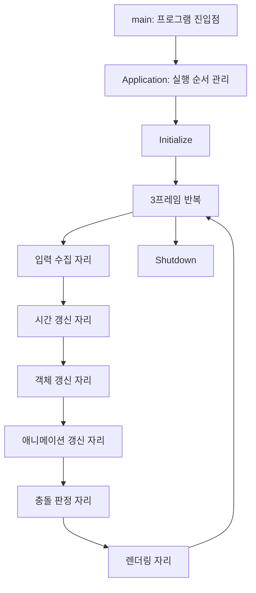

# 00. 최상위 구조와 실행 순서

이 단계는 입력부터 화면 출력까지 들어갈 자리를 먼저 연결한다. 실행 가능한 것은 콘솔 프로그램의 시작·반복·종료와 로그 출력이다. 키 입력, 시간 측정, 객체 관리, 애니메이션, 충돌, DX11은 아직 구현하지 않았다. 출력의 `[placeholder]`는 이후 단계에서 채울 자리라는 뜻이다.

## 책임과 소유 관계

`main`은 `Application` 하나를 만든다. 이 객체는 `main`이 끝날 때 자동으로 정리된다. 아직 동적으로 할당한 객체나 GPU 자원은 없다.

`Application`은 각 처리 단계의 호출 순서를 책임진다. 게임 규칙을 결정하거나 크라켄을 직접 그리는 객체가 아니다. 이후 별도 모듈이 생기면 현재 자리 표시자 함수에서 해당 모듈을 호출한다.



다음 표는 앞으로 채울 모듈의 계약이다. 현재 구현은 전달 데이터를 만들지 않고 순서만 출력한다.

| 단계 | 받을 것 | 만들거나 전달할 것 |
|---|---|---|
| 입력 | Windows 키·마우스 메시지 | 이번 갱신에서 사용할 입력 |
| 시간 | 실제 경과 시간과 정지·배속 설정 | 이번 갱신에서 진행할 시간 |
| 객체 | 입력과 시간 | 객체의 상태·행동 요청 |
| 애니메이션 | 모션·재생 요청·진행 시간 | 뼈 자세와 시점별 이벤트 |
| 충돌 | 판정체의 위치·형상·활성 구간 | 접촉 후보 |
| 렌더링 | 카메라·객체 변환·메시·뼈 자세 | 화면 |

지금의 반복은 고정 tick이나 실제 렌더 프레임이 아니다. 이후 입력·시간 단계에서 입력 수집, 고정 갱신 0회 이상, 화면 출력 1회를 구분한다. 충돌 결과 처리나 예약 삭제 역시 해당 책임을 구현할 단계에서 추가한다.

## 코드 읽는 순서

1. `src/main.cpp`: 프로그램이 처음 시작하는 곳과 Application의 수명을 확인한다.
2. `src/Application.h`: Application이 외부에 제공하는 Run과 내부 단계 함수들을 확인한다.
3. `src/Application.cpp`: Run에서 함수가 호출되는 순서를 읽는다. 각 단계의 내부는 지금 로그 한 줄뿐이다.
4. `CMakeLists.txt`: 어떤 소스 파일로 실행 파일을 만드는지 확인한다.

## 빌드와 실행

필요한 도구는 Visual Studio 2022의 C++ 데스크톱 개발 도구와 CMake다. 저장소 루트에서 PowerShell로 실행한다.

```powershell
cmake -S . -B build -G "Visual Studio 17 2022" -A x64
cmake --build build --config Release
./build/Release/KrakenLearning.exe
```

CMake가 PATH에 없고 VS2022 Community의 기본 위치에 설치돼 있다면 다음을 사용한다.

```powershell
$cmakePath = 'C:\Program Files\Microsoft Visual Studio\2022\Community\Common7\IDE\CommonExtensions\Microsoft\CMake\CMake\bin\cmake.exe'
& $cmakePath -S . -B build -G 'Visual Studio 17 2022' -A x64
& $cmakePath --build build --config Release
./build/Release/KrakenLearning.exe
```

## 실행 합격 기준

- 시작에 `Initialize`가 한 번 출력된다.
- `Frame 1`, `Frame 2`, `Frame 3`이 출력된다.
- 각 프레임에서 Input → Time → Objects → Animation → Collision → Render가 순서대로 출력된다.
- 마지막에 `Shutdown`이 한 번 출력되고 종료 코드가 0이다.
- 실제 입력·시간·그래픽이 구현됐다고 보고하지 않는다.

GitHub Actions는 같은 소스를 Release로 빌드하고 실행한다. 콘솔 실행 성공은 구조 골격의 확인일 뿐 이후 모듈의 정확성 검증은 아니다.

## 검증 기록

2026-11-02, Windows 개발 PC에서 VS2022 / MSVC 19.44.35225.0으로 Release 구성과 빌드에 성공했다. 실행은 위 순서로 정확히 3프레임을 출력하고 종료 코드 0으로 끝났다. 이 기록은 로컬 실행 결과다. GitHub Actions 결과는 PR의 Checks에서 별도로 확인한다.

## 학생이 직접 답할 질문

1. Application은 누가 만들고, 언제 사라지는가?
2. 왜 Render를 애니메이션과 충돌 처리 뒤에 호출하는가?
3. 실제 입력 모듈을 붙일 때, 입력을 받는 함수는 무엇을 다음 단계에 전달해야 하는가?

학생 답변: 아직 제출되지 않음. 에이전트가 대신 작성하지 않는다.

## 작은 변형 과제

반복 프레임 수를 3에서 5로 변경해 빌드·실행한다. 어떤 파일의 어떤 값을 바꿨으며, 모듈 내부를 바꾸지 않아도 되는 이유를 PR 댓글에 설명한다. 이 과제의 변경은 기본 구현에 미리 포함하지 않는다.
