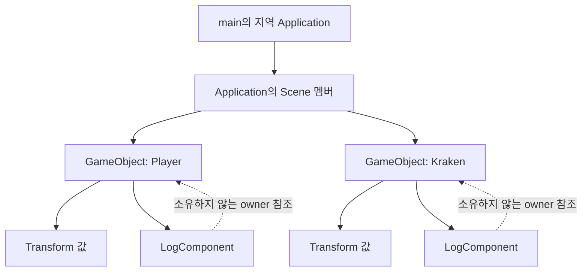

# 01. GameObject와 Component의 수명

목표는 Scene → GameObject → Component의 소유 관계를 실행으로 확인하는 것이다.
실제 입력·시간·애니메이션·충돌·DX11은 아직 placeholder다.

## 먼저 볼 구조



실선은 소유, 점선은 참조다. Transform은 별도 동작이 없는 단순 데이터이므로 이번에는 GameObject의 값 멤버로 둔다.
Unity 전체 구조를 복제하지 않는다. GameObject에 동작 Component를 붙이는 관계만 적용한다.

| 모듈 | 소유하는 것 | 받는 것 / 하는 일 | 반환하거나 전달하는 것 |
| --- | --- | --- | --- |
| Application | Scene | 초기화·갱신·종료 호출 | 매 프레임 Scene.Update 호출 |
| Scene | GameObject 목록 | 생성, 갱신, 삭제 예약 정리 | 생성한 객체의 참조 |
| GameObject | Transform, Component 목록 | 활성 상태와 삭제 여부 확인 | 실행 가능한 Component.Update 호출 |
| Component | 자신의 활성 상태 | owner 참조를 통해 객체 조회 | 실제 기능은 파생 클래스가 구현 |
| LogComponent | 추가 소유 자원 없음 | 자기 객체의 이름과 위치 조회 | 콘솔 로그 |

CreateObject가 돌려주는 참조와 Component의 owner 참조는 빌려 쓰는 것이다.
Scene이 해당 객체를 정리한 뒤에는 그 참조를 사용하면 안 된다.
객체는 복사하지 않는다. 복사하면 Component가 참조하는 owner와 실제 소유자가 달라질 수 있기 때문이다.

## 꼭 필요한 문법만 읽기

- std::unique_ptr: 객체를 소유하는 보관함이다. 보관함이 없어지면 안의 객체도 한 번 정리된다.
- std::make_unique: 객체를 만들고 그 보관함을 돌려준다.
- std::move: 객체 자체의 위치를 바꾸는 기능이 아니라 여기서는 보관함의 소유권을 넘길 때 쓴다.
- virtual / override: Component를 통해 호출해도 실제로 붙인 LogComponent의 동작이 실행되게 한다.
- virtual 소멸자: Component 보관함을 정리할 때 실제 파생 클래스의 정리까지 실행되게 한다.
- '= delete': GameObject 복사를 금지한다. 여기서 메모리를 삭제하라는 뜻은 아니다.
- '<...>'는 표준 컨테이너의 보관할 자료형 표기다. 직접 템플릿이나 자동 등록 시스템을 만들지 않는다.

메모리 구조를 먼저 이해한 뒤 각 문법을 읽는다. new/delete를 여러 곳에 흩어 쓰지 않는다.

## 갱신과 정리 순서

1. main이 Application을 만든다. 그 안의 Scene도 생성된다.
2. Initialize에서 Player와 Kraken을 만들고 LogComponent를 붙인다.
3. 예제의 Kraken은 처음부터 비활성이다. Player만 매 프레임 Update 로그를 출력한다.
4. GameObject는 비활성 또는 삭제 예약 상태면 이후 Component를 호출하지 않는다.
5. RequestDestroy는 표시만 한다. 현재 실행 중인 Component를 즉시 삭제하지 않는다.
6. Scene.Update의 전체 순회가 끝나면 삭제 예약 객체를 정리한다.
7. GameObject 정리 시 Component를 먼저 정리한다. 그동안 owner 이름과 Transform은 유효하다.
8. Shutdown은 Scene.Clear를 호출한다. Application 자체는 main의 범위를 벗어날 때 소멸한다.

같은 객체의 Component 사이, 서로 다른 객체 사이의 정리 순서에는 의존하지 않는다.
보장하는 것은 각 Component가 자신의 owner 데이터보다 먼저 정리된다는 관계다.
Clear를 갱신 중에 요청해도 즉시 해제하지 않는다. 갱신 밖에서는 바로 정리한다.
중복 삭제 요청과 빈 Scene.Clear는 안전하다.

갱신 중 생성한 GameObject는 다음 Scene.Update부터, 자기 갱신 중 추가한 Component는 다음 GameObject.Update부터 실행한다.
아직 차례가 오지 않은 다른 객체에 Component를 붙이면 그 객체의 이번 Update부터 실행될 수 있다.
갱신 중 vector 크기가 늘어도 인덱스와 시작 시점의 개수로 순회하므로 반복자가 무효화되는 문제를 피한다.
여러 스레드에서 동시에 수정하는 것은 이 단계 범위 밖이다.
Scene.Update의 재귀 호출은 오류로 처리한다. 예외가 발생하면 갱신 상태를 복구하고 오류를 호출자에게 전달한다.

## 읽기 순서

1. Application.cpp: 실제 생성·연결·갱신·정리 위치.
2. Scene.h / Scene.cpp: 객체를 누가 보관하고 언제 지우는가.
3. GameObject.h / GameObject.cpp: Transform과 Component를 누가 보관하는가.
4. Component.h / LogComponent.cpp: 공통 기능과 실제 동작의 관계.

LifecycleTests.cpp는 위 구조를 읽은 뒤 보는 검증 예제다.

## 실행

루트의 NereidesEngine2.sln을 VS2022로 열고 Debug 또는 Release / x64에서 Ctrl+F5로 실행한다.
기본 실행은 Player·Kraken 생성 → Player 갱신 → Component 정리 → GameObject 정리를 출력한다.
학생이 이전 과제에서 바꾼 frameCount는 그대로 실험할 수 있다.

Developer PowerShell for VS 2022:

```powershell
msbuild NereidesEngine2.sln /p:Configuration=Debug /p:Platform=x64
./bin/x64/Debug/NereidesEngine2.exe
./bin/x64/Debug/NereidesEngine2.exe --lifecycle-tests
```

자동 검증은 비활성 객체·컴포넌트, 갱신 중 자기 삭제, 갱신 중 Scene.Clear,
갱신 중 생성, 20회 반복 생성·소멸을 확인한다. Release에서도 검사하도록 assert 대신 실패 시 종료 코드 1을 사용한다.
정상 종료와 함께 'Lifecycle tests PASS (5 cases)'가 출력되어야 한다.
이 테스트의 성공은 학생 이해 완료와 별개다.

## 학생 질문

1. Scene을 정리하면 Component와 GameObject는 어떤 관계로 정리되는가?
2. 위치를 LogComponent에 두지 않고 Transform에 보관하는 이유는 무엇인가?
3. Update 안에서 즉시 객체를 삭제하면 어떤 문제가 생길 수 있는가?

변형 과제: 두 번째 갱신부터 Player를 비활성화하고 실제 Update 횟수를 확인한다.
어디를 수정했는지, 객체가 삭제된 것인지 갱신만 멈춘 것인지 설명한다.
정답 변경은 기본 예제에 포함하지 않았다. 학생 이해 상태는 미확인이다.

## 검증 기록

2026-11-02: 로컬 VS2022의 Debug·Release 빌드, 기본 예제, 수명 검증 5개가 모두 종료 코드 0으로 통과했다. 기본 예제는 학생의 로컬 frameCount=5 변경을 유지한 상태로 확인했다. 커밋에는 그 학생 수정이 포함되지 않으며 CI는 커밋된 기본 횟수로 검증한다.
