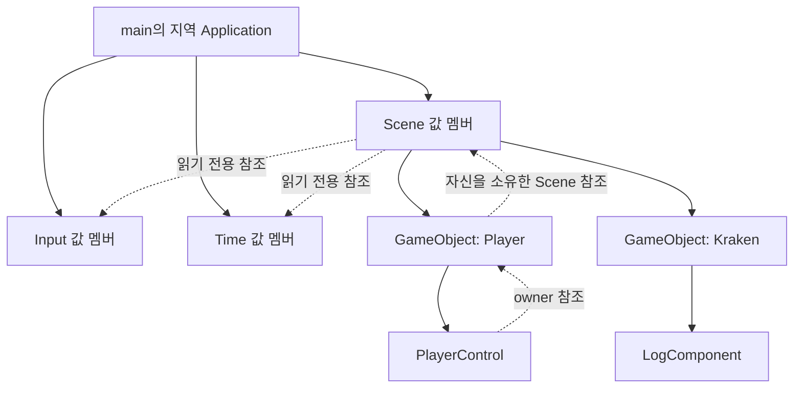
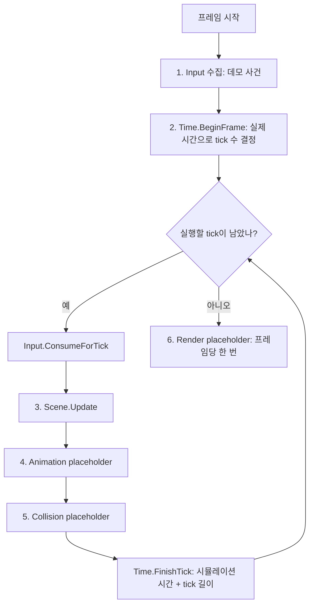

# 02. 입력 전달과 시간 관리

목표는 두 가지다. 입력을 모으는 일과 쓰는 일을 나눈다. 실제로 흐른 시간을 고정 길이의 tick으로 바꾼다.

이번 콘솔 프로그램에는 아직 창이 없다. 그래서 키·마우스 사건은 Application의 데모 스크립트가 넣고, 프레임 길이도 미리 정한 값을 쓴다.
단계 3에서 창이 생기면 같은 Input 함수에 실제 창 메시지를 넣고, 같은 Time 함수에 실제로 잰 시간을 넣는다. 받는 쪽 코드는 바뀌지 않는다.

## 먼저 볼 구조



실선은 소유, 점선은 소유하지 않는 참조다. Application이 Input·Time·Scene을 값 멤버로 가진다.
컴포넌트는 Input과 Time을 직접 보관하지 않는다. 소유자 GameObject를 거쳐 Scene에서 읽는다.

| 모듈 | 소유자 | 받는 것 | 내보내는 것 | 호출 시점 |
| --- | --- | --- | --- | --- |
| Input | Application | 키 누름·뗌, 마우스 이동, 포커스 상실 | tick 하나 동안 고정된 누름·유지·뗌과 마우스 변화량 | 수집은 프레임 중 언제든, 소비는 각 tick 시작에 한 번 |
| Time | Application | 실제 경과 시간, 정지·배속 요청, tick 종료 알림 | 이번 프레임의 tick 수, tick 길이, 실제·시뮬레이션·버린 시간의 누적값 | 프레임 시작에 BeginFrame 한 번, 각 tick 끝에 FinishTick 한 번 |
| Scene | Application | 만들 때 Input·Time 읽기 전용 참조, 객체 생성·삭제 요청 | 객체 목록, 컴포넌트에 알려 주는 Input·Time | 연결은 Application을 만들 때 한 번, 갱신은 각 tick |
| PlayerControl | Player GameObject | 생성자로 이동 속도. Input의 tick 결과와 Time의 tick 길이는 소유자와 Scene을 거쳐 읽는다 | Player Transform 변경, 공격 횟수 | 각 tick의 Scene.Update 안 |
| Application | main | 데모 사건과 프레임 길이 | 위 모듈의 호출 순서 | 매 프레임 |

### 컴포넌트가 입력과 시간을 읽는 경로

컴포넌트 안에서는 `GetInput()`과 `GetTime()`을 부른다. 이 두 함수가 `GetOwner().GetScene().GetInput()`처럼 소유자 GameObject와 그 Scene을 거쳐 읽는다. 컴포넌트 안에서 쓰라고 protected로 두었다. 같은 Input·Time을 `GetOwner().GetScene()`으로도 읽을 수 있다. 어느 쪽이든 읽기 전용이라 값을 바꿀 수는 없다.

- **생성자에는 고유 값만 받는다.** 이동 속도처럼 만들 때 정해지고 tick마다 바뀌지 않는 값이다. 단계 4의 클립 원본, 단계 6의 최대 HP도 같은 쪽이다.
- **tick마다 읽는 환경은 소유자를 거쳐 읽는다.** 실행 중에 만든 객체도 Scene이 만들었으므로 같은 경로로 닿는다.
- **GameObject는 Scene::CreateObject로만 만든다.** 직접 만들면 Scene이 소유하지 않아 갱신·정리되지 않는다. 그 객체가 Scene보다 오래 살면 `GetScene()`이 끊어진 참조를 돌려준다.
- **Scene 창구 규칙**: Scene이 컴포넌트에 알려 주는 서비스는 읽기 전용 Input과 Time 두 개뿐이다. 그 밖에 컴포넌트가 Scene에서 쓰는 것은 객체 생성 `CreateObject`와 정리 요청 `Clear`뿐이다. `Clear`는 갱신 중이면 갱신이 끝난 뒤 처리된다. `Update`는 Application만 부르고, 갱신 중에 다시 부르면 예외가 난다. 컴포넌트 소멸자에서는 `CreateObject`, `Clear`, `Update`를 부르지 않는다. 소멸자는 Scene이 객체 목록을 지우는 도중에 실행된다. 지우는 도중 같은 목록에 객체를 더하거나 다시 지우기 시작하면 정리 과정이 꼬여 프로그램이 죽는다. 소멸자에서 `GetInput()`·`GetTime()`으로 읽는 것은 괜찮다. 단계 4에서는 정리 중에 들어온 생성·정리 요청을 따로 받아 두었다가 정리가 끝난 뒤 처리하게 해서 구조로도 막는다. Renderer, 모델 로더, 충돌 기능은 Scene에 넣지 않는다. 편하다는 이유로 넣기 시작하면 모든 것을 담는 창구가 되어, 저장소 규칙이 금지한 범용 서비스 컨테이너와 같아진다.
- **읽는 것 표시**: 생성자만 봐서는 무엇을 읽는지 알 수 없다. 그래서 컴포넌트 헤더 주석에 읽는 것을 적는다.
- **다시 검토할 신호**: Scene에 Input·Time 말고 다른 서비스를 넣고 싶어질 때다. 그때는 이 규칙을 지키는 다른 전달 방법을 먼저 찾는다.

### 선언 순서가 곧 수명 순서다

C++는 멤버를 선언한 순서대로 만들고, 반대 순서로 정리한다.
Application은 Input, Time, Scene 순서로 선언한다. 그래서 Scene이 가장 먼저 정리된다.
Scene이 참조하는 Input과 Time은 Scene보다 늦게 정리되므로, Scene이 살아 있는 동안 참조가 항상 유효하다.
GameObject가 가진 Scene 참조에는 이 규칙이 필요 없다. Scene이 GameObject를 소유하므로 Scene이 항상 더 오래 산다.
서비스 참조를 보관하는 곳은 Scene 한 곳뿐이다. 다만 Scene과 Input·Time을 함께 만드는 곳은 어디든 Input과 Time을 먼저 선언해야 한다. 지금은 Application, 시험의 TestWorld, 시험 함수의 지역 변수가 그런 곳이다.

### 단계 2에서 바뀐 단계 1 코드

- GameObject는 자신을 소유한 Scene을 안다. Scene이 객체를 만들 때 자기 자신을 넘긴다.
- Scene은 만들 때 Input과 Time을 받는다. 그래서 시험에서도 Scene을 만들려면 Input과 Time이 필요하다.
- Component에 protected 함수 `GetInput()`과 `GetTime()`이 생겼다. `Update()`의 모양은 단계 1 그대로다.

## 한 프레임의 흐름



렌더 프레임은 화면 한 장을 내보내는 단위다. 길이는 컴퓨터 상태에 따라 매번 다르다.
tick은 게임 규칙이 한 걸음 진행하는 단위다. 길이가 항상 같다.
그래서 프레임 하나 동안 tick은 0번일 수도, 여러 번일 수도 있다.

## Input 규칙

Input은 두 쪽으로 나뉜다.

- **수집 쪽**: OnKeyDown, OnKeyUp, OnMouseMove, OnFocusLost. 지금은 데모 스크립트, 단계 3부터는 창 메시지가 호출한다.
- **소비 쪽**: ConsumeForTick. Application이 각 tick 시작에 한 번 호출한다. 모인 사건을 이번 tick의 결과로 옮기고 일회성 값을 비운다.
- **읽기 쪽**: IsPressed, IsHeld, IsReleased, MouseDeltaX, MouseDeltaY. 행동 Component는 마지막 소비 결과만 읽는다.

| 결과 | 뜻 |
| --- | --- |
| 누름 | 지난 소비 이후 한 번이라도 새로 눌림 |
| 유지 | 소비하는 순간 눌려 있음 |
| 뗌 | 지난 소비 이후 한 번이라도 떼어짐 |
| 마우스 변화량 | 지난 소비 이후 움직인 양의 합 |

- **짧은 입력**: tick 사이에 눌렀다 떼면 다음 tick에서 누름과 뗌은 참, 유지는 거짓이다. 그래서 공격처럼 누름을 보는 행동은 한 번 실행되고, 이동처럼 유지를 보는 행동은 움직이지 않는다.
- **tick이 0번인 프레임**: 소비하지 않으므로 사건은 다음 tick까지 그대로 보관된다. 짧은 입력이 사라지지 않는다.
- **tick이 여러 번인 프레임**: 첫 tick만 누름과 마우스 변화량을 받는다. 이후 tick은 유지만 본다. 같은 누름이 여러 tick에서 반복 실행되지 않는다.
- **키 자동 반복**: 이미 눌린 키의 OnKeyDown은 무시한다. 키를 오래 누르면 OS가 누름을 반복해서 보내기 때문이다.
- **포커스 상실**: 눌린 상태와 모인 사건을 모두 비운다. 뗌 사건은 만들지 않는다. 그 뒤에 들어오는 OnKeyUp은 눌린 키가 없으므로 무시된다.

행동과 키의 연결은 Input.cpp의 작은 표 하나에 둔다. 게임 코드는 키가 아니라 행동 이름으로 묻는다.

| 행동 | 키 |
| --- | --- |
| MoveForward | W |
| MoveBack | S |
| MoveLeft | A |
| MoveRight | D |
| Attack | Space |

## Time 규칙

- **실제 시간**: BeginFrame에 들어온 값의 합이다. 정지·배속과 관계없이 늘어난다.
- **시뮬레이션 시간**: 마친 tick 수 곱하기 tick 길이다. 게임 규칙은 이 시간만 쓴다.
- **tick 수 결정과 진행의 분리**: BeginFrame은 이번 프레임의 tick 수만 정한다. tick 하나를 마칠 때마다 FinishTick이 시뮬레이션 시간을 tick 길이만큼 늘린다. 그래서 tick 안에서 읽는 시뮬레이션 시간은 그 tick이 시작한 시각이다.
- **호출 약속**: BeginFrame이 정한 tick을 모두 FinishTick으로 마친 뒤에 다음 BeginFrame을 부른다. 남은 tick이 있는데 BeginFrame을 부르거나, 남은 tick이 없는데 FinishTick을 부르면 예외로 바로 알린다.
- **누적기**: 실제 시간에 배속을 곱해 쌓고, tick 길이만큼씩 꺼내 tick 수를 센다. 남은 조각은 다음 프레임으로 넘긴다.
- **정지**: 누적기에 더하지 않는다. 이미 남은 조각은 그대로 둔다.
- **배속**: tick 길이는 그대로 두고 tick 수가 바뀐다. 그래서 행동 Component는 늘 같은 길이로 계산한다.
- **적용 경계**: RequestPause와 RequestScale은 값을 기록만 한다. 실제 적용은 다음 BeginFrame의 시작이다. tick을 실행하는 도중에는 정지·배속이 바뀌지 않는다.
- **오류 처리**: 음수 실제 시간, 음수 배속, 0 이하 tick 길이, 1 미만 상한은 예외로 거부한다.
- **소수 오차**: 0.1을 여러 번 더하면 정확히 같지 않을 수 있다. tick 수를 셀 때 아주 작은 여유값을 둔다.

### 낮은 FPS에서 따라잡기 상한

프레임 하나에서 실행할 tick 수에 상한을 둔다. 상한을 넘는 누적 시간은 모두 버리고 DroppedTime에 더해 기록한다. DroppedTime은 프레임별 값이 아니라 지금까지 버린 시간의 합이다. 데모 로그도 이 값을 total 묶음에 출력한다.

- **이유**: 느린 프레임 뒤에 tick을 한꺼번에 많이 돌리면 그 tick 때문에 다음 프레임이 또 느려진다. 이 악순환을 끊는다.
- **결과**: 그 순간 게임은 실제보다 느리게 진행된다. 시뮬레이션 시간이 실제 시간보다 적게 늘어난다.
- **버린 시간의 이후 처리**: 다음 프레임으로 넘기지 않는다. 다음 프레임은 0에서 다시 쌓는다.

데모는 로그를 읽기 쉽게 tick 길이 0.1초, 상한 3으로 둔다. 실제 게임은 보통 tick 길이를 1/60초 정도로 둔다.

## 데모 시나리오와 기대 결과

PlayerControl의 이동 속도는 초당 1이다. tick 하나에 0.1만큼 움직인다. 대각선으로 움직일 때도 방향의 길이로 나눠 같은 속도를 지킨다.

| 프레임 | 실제 시간 | 데모 사건 | 기대 tick 수 | 확인할 것 |
| --- | --- | --- | --- | --- |
| 1 | 0.10 | W 누름, 마우스 x 30 | 1 | 앞으로 0.1 이동, 몸통 회전 |
| 2 | 0.05 | Space 눌렀다 뗌 | 0 | 짧은 입력이 보관됨 |
| 3 | 0.05 | 없음 | 1 | 공격 1회, 이동 계속 |
| 4 | 0.10 | 배속 2 요청 | 2 | 같은 실제 시간에 tick 2배 |
| 5 | 0.20 | 정지 요청 | 0 | 실제 시간만 증가 |
| 6 | 1.00 | 재개, 배속 1 요청 | 3 | 상한 적용, 0.7초 버림 |
| 7 | 0.10 | 포커스 상실 | 1 | W가 풀려 이동 멈춤 |

## 꼭 필요한 문법만 읽기

- enum class: 키와 행동 이름을 숫자 대신 이름으로 쓴다. 다른 enum과 섞이지 않는다.
- `static_cast<int>`: enum class 값을 배열 번호로 바꿀 때만 쓴다.
- std::sqrt: 방향의 길이를 구한다. 대각선 이동 속도를 맞출 때만 쓴다.
- const 참조 멤버: Scene은 Input과 Time을 읽기만 한다. 소유하지 않고 바꾸지도 않는다.
- 앞 선언: GameObject.h는 `class Scene;`으로 Scene을 이름만 알린다. GameObject.h와 Scene.h가 서로를 포함하면 컴파일되지 않기 때문이다. 이름만 알아도 참조를 보관하고 돌려줄 수는 있다. 멤버 함수를 부르거나 객체 크기가 필요할 때만 전체 정의가 필요하다.
- const 함수와 참조 멤버: `GetScene()`은 const 함수인데도 수정 가능한 `Scene&`를 돌려준다. const는 GameObject 자신의 값이 바뀌지 않게 막을 뿐, 참조로 가리키는 Scene까지 막지는 않는다. 단계 1의 `GetOwner()`도 같은 모양이다.
- 생성자 초기화 목록: 참조 멤버와 기본 생성자가 없는 Time·Scene 멤버는 여기서 정해야 한다.
- 멤버 선언 순서: 생성은 선언 순서, 정리는 반대 순서다.

## 읽기 순서

1. src/Application.cpp: 프레임과 tick의 반복, 수집·소비 위치.
2. src/Input.h / Input.cpp: 수집·소비·읽기의 경계와 행동 표.
3. src/Time.h / Time.cpp: 누적기, tick 수 결정과 진행의 분리, 적용 경계, 따라잡기 상한.
4. src/Scene.h와 src/Component.cpp: 컴포넌트가 소유자와 Scene을 거쳐 입력과 시간을 읽는 경로.
5. src/PlayerControl.cpp: 입력과 시간을 읽는 행동 Component와 대각선 속도 보정.

src/InputTimeTests.cpp는 위 규칙을 확인하는 검증 예제다.

헤더 이름 Time.h는 표준 헤더 time.h와 대소문자만 다르다. 지금 프로젝트는 src 폴더를 추가 include 경로로 쓰지 않으므로 충돌하지 않는다. 나중에 src를 include 경로에 넣게 되면 Windows는 대소문자를 구분하지 않아 표준 헤더 대신 이 파일을 읽을 수 있다. 그때는 헤더 이름을 먼저 바꾼다.

## 실행

Developer PowerShell for VS 2022:

```powershell
msbuild NereidesEngine2.sln /p:Configuration=Debug /p:Platform=x64
./bin/x64/Debug/NereidesEngine2.exe
./bin/x64/Debug/NereidesEngine2.exe --lifecycle-tests
./bin/x64/Debug/NereidesEngine2.exe --input-time-tests
```

## 이번에 하지 않는 것

창과 OS 메시지, 실제 시계 측정, 키 재설정과 설정 UI, 콤보 입력, 보스 행동, 렌더 보간은 구현하지 않는다.
여러 미래 장치를 위한 범용 입력 계층도 만들지 않는다.

## 학생 질문

1. 입력 수집과 소비를 왜 나누는가?
2. 렌더 프레임과 고정 tick은 무엇이 다른가?
3. 게임 시간과 실제 시간을 분리하면 무엇을 제어할 수 있는가?

변형 과제: 같은 실제 시간 동안 정상 배속과 절반 배속에서 Player의 이동 거리를 비교한다.
어디를 바꿨는지, 두 거리가 왜 그런 비율이 되는지 설명한다.
정답 변경은 기본 예제에 포함하지 않는다. 학생 이해 상태는 미확인이다.

## 검증 기록

2026-11-03, Windows 개발 PC의 VS2022 MSBuild로 Debug·Release x64를 다시 빌드했다. 경고 수준 4에서 경고 없이 성공했다.

| 명령 | 기대 결과 | 실제 결과 |
| --- | --- | --- |
| NereidesEngine2.exe | 위 데모 표와 같은 tick 수와 위치, 종료 코드 0 | 두 구성 모두 일치, 종료 코드 0 |
| NereidesEngine2.exe --lifecycle-tests | 단계 1 검증 5개 통과 | 두 구성 모두 PASS (5 cases) |
| NereidesEngine2.exe --input-time-tests | 입력·시간 검증 17개 통과 | 두 구성 모두 PASS (17 cases) |

입력·시간 검증 17개가 확인하는 것은 다음과 같다.

- 누름·유지·뗌의 1회 전달, 다음 소비 전까지 고정되는 tick 결과, 짧은 입력 보관과 1회 소비, 키 자동 반복 무시, 마우스 변화량 합산과 1회 전달.
- 포커스 상실 뒤 눌린 상태·사건·늦은 뗌 신호가 남지 않음.
- 남은 시간 조각의 이월, tick을 마칠 때마다 늘어나는 시뮬레이션 시간과 호출 순서 위반 거부, 경계에서만 적용되는 정지와 배속, 따라잡기 상한과 tick 조각까지 버리는 정책.
- 잘못된 tick 길이·상한·배속·실제 시간 거부, 배열 크기용 Key::Count를 실제 키로 넣었을 때 거부.
- 처음부터 있던 객체와 갱신 중에 만든 객체의 컴포넌트가 모두 자기 Update 안에서 소유자와 Scene을 거쳐 같은 Input·Time에 닿음.
- 정상·정지·2배속에서 Player 이동량, 대각선 이동 속도, tick 3번인 프레임에서 짧은 입력의 공격 1회.

실제 창 메시지와 실제 시계는 아직 연결하지 않았다. 이 검증은 데모 사건과 정한 프레임 길이 기준이다.
코드 검증 통과는 학생 이해 완료와 별개다.
