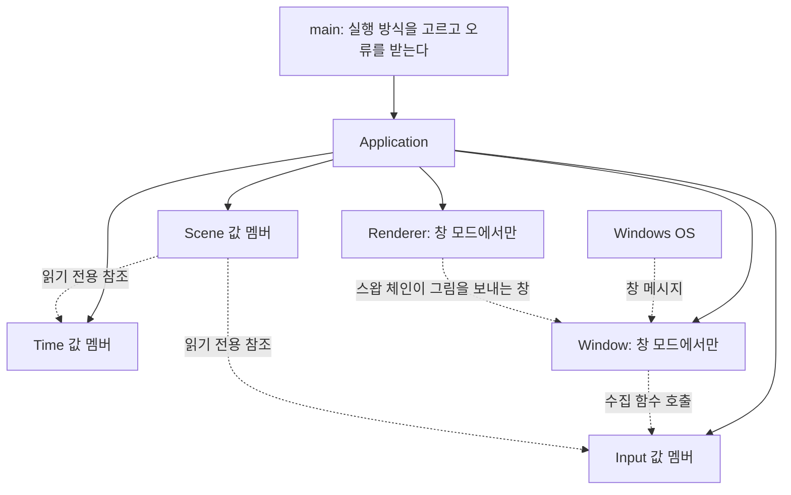
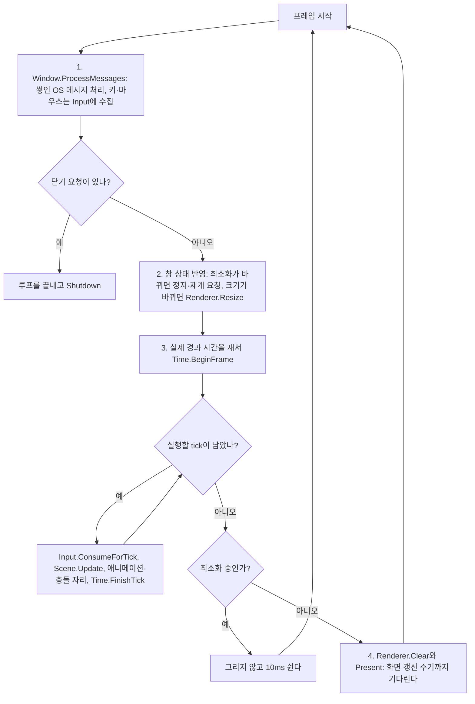

# 03-1. Win32 창과 DX11 장치, 실시간 루프

목표는 단계 2에서 만든 Input과 Time을 실제 창과 실제 시계에 연결하는 것이다. 창 메시지가 Input에 들어가고, 실제로 흐른 시간이 Time에 들어간다. 받는 쪽인 Input과 Time의 코드는 바꾸지 않는다.

DX11은 이번에 장치를 만들고 화면을 한 가지 색으로 지우는 데까지만 쓴다. 바닥·Player·Kraken을 그리는 일은 단계 3-2에서 한다.
이 단계는 [이슈 4](https://github.com/jung-seung-hwan/kraken-engine-learning/issues/4)이고, 단계 3을 둘로 나눈 앞쪽이다. 뒤쪽은 [이슈 12](https://github.com/jung-seung-hwan/kraken-engine-learning/issues/12)다.

## 먼저 볼 구조



실선은 소유, 점선은 소유하지 않는 참조나 호출이다. Scene 아래의 GameObject와 Component는 단계 2와 같다.

| 모듈 | 소유자 | 받는 것 | 내보내는 것 | 호출 시점 |
| --- | --- | --- | --- | --- |
| Window | Application, 창 모드에서만 | OS 창 메시지 | Input 수집 함수 호출, 창 크기·최소화·닫기 요청 기록 | 프레임 시작의 ProcessMessages 안. 창을 만들거나 없앨 때도 OS가 메시지를 보낸다 |
| Renderer | Application, 창 모드에서만 | 만들 때 창 핸들과 크기, 지울 색 | 창에 보이는 화면 | 만들 때 한 번, 크기가 바뀐 프레임에 Resize, 그리는 프레임 끝에 Clear와 Present |
| Input | Application | Window가 바꿔 준 키·마우스·포커스 사건 | 단계 2와 같다 | 수집은 ProcessMessages 안, 소비는 각 tick 시작 |
| Time | Application | Application이 잰 실제 경과 시간, 최소화에 따른 정지·재개 요청 | 단계 2와 같다 | 프레임마다 BeginFrame 한 번 |
| Application | main | 실행 방식 | 위 모듈의 호출 순서 | 매 프레임 |

### 선언 순서가 곧 수명 순서다

Application은 Input, Time, Window, Renderer, Scene 순서로 선언한다. 단계 2와 같은 규칙이다. 참조되는 쪽을 먼저 선언해서 더 오래 살게 한다.

- **Window는 Input을 참조한다.** 창을 없앨 때 OS가 포커스 상실 메시지를 보내면 Window가 Input을 부른다. 그래서 Input이 Window보다 오래 살아야 한다.
- **Renderer의 스왑 체인은 창에 그림을 보낸다.** 창이 사라지기 전에 스왑 체인을 먼저 정리해야 한다. 그래서 Renderer를 Window 뒤에 선언해서 먼저 정리한다.
- **Scene은 Input과 Time을 참조한다.** 지금처럼 마지막에 선언해서 가장 먼저 정리한다.

단계 2 문서의 "서비스 참조를 보관하는 곳은 Scene 한 곳뿐이다"는 이제 맞지 않는다. Window도 수집을 위해 Input을 참조한다. 컴포넌트에 서비스를 알려 주는 창구가 Scene 하나라는 규칙은 그대로다.

### Window와 Renderer를 unique_ptr로 갖는 이유

스크립트 데모와 시험에는 창이 없다. 그래서 Window와 Renderer는 창 모드에서만 만든다. 있을 수도 없을 수도 있는 객체를 소유하려고 단계 1에서 배운 unique_ptr을 쓴다. 만들지 않았으면 nullptr이다. 정리 순서는 값 멤버와 똑같이 선언의 반대 순서다.

### 실행 방식

| 명령 | 하는 일 |
| --- | --- |
| `NereidesEngine2.exe` | 창 모드. 창을 열고 실제 시계로 돈다. 창을 닫으면 끝난다 |
| `NereidesEngine2.exe --demo` | 단계 2의 스크립트 데모. 정한 사건과 프레임 길이로 7프레임을 돌고 끝난다 |
| `--lifecycle-tests`, `--input-time-tests`, `--window-tests` | 검증 |

알 수 없는 인자를 받으면 사용법을 출력하고 종료 코드 2로 끝난다. 인자를 잘못 써서 CI에서 창이 열린 채 멈추는 일을 막는다.

## 한 프레임의 흐름

창 모드의 프레임이다. tick 안의 순서는 단계 2와 같다.



- **메시지 처리가 먼저다.** 이 안에서 Input 수집과 창 상태 기록이 일어난다. Window는 기록만 한다. 정지 요청과 Renderer 크기 변경은 Application이 메시지 처리가 끝난 뒤에 한다. WM_SIZE 같은 메시지는 창을 만들거나 크기를 바꾸는 도중에도 바로 들어오므로, 그 자리에서 Renderer를 바꾸면 예상하지 못한 때에 장치 상태가 바뀐다.
- **실제 시간은 Application이 잰다.** `std::chrono::steady_clock`으로 지난 프레임과의 차이를 재서 Time에 넣는다. Time은 단계 2처럼 시계를 읽지 않고 받은 시간만 쓴다.
- **그리기는 프레임마다 한 번이다.** Present가 화면 갱신 주기를 기다리므로, 이 기다림이 루프의 속도를 정한다.
- **최소화 중에는 그리지 않는다.** 보이는 화면이 없고, 크기도 0이라 스왑 체인을 다룰 수 없다. Present를 건너뛰면 기다림이 없어 루프가 CPU를 다 쓰므로 10ms씩 쉰다. 최소화 중에 들어온 크기 변경은 기록만 남겨 두었다가 복원한 뒤 반영한다.
- **복원한 프레임은 시계 기준을 다시 잡는다.** 최소화 동안 흐른 시간이 복원 직후 tick으로 들어가서 Player가 갑자기 움직이는 일을 막는다.

## Window 규칙

### 창 만들기와 WndProc

- **만들기와 보여 주기를 나눈다.** 생성자는 숨긴 창을 만든다. Application이 Renderer까지 만든 뒤 Show를 부른다. 시험은 보이지 않는 창으로 메시지 규칙만 확인한다.
- **OS는 창 메시지를 WndProc라는 함수로 보낸다.** 이 함수는 객체 없이 불리는 static 멤버 함수다. 창을 만들 때 Window 주소를 넘기면, OS가 첫 메시지인 WM_NCCREATE에 실어 돌려준다. WndProc는 그 주소를 창에 붙여 두고, 다음 메시지부터 꺼내서 Window의 HandleMessage에 넘긴다. 창이 완전히 사라지는 WM_NCDESTROY에서 붙여 둔 주소를 지운다.
- **WndProc 안에서는 예외를 던지지 않는다.** 예외가 OS 코드를 거쳐 빠져나가면 안전하게 처리되지 않는다.

### 키보드

| OS 키 | Key | 행동 |
| --- | --- | --- |
| W | W | MoveForward |
| A | A | MoveLeft |
| S | S | MoveBack |
| D | D | MoveRight |
| VK_SPACE | Space | Attack |

- 표에 없는 키는 무시한다. Alt 조합 키인 WM_SYSKEYDOWN은 OS에 맡긴다. 그래서 Alt+F4로 닫을 수 있다.
- **자동 반복을 Window가 거른다.** 키를 오래 누르고 있으면 OS가 WM_KEYDOWN을 반복해서 보낸다. 반복 신호는 lParam의 30번 비트가 1이다. Window는 이 비트가 1인 WM_KEYDOWN을 버린다. 그래서 포커스를 잃은 뒤 키를 누른 채 돌아와도 새 누름이 들어오지 않고, 키를 다시 눌러야 움직인다. 이미 눌린 키를 거르는 Input의 규칙은 그대로 둔다.

### 마우스

- WM_MOUSEMOVE는 창 안의 좌표를 준다. Input은 이동량을 받으므로 Window가 지난 좌표와의 차이를 넘긴다.
- **기준점이 없으면 첫 이동은 기준점만 잡는다.** 포커스를 잃었을 때와 커서가 창 밖으로 나갔을 때 기준점을 지운다. 지우지 않으면 돌아온 첫 이동에서 회전이 크게 튄다. 커서가 나간 것은 WM_MOUSELEAVE로 안다. 이 메시지는 TrackMouseEvent로 요청해 둬야 온다.
- 마우스 버튼은 아직 연결하지 않는다. 공격은 Space다.

### 포커스, 크기, 최소화, 닫기

| 메시지 | Window가 하는 일 | 그다음 |
| --- | --- | --- |
| WM_KILLFOCUS | Input.OnFocusLost, 마우스 기준점 지우기 | 눌린 상태가 비어 이동이 멈춘다 |
| WM_SIZE, 최소화 | 최소화 상태 기록 | Application이 정지 요청 |
| WM_SIZE, 그 밖 | 최소화 해제 기록, 크기가 바뀌었으면 새 크기 기록 | Application이 재개 요청과 시계 기준 다시 잡기, 최소화가 아닐 때 Renderer.Resize |
| WM_CLOSE | 닫기 요청만 기록하고 창은 아직 없애지 않는다 | 루프가 끝나고 Shutdown, 이어서 멤버 정리 |

- 최소화되면 WM_SIZE의 크기가 0이다. 크기 0은 기록하지 않는다. 0 크기로 스왑 체인 버퍼를 바꿀 수는 없다.
- **창을 바로 없애지 않는 이유는 정리 순서다.** Application은 Scene, Renderer, Window 순서로 정리한다. 스왑 체인이 먼저 사라진 뒤 Window 소멸자가 창을 없앤다.

## Renderer 규칙

| DX11 객체 | 하는 일 | 만드는 때 | 정리되는 때 |
| --- | --- | --- | --- |
| 장치 `ID3D11Device` | GPU 자원을 만든다 | Renderer 생성자 | Renderer가 정리될 때 마지막 |
| 장치 문맥 `ID3D11DeviceContext` | 지우기·그리기 명령을 GPU에 보낸다 | Renderer 생성자 | 장치 바로 앞 |
| 스왑 체인 `IDXGISwapChain` | 화면 버퍼 두 장을 번갈아 창에 보낸다 | Renderer 생성자. 크기 변경 때는 버퍼 크기만 바뀐다 | 화면 대상 다음 |
| 화면 대상 `ID3D11RenderTargetView` | 스왑 체인의 버퍼를 그리기 대상으로 연결하는 창구 | 생성자, 크기를 바꿀 때마다 다시 만든다 | 크기 변경 직전, Renderer가 정리될 때 가장 먼저 |

Renderer는 이 넷을 ComPtr 멤버로 갖고 장치, 문맥, 스왑 체인, 화면 대상 순서로 선언한다. 정리는 반대 순서라서 화면 대상이 가장 먼저, 장치가 가장 나중에 정리된다.

- **스왑 체인과 화면 대상은 다르다.** 그림이 담기는 버퍼는 스왑 체인이 소유한다. 화면 대상은 그 버퍼를 가리켜 "여기에 그려라"라고 알려 주는 창구일 뿐이다.
- **장치 만들기.** 그래픽 하드웨어로 만들고, 실패하면 CPU로 DX11을 흉내 내는 WARP 장치로 다시 만든다. 다시 만들기 전에는 앞 시도가 남긴 객체를 먼저 놓는다. 어느 쪽을 쓰는지 콘솔에 적는다.
- **기능 수준은 11_0만 받는다.** 단계 3-2의 셰이더가 셰이더 모델 5.0을 쓰려면 기능 수준 11_0이 필요하다. 11_0을 지원하지 않는 그래픽 하드웨어라면 WARP로 넘어간다. WARP는 11_0을 지원한다.
- **디버그 계층.** Debug 빌드는 잘못된 DX11 사용을 알려 주는 디버그 계층을 켠다. 디버그 계층이 설치되지 않은 PC에서는 DXGI_ERROR_SDK_COMPONENT_MISSING으로 실패하므로, 그때만 디버그 계층을 끄고 다시 만든다. 다른 실패는 숨기지 않는다.
- **크기 변경 순서.** 화면 대상을 그리기 단계에서 풀고 놓는다. 그다음 스왑 체인의 버퍼 크기를 바꾸고, 새 버퍼로 화면 대상을 다시 만든다. 화면 대상이 버퍼를 붙잡고 있으면 버퍼 크기를 바꿀 수 없다. 크기는 0보다 커야 하고, 아니면 예외를 던진다.
- **Alt+Enter 전체 화면 전환은 끈다.** 전체 화면은 이번 범위가 아니다.
- **지우기와 표시.** 어두운 파란색으로 지운 뒤 `Present(1, 0)`으로 보낸다. 1은 화면 갱신 주기 하나를 기다린다는 뜻이고, 이것이 수직 동기다.

## 오류 처리 규칙

- DX11 함수는 성공과 실패를 HRESULT 값으로 돌려준다. 실패하면 Renderer가 무엇이 실패했는지와 HRESULT 값을 담아 `std::runtime_error` 예외를 던진다. 창을 만드는 Win32 함수가 실패해도 같은 방식으로 던진다.
- main이 예외를 받아 `Error: ...`를 출력하고 종료 코드 1을 돌려준다. CI 로그에서도 원인이 보인다.
- 생성자 도중에 예외가 나도 이미 만든 ComPtr 멤버는 자동으로 정리된다.
- WndProc 안에서는 던지지 않는다.

## 시간 값과 로그

| 값 | 창 모드 | 스크립트 데모 |
| --- | --- | --- |
| tick 길이 | 1/60초 | 0.1초 |
| 프레임당 tick 상한 | 5 | 3 |
| 수직 동기 | 켬 | 해당 없음 |
| PlayerControl 위치 로그 | 30 tick, 곧 0.5초마다. 공격은 따로 바로 한 줄 | tick마다 |
| tick 단계 로그 | 쓰지 않음 | 단계 2와 같음 |

- 데모의 값은 그대로 둔다. 같은 입력이면 단계 2와 같은 결과가 나와야 하므로 회귀 검사로 쓴다.
- 창 모드에서 tick마다 콘솔에 쓰면 초당 60줄이 된다. 콘솔 출력이 프레임을 늦추면 따라잡기 상한에 걸려 게임이 느려질 수 있다. 위치 로그 간격은 PlayerControl이 생성자로 받는 고유 값이다. 공격 줄은 정기 로그의 간격을 밀지 않는다.

## 단계 3-1에서 바뀐 기존 코드

- main: 실행 방식 고르기, 알 수 없는 인자 거부, 예외 받기.
- Application: 실행 방식, 멤버 순서, 창 모드 루프. 스크립트 데모는 RunDemo로 옮기고 내용은 그대로 둔다.
- PlayerControl: 생성자에 위치 로그 간격을 받는다. 공격은 간격과 상관없이 바로 출력한다.
- 시험: PlayerControl 생성자 변경을 반영한다.
- CI: 데모를 `--demo`로 실행하고, 창 메시지 시험을 더하고, 작업 시간 제한을 둔다.
- 프로젝트: 창 헤더의 min·max 매크로가 표준 함수와 부딪히지 않게 NOMINMAX와 WIN32_LEAN_AND_MEAN을 정의하고, d3d11.lib를 연결한다.

## 알려진 한계

- 창 테두리를 끌어 크기를 바꾸거나 창을 옮기는 동안에는 OS가 메시지 처리 안에서 루프를 붙잡아 게임이 멈춘다. 놓은 뒤 첫 프레임의 긴 시간은 따라잡기 상한이 버린다.
- WM_MOUSEMOVE는 커서가 화면 끝에 닿으면 더 오지 않는다. 마우스로 카메라를 돌리게 되면 Raw Input을 다시 본다.
- 최소화 정지는 Time의 정지 요청을 쓴다. 나중에 게임 쪽에서도 정지를 요청하게 되면, 복원 때의 재개 요청이 게임의 정지를 풀지 않도록 다시 정해야 한다.
- 장치가 사라지는 경우, 예를 들어 드라이버 갱신이나 그래픽 카드 분리는 복구하지 않고 오류로 끝낸다.

## 꼭 필요한 문법만 읽기

- static 멤버 함수: 객체 없이 부르는 멤버 함수다. OS는 객체를 모르고 함수 하나만 부를 수 있어서, WndProc를 static으로 둔다.
- `reinterpret_cast`: 주소를 정수로, 정수를 주소로 바꾼다. Window 주소를 창에 붙여 둘 때만 쓴다. 타입 검사를 건너뛰므로 다른 곳에서는 쓰지 않는다.
- ComPtr: DX11 객체의 참조 수를 대신 관리한다. unique_ptr처럼 멤버가 정리될 때 자동으로 놓아 준다. 다른 점은 같은 객체를 여러 ComPtr가 가리킬 수 있고, 마지막 하나가 놓을 때 실제로 사라진다는 것이다. `GetAddressOf()`는 DX11 함수가 만든 객체를 받을 자리를 넘길 때, `Get()`은 소유를 넘기지 않고 잠깐 빌려줄 때, `Reset()`은 들고 있던 객체를 놓을 때 쓴다.
- 예외: 단계 1·2에서 이미 throw를 썼다. 이번에 main이 처음으로 try와 catch로 받아서 메시지를 출력한다.
- 이름 없는 namespace: 그 .cpp 파일 안에서만 쓰는 함수와 상수를 둔다. 다른 파일에 같은 이름이 있어도 부딪히지 않는다. 단계 2부터 이미 쓰고 있었다.
- `std::chrono::steady_clock`: 컴퓨터 시각을 바꿔도 거꾸로 가지 않는 시계다. 두 시각의 차이를 초 단위 double로 바꿔 Time에 넣는다.
- `#ifdef _DEBUG`: Debug 빌드에서만 컴파일되는 부분이다. 디버그 계층을 켤 때만 쓴다.
- `IID_PPV_ARGS`: COM 객체를 받을 자리의 주소와, 그 자리에 들어갈 형식의 번호를 함께 넘겨 주는 매크로다. 스왑 체인에서 버퍼와 DXGI 팩토리를 꺼낼 때만 쓴다.
- 비트 검사 `(lParam & 0x40000000) != 0`: 0x40000000은 30번 비트만 1인 값이다. `&`로 그 비트만 남겨서 0인지 본다.
- `std::this_thread::sleep_for`: 지금 스레드를 정한 시간만큼 쉬게 한다. 최소화 중에 10ms씩 쉴 때 쓴다.

## 읽기 순서

1. src/main.cpp: 실행 방식 고르기와 오류 받기.
2. src/Application.h / Application.cpp: 멤버 선언 순서와 창 모드 루프.
3. src/Window.h / Window.cpp: 메시지를 Input 호출로 바꾸는 규칙, 창 상태 기록, 닫기 경로.
4. src/Renderer.h / Renderer.cpp: 장치·스왑 체인·화면 대상의 소유, 크기 변경, 지우기와 표시.

src/WindowTests.cpp는 창 메시지 규칙을 확인하는 검증 예제다.

## 실행

Developer PowerShell for VS 2022:

```powershell
msbuild NereidesEngine2.sln /p:Configuration=Debug /p:Platform=x64
./bin/x64/Debug/NereidesEngine2.exe
./bin/x64/Debug/NereidesEngine2.exe --demo
./bin/x64/Debug/NereidesEngine2.exe --lifecycle-tests
./bin/x64/Debug/NereidesEngine2.exe --input-time-tests
./bin/x64/Debug/NereidesEngine2.exe --window-tests
```

창 모드 조작: W·A·S·D로 이동, Space로 공격, 마우스를 가로로 움직여 회전. 창을 닫으면 끝난다.

## 검증 계획

CI와 로컬에서 자동으로 확인하는 것:

| 명령 | 기대 결과 |
| --- | --- |
| Debug·Release 빌드 | 경고 수준 4에서 경고 없이 성공 |
| `--demo` | 단계 2 데모와 같은 tick 수, 위치, 공격, 종료 코드 0 |
| `--lifecycle-tests` | 단계 1 검증 5개 통과 |
| `--input-time-tests` | 입력·시간 검증 17개 통과 |
| `--window-tests` | 창 메시지 검증 8개 통과 |

창 메시지 검증 8개는 보이지 않는 창에 메시지를 보내서 확인한다.

1. W·A·S·D·Space의 누름과 뗌이 각 행동으로 들어간다.
2. 키를 누르고 있는 동안의 자동 반복 신호와, 포커스를 잃은 뒤 들어온 자동 반복 신호는 무시된다. 새로 누르면 들어간다.
3. 표에 없는 키와 Alt 조합 키는 무시된다.
4. 마우스 첫 이동은 기준점만 잡고, 다음 이동부터 음수를 포함한 차이가 들어간다.
5. 포커스 상실과 커서가 창 밖으로 나간 뒤에는 기준점을 다시 잡는다.
6. 크기 변경, 최소화, 복원이 기록되고, 최소화의 크기 0은 기록되지 않는다.
7. 닫기 요청을 받으면 루프가 끝나지만 창은 Window가 정리될 때까지 남는다.
8. 메시지 큐에 쌓인 키 메시지는 ProcessMessages가 꺼내서 Input에 넘긴다.

5번은 WM_MOUSELEAVE를 직접 보내서 확인한다. TrackMouseEvent의 등록 상태는 물어볼 수 있지만, 숨긴 창 위에는 커서가 없어서 OS가 추적을 바로 끝낸다. 그래서 실제 등록은 결정적인 시험으로 만들 수 없다.

CI는 창 모드를 돌리지 않는다. 창 모드는 로컬에서 아래 절차로 확인하고 결과를 기록한다. 같은 메시지를 스크립트로 창에 보내 반복할 수 있게 한다.

| 조작 | 기대 결과 |
| --- | --- |
| 인자 없이 실행 | 창이 열리고 어두운 파란색으로 지워진다. 콘솔에 0.5초마다 Player 위치가 찍힌다 |
| W를 누르고 있기 | z가 초당 1씩 는다 |
| Space | 공격 로그가 바로 한 줄 찍힌다 |
| 최소화 | 위치 로그가 멈춘다 |
| 복원 | 로그가 다시 찍히고 위치가 튀지 않는다 |
| 창 크기 바꾸기 | 멈추지 않고 새 크기로 지워진다 |
| W를 누른 채 다른 창으로 갔다가 돌아오기 | 돌아와도 움직이지 않고, 다시 누르면 움직인다 |
| 창 닫기 | Shutdown 로그가 찍히고 종료 코드 0 |

## 이번에 하지 않는 것

셰이더, 도형, 깊이, 카메라, 렌더 데이터, 보간 계수는 단계 3-2에서 한다. Raw Input, 마우스 버튼, 키 재설정, 전체 화면, 화면 배율 대응, 창을 끌거나 크기를 바꾸는 동안 루프를 계속 돌리는 처리, 장치 분실 복구는 하지 않는다. CI의 WARP 그리기 시험은 단계 3-2에서 실제 장면과 함께 넣는다.

## 학생 질문

1. 창 메시지가 Input까지 도달하는 경로는 무엇인가?
2. 창이 최소화되거나 포커스를 잃으면 Input과 Time에는 각각 무슨 일이 일어나는가?
3. DX11 장치·스왑 체인·화면 대상은 누가 소유하고, 어떤 순서로 정리되는가?

변형 과제: 포커스를 잃었을 때도 최소화처럼 게임 시간이 멈추도록 바꾼다. 어느 파일에서 무엇을 바꿨는지, 정지가 언제 적용되는지 설명한다.
정답 변경은 기본 예제에 포함하지 않는다. 학생 이해 상태는 미확인이다.

## 검증 기록

2026-11-04, Windows 11 개발 PC의 VS2022 MSBuild로 Debug·Release x64를 다시 빌드했다. 경고 수준 4에서 경고 0, 오류 0이었다.

| 명령 | 기대 결과 | 실제 결과 |
| --- | --- | --- |
| `--demo` | 단계 2 데모와 같은 결과, 종료 코드 0 | 두 구성 모두 두 번째 안내 줄을 빼면 단계 2 실행 파일의 출력과 같다. 종료 코드 0 |
| `--lifecycle-tests` | 5개 통과 | 두 구성 모두 PASS (5 cases) |
| `--input-time-tests` | 17개 통과 | 두 구성 모두 PASS (17 cases) |
| `--window-tests` | 8개 통과 | 두 구성 모두 PASS (8 cases) |
| 알 수 없는 인자 | 사용법 출력, 종료 코드 2 | 두 구성 모두 종료 코드 2 |

창 모드는 다른 프로세스의 PowerShell 스크립트가 실제 창에 메시지를 보내는 방식으로 두 구성 모두 확인했다.

| 조작 | 실제 결과 |
| --- | --- |
| 인자 없이 실행 | 창이 열리고 "DX11 device: graphics hardware"가 찍힘 |
| W 2초 | z가 0.00에서 2.00으로 늘어남 |
| Space | 공격 줄이 바로 한 줄 찍힘 |
| 최소화 1.5초 | 정지 줄 뒤로 위치 로그가 없음 |
| 복원 | 재개 줄 뒤로 위치가 2.00 그대로 |
| 크기 변경 두 번 | 안쪽 크기가 624x361, 1184x721로 바뀌고 계속 실행 |
| W를 누른 채 포커스 상실, 반복 신호 1.5초 | z가 3.02 부근에서 멈춤 |
| W 다시 누르기 1초 | z가 약 4.0까지 다시 늘어남 |
| 창 닫기 | Shutdown과 객체 정리 로그, 종료 코드 0 |

확인하지 못한 것은 다음과 같다.

- 실제 Alt+Tab 포커스 이동은 스크립트로 할 수 없어서, 대신 WM_KILLFOCUS를 직접 보냈다.
- 커서가 실제로 창 밖으로 나가는 경우와 사람이 창 테두리를 끄는 경우는 확인하지 않았다. 직접 실행해서 확인할 항목으로 남긴다.
- 이 PC에는 그래픽 하드웨어와 디버그 계층이 있어서, WARP로 넘어가는 경로와 디버그 계층 없이 다시 만드는 경로는 실행되지 않았다.
- CI 결과는 push 뒤 PR에서 확인한다.
