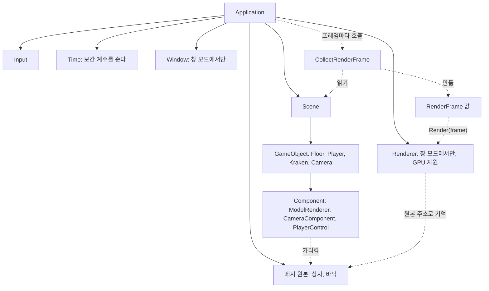
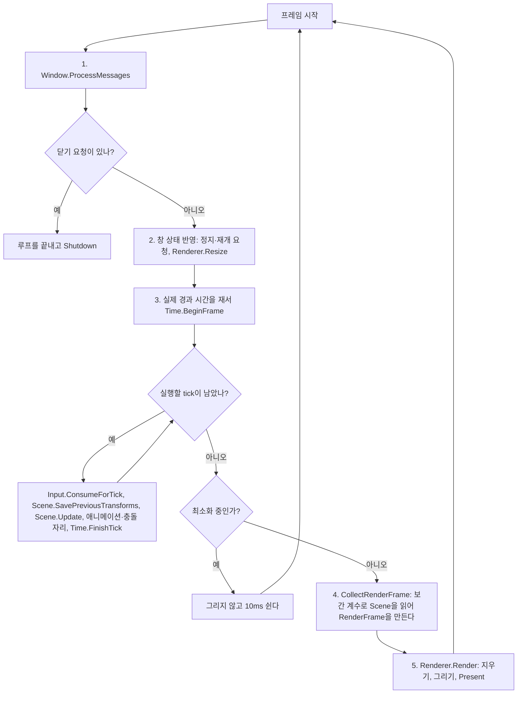

# 03-2. 카메라·도형·렌더 데이터로 장면 표시

목표는 바닥·Player·Kraken을 평면과 상자로 화면에 그리는 것이다. 무엇을 어디에 그릴지는 Scene 안의 GameObject와 Component가 정한다. Renderer는 프레임마다 한 번 받는 값만 보고 그린다. tick과 tick 사이의 위치를 섞어 그려서 움직임이 끊기지 않게 한다.

이 단계는 [이슈 12](https://github.com/jung-seung-hwan/kraken-engine-learning/issues/12)이고, 단계 3을 둘로 나눈 뒤쪽이다. 앞쪽은 [03-1 문서](03-1-window-loop.md)다.

이 문서는 코드를 쓰기 전에 정한 계약이다. 2026-11-05 대화에서 학생이 이 문서대로 코드를 시작하자고 했고, 코드는 이 계약대로 썼다. 학생 이해 상태와는 별개다.

## 셜록 렌더러를 전제로 한 범위

우리가 만드는 DX11 그리기는 학습용이다. 나중에 팀원이 만든 셜록 엔진의 렌더러로 바꾼다. 상위 Nereides 프로젝트가 이미 셜록 렌더러를 붙였으므로, 그 연결 방식을 참고해 경계를 정했다. 참고한 것은 상위 Nereides 프로젝트의 `feat/Program_JSH` 브랜치, 커밋 7ed8c40이다. 파일과 코드는 복사하지 않는다. 이름과 경계의 모양만 따른다.

넘버리데스에서는 엔진이 모든 tick 뒤 프레임마다 한 번 Scene을 읽어 `RenderFrame` 값 하나를 만든다. 이 값을 얇은 렌더러 앞면 `D3D11Renderer`의 `RenderScene(frame)`에 넘긴다. 셜록 쪽은 Scene을 읽지 않는다. 이슈 12의 모듈 계약과 같은 모양이다. 그래서 이번 단계는 이 경계를 넘버리데스와 같은 이름, 같은 모양으로 만들고, 렌더러 안쪽만 작게 만든다.

| 부분 | 셜록을 붙인 뒤 |
| --- | --- |
| CameraComponent, ModelRenderer, 메시 원본 만들기, 월드 행렬, 보간, 수집 함수 `CollectRenderFrame`, 넘기는 값 `RenderFrame` | 남는다. 우리 엔진 코드다 |
| Renderer 안쪽: 셰이더, 깊이 버퍼, GPU 버퍼와 그 캐시, 그리기 반복 | 바뀐다. 셜록 Renderer가 맡는다 |

셜록을 붙일 때는 Renderer 파일을 셜록 쪽으로 바꾸고, 수집 함수가 만드는 형식을 셜록 쪽 형식에 맞춘다. 그래서 렌더러 인터페이스 같은 추상화를 미리 만들지 않는다.

셜록 연결 자체는 이번 범위가 아니다. 붙이기 전에 따로 정할 것이 있다.

- 셜록은 C++20을 쓰고 우리는 C++17이다.
- 셜록은 vcpkg 패키지(DirectXTex, ImGui 등)를 쓴다.
- 셜록은 실패를 예외가 아니라 bool로 알린다.
- 셜록의 `Renderer`는 우리 `Renderer`와 이름이 같다.
- 상위 프로젝트 파일을 복사하지 않는다는 AGENTS.md 규칙과 어떻게 맞출지 정해야 한다.

## 먼저 볼 구조



실선은 소유, 점선은 소유하지 않는 참조나 호출이다. Window와 Input, Scene과 Time의 관계는 03-1과 같다.

| 모듈 | 소유자 | 받는 것 | 내보내는 것 | 호출 시점 |
| --- | --- | --- | --- | --- |
| 메시 원본 `MeshData` | Application 값 멤버. 창 모드에서 채운다 | `MakeBox`, `MakeFloor`가 만든 정점·인덱스 | 정점·인덱스 배열 | Initialize에서 한 번 만들고 프로그램이 끝날 때까지 바꾸지 않는다 |
| ModelRenderer | 붙은 GameObject | 생성자로 메시 원본 참조와 색 | 그릴 항목 하나 | 수집 때 프레임마다 |
| CameraComponent | 카메라 GameObject | 생성자로 시야각(도), near, far | 투영 행렬 | 수집 때 프레임마다 |
| 직전 Transform | GameObject | tick 시작의 Transform 복사 | 보간한 Transform | 복사는 tick 시작, 읽기는 수집 때 |
| 보간 계수 | Time | BeginFrame에서 남은 시간 | 0 이상 1 미만의 값 | 모든 tick이 끝난 뒤 수집 때 |
| CollectRenderFrame | 함수. Application만 부른다 | Scene(읽기 전용), 카메라, 화면 비율, 보간 계수 | RenderFrame 값 | 모든 tick이 끝난 뒤 프레임마다 한 번 |
| RenderFrame | 그 프레임의 지역 변수 | 수집 결과 | Renderer 입력 | 만들어서 Render에 넘긴 뒤 사라진다 |
| Renderer | Application, 창 모드에서만 | RenderFrame | 창에 보이는 장면 | 프레임마다 Render 한 번, 크기가 바뀐 프레임에 Resize |

### 선언 순서

Application은 Input, Time, 메시 원본, Window, Renderer, Scene 순서로 선언한다. 참조되는 쪽을 먼저 선언하는 03-1의 규칙 그대로다.

- **메시 원본은 Renderer와 Scene보다 먼저 선언한다.** Scene 안의 ModelRenderer가 메시 원본을 가리키고, Renderer는 원본 주소로 GPU 버퍼를 기억한다. 그래서 메시 원본이 둘보다 오래 살아야 한다.
- **카메라는 Application이 가리키기만 한다.** 창 모드에서 만든 CameraComponent의 주소를 `m_camera`에 둔다. 소유자는 카메라 GameObject다. 카메라 객체는 Shutdown 전까지 지우지 않는다.

### RenderFrame.h는 Scene을 모른다

`RenderFrame.h`는 DirectXMath와 표준 컨테이너만 포함한다. `Renderer.h`는 이 헤더만 포함하므로 Renderer 코드는 Scene을 읽을 방법이 없다. "Renderer는 Scene을 읽지 않는다"를 컴파일러가 지켜 주는 셈이다. 아는 방향은 한쪽뿐이다. Scene 쪽은 RenderFrame을 안다. 컴포넌트가 그릴 항목을 넣기 때문이다. 하지만 RenderFrame.h와 Renderer는 Scene을 모른다. Scene을 읽어 RenderFrame을 만드는 곳은 `CollectRenderFrame.cpp` 하나다.

넘버리데스는 `RenderFrame.h`가 Scene을 포함하고 같은 파일에 메시 컴포넌트도 둔다. 이 점은 일부러 다르게 한다.

## 한 프레임의 흐름

창 모드의 프레임이다. 03-1에서 tick 시작의 직전 Transform 복사와, 수집과 Render가 바뀐다.



- **직전 Transform은 tick 시작에 복사한다.** 입력 소비 다음, Scene.Update 앞이다. 이번 tick이 움직이기 전의 값이 직전 값이 된다.
- **수집은 모든 tick이 끝난 뒤 프레임마다 한 번이다.** tick 안에서 모으면 tick이 0번인 프레임에는 넘길 값이 없다. 정지 중이 그런 프레임이다.
- **정지 중에도 그린다.** tick이 없고 보간 계수도 그대로라서 마지막 장면이 그대로 다시 그려진다.
- **최소화 중에는 수집도 그리기도 하지 않는다.** 03-1과 같다.

## 보간

### 왜 필요한가

게임 상태는 tick마다, 곧 1/60초마다 바뀐다. 화면은 모니터 주사율에 맞춰 그린다. 144Hz 모니터면 1초에 144번이다. 그냥 그리면 같은 위치를 여러 번 그리다가 tick이 올 때 한 번에 움직여서 끊겨 보인다. 그래서 직전 tick의 Transform과 이번 tick의 Transform을 보간 계수만큼 섞어서 그린다.

### 보간 계수

보간 계수는 "아직 tick으로 쓰지 않은 남은 시간 ÷ tick 길이"다. Time의 `InterpolationAlpha()`가 돌려준다. BeginFrame이 이번 프레임의 tick을 모두 빼고 남긴 시간을 쓴다.

| 상황 | 계수 |
| --- | --- |
| BeginFrame 뒤, 모든 tick 뒤 | 같은 값이고 0 이상 1 미만이다 |
| 정지 중 | 바뀌지 않는다. 화면이 멈춘 그대로 남는다 |
| 따라잡기 상한에 걸린 프레임 | 남은 시간을 버리므로 0이다 |
| 배속 중 | 남은 시간이 게임 시간이라 배속에도 맞는다 |

### 직전 Transform

- GameObject가 Transform 옆에 직전 tick의 Transform과 "직전 값 있음" 표시를 둔다.
- Scene의 `SavePreviousTransforms`가 tick 시작에 모든 객체의 Transform을 직전 값으로 복사하고 표시를 켠다. 비활성 객체도 복사한다. 다른 컴포넌트가 비활성 객체를 옮긴 뒤 다시 켜도 끌려오지 않게 하기 위해서다.
- 그릴 Transform은 직전 값이 있으면 직전 값과 현재 값을 계수로 섞은 값이다. 위치, 회전, 크기를 모두 섞는다. 직전 값이 없으면 현재 값을 그대로 쓴다.
- **직전 값이 없는 경우**는 새로 만든 객체와, Initialize 직후 첫 tick 전의 프레임이다. Initialize는 객체를 원점에 만든 뒤 위치를 옮긴다. 원점을 직전 값으로 쓰면 첫 프레임에 Player와 Kraken이 원점에서 끌려오는 것처럼 보인다. 표시가 꺼져 있으면 현재 값을 쓰므로 이 문제가 없다.
- 보간은 그리기에만 쓴다. 게임 코드는 지금처럼 현재 Transform만 읽고 쓴다.

### 회전과 마우스

- 회전은 라디안 값을 그대로 섞는다. PlayerControl은 `rotation.y`를 감싸지 않고 계속 더하므로 선형으로 섞어도 맞다. 나중에 각도를 -π~π로 감싸게 되면 짧은 쪽으로 섞도록 바꾼다.
- 마우스 회전은 지금처럼 tick에서 적용하고, 보간으로 부드럽게만 보이게 한다. 카메라를 마우스로 돌리게 되면 tick에서 적용할지 프레임에서 적용할지 다시 정한다. 그 일은 단계 6이다.

## 좌표와 행렬

- **왼손 좌표계다.** +X는 오른쪽, +Y는 위, +Z는 앞이다. PlayerControl이 W를 +Z로 움직이는 것과 같다.
- **월드 행렬은 크기 × 회전 × 이동이다.** 회전은 `XMMatrixRotationRollPitchYaw`에 x(피치), y(요), z(롤)를 라디안으로 넣는다. 이 계산은 `Transform.cpp`의 `WorldMatrix` 한 곳에서 한다. 단계 5의 Collision도 같은 함수를 쓴다.
- **view 행렬은 카메라 객체의 위치와 회전으로 만든다.** 카메라의 앞은 +Z, 위는 +Y다. 크기는 무시한다.
- **projection 행렬은 `XMMatrixPerspectiveFovLH`로 만든다.** 시야각(도를 라디안으로 바꿔서), 화면 비율, near, far를 넣는다. 화면 비율은 Application이 창 안쪽의 너비 ÷ 높이로 계산해 넘긴다. 최소화 중에는 수집하지 않으므로 높이 0으로 나누는 일이 없다.
- **DirectXMath를 쓴다.** 계산은 `XMMATRIX`, 보관은 `XMFLOAT4X4`로 한다. DirectXMath는 행 벡터 규칙이고 HLSL 상수 버퍼는 기본이 열 우선 배치라서, GPU에 올릴 때 행렬을 전치한다. 넘버리데스도 같다.
- **바깥에서 볼 때 시계 방향이 앞면이다.** DX11의 기본 래스터라이저 상태가 시계 방향을 앞면으로 보고 뒷면을 그리지 않는다. 그래서 래스터라이저 상태를 따로 만들지 않는다. 깊이도 기본 상태(가까운 것이 이김)를 쓴다.

## 메시 원본과 RenderFrame

| 형식 | 필드 | 넘버리데스와 비교 |
| --- | --- | --- |
| `MeshVertex` | 위치, 법선 | 넘버리데스는 색, UV, 탄젠트, 뼈 번호, 가중치도 있다 |
| `MeshData` | 정점 배열, 32비트 인덱스 배열 | 같다 |
| `DrawItem` | 메시 원본 주소 `const MeshData*`, 월드 행렬, 색 | 넘버리데스는 메시를 `shared_ptr`로 갖고, 색 대신 재질, 뼈 행렬도 있다 |
| `RenderFrame` | view, projection, 항목 목록, 빛 방향, 지우는 색 | 넘버리데스는 조명 목록, 환경, 시간도 있다 |

- **`MakeBox`**: 한 변이 1인 상자를 만든다. 중심은 원점이다. 면마다 법선이 달라서 면마다 정점 4개를 둔다. 정점 24개, 인덱스 36개다.
- **`MakeFloor`**: 한 변이 1인 평면을 y=0에 만든다. 법선은 +Y다. 넓이는 Transform의 크기로 키운다.
- **빛 방향과 지우는 색**은 RenderFrame 멤버의 기본값으로 둔다. 빛은 위쪽 앞에서 비스듬히 내려오는 방향 하나로 고정한다. 지우는 색은 03-1의 어두운 파란색이다.
- **법선**은 면이 바라보는 방향을 뜻하는 길이 1짜리 벡터다. 빛과 법선이 이루는 각도로 면의 밝기를 정한다.

### 메시 원본의 소유

- 메시 원본은 Application 하나가 소유한다. ModelRenderer와 DrawItem은 주소를 가리키기만 한다. Player와 Kraken은 같은 상자 원본을 가리킨다.
- 넘버리데스는 메시 원본을 `shared_ptr`로 여럿이 함께 갖고, 원본이 사라지면 `weak_ptr`로 알아내 GPU 자원을 버린다. 3-2는 메시를 지우지 않으므로 소유자 하나로 충분하다. 모델을 불러오고 지우는 단계 4에서 다시 정한다.

## ModelRenderer와 CameraComponent

### 그릴 것을 찾는 방법

Component에 가상 함수 하나를 더한다.

```cpp
virtual void AddDrawItems(RenderFrame&, const DirectX::XMFLOAT4X4&) const {}
```

- 기본은 아무것도 넣지 않는다. 그릴 것이 있는 컴포넌트만 재정의한다. 재정의하는 쪽은 `frame`, `world`처럼 이름을 붙여 쓴다.
- 기본 구현은 매개변수를 쓰지 않으므로 이름을 비운다. 이름이 있으면 경고 수준 4에서 "쓰지 않는 매개변수" 경고가 난다.
- 수집 함수가 객체마다 보간한 월드 행렬을 한 번 계산해서 넘긴다. 그래서 컴포넌트는 보간 계수를 몰라도 된다.
- 비활성 객체와 꺼진 컴포넌트는 부르지 않는다. Update와 같은 규칙이다.
- 형식으로 컴포넌트를 찾지 않는다. 템플릿과 실행 시간 형식 검사를 쓰지 않는 학습 제약 때문이다. 넘버리데스는 `Get<MeshComponent>()`로 찾는다.
- 단계 4의 뼈와 단계 5의 디버그 도형도 같은 함수로 항목을 넣는다.

### ModelRenderer

- 생성자: `ModelRenderer(GameObject& owner, const MeshData& mesh, const DirectX::XMFLOAT4& color)`. 단계 2의 규칙대로 자기 값만 생성자로 받는다.
- `AddDrawItems`에서 메시 원본 주소, 받은 월드 행렬, 색으로 항목 하나를 넣는다.
- 넘버리데스의 `MeshComponent` 자리다. 이름은 처음 설계대로 ModelRenderer로 둔다. 단계 4에서 불러온 모델 원본도 이 컴포넌트가 받는다.

### CameraComponent

- 생성자: `CameraComponent(GameObject& owner, float verticalFovDegrees, float nearPlane, float farPlane)`. 시야각은 0보다 크고 180보다 작아야 하고, near는 0보다 크고 far보다 작아야 한다. 아니면 예외를 던진다.
- `Projection(aspect)`가 투영 행렬을 돌려준다. view 행렬은 카메라 객체의 보간한 Transform으로 수집 함수가 만든다.
- 카메라는 하나다. Application이 주소를 기억해서 수집 함수에 넘긴다. 넘버리데스처럼 여러 카메라 가운데 우선순위로 고르는 일은 하지 않는다.
- 카메라는 고정한다. Player를 따라가거나 마우스로 시점을 돌리는 일은 단계 6에서 정한다.

## 장면 구성

창 모드에서만 그릴 장면을 만든다.

| 객체 | 위치·크기 | 컴포넌트 |
| --- | --- | --- |
| Floor | 원점, 크기 (20, 1, 20) | ModelRenderer: 바닥, 회색 |
| Player | (-2, 0.5, 0) | PlayerControl, ModelRenderer: 상자, 파랑 |
| Kraken | (2, 1, 0), 크기 2 | ModelRenderer: 상자, 빨강 |
| Camera | (0, 4, -8), 아래로 약 25도 | CameraComponent: 60도, 0.1, 100 |

- 상자는 중심이 원점이라 높이의 절반만큼 올려 바닥 위에 세운다.
- **창 모드의 Kraken은 켠다.** 비활성 객체는 그리지 않기로 했기 때문이다. LogComponent는 달지 않는다. 켜면 tick마다, 곧 초당 60줄을 찍기 때문이다.
- **스크립트 데모는 단계 2 그대로다.** 바닥·카메라·ModelRenderer를 만들지 않고, Kraken은 LogComponent를 달고 꺼 둔다. 그래서 데모 출력이 바뀌지 않는다.

## Renderer 규칙

03-1의 장치, 문맥, 스왑 체인, 화면 대상에 다음을 더한다.

| DX11 객체 | 하는 일 | 만드는 때 | 정리되는 때 |
| --- | --- | --- | --- |
| 깊이 버퍼와 깊이 대상, 형식 D24_UNORM_S8_UINT | 화면의 점마다 가장 가까운 깊이를 기억해서 뒤에 있는 면을 가린다 | 생성자, 크기를 바꿀 때마다 다시 | 크기 변경 직전, Renderer가 정리될 때 |
| 정점 셰이더, 픽셀 셰이더 | 정점을 화면 위치로 바꾸고, 점마다 색을 정한다 | 생성자. 빌드 때 만든 바이트 배열로 만든다 | Renderer가 정리될 때 |
| 입력 배치 | 정점 버퍼의 바이트가 위치와 법선이라는 것을 알린다 | 생성자 | Renderer가 정리될 때 |
| 상수 버퍼 두 개 | 프레임 값(view × projection, 빛 방향)과 항목 값(월드 행렬, 색)을 셰이더에 넘긴다 | 생성자 | Renderer가 정리될 때 |
| 메시별 정점·인덱스 버퍼 | CPU 메시 원본을 GPU에 복사한 것 | 그 메시를 처음 그리는 Render | Renderer가 정리될 때 |

- **`Render(frame)` 한 번에 한 프레임을 그린다.** 순서는 다음과 같다.
  1. 화면 대상과 깊이 대상을 연결하고 뷰포트를 잡는다.
  2. 화면을 지우는 색으로, 깊이를 1로 지운다.
  3. 셰이더, 입력 배치, 프레임 상수를 설정한다.
  4. 항목마다 GPU 메시를 찾고(없으면 만들고), 항목 상수를 올리고, 그린다.
  5. `Present(1, 0)`으로 보낸다.
- **03-1의 Clear와 Present는 Render 안으로 들어간다.** Application이 부르는 것은 Render 하나다. 넘버리데스의 `RenderScene(frame)`과 같은 모양이다.
- **그리기 전마다 화면 대상 연결과 뷰포트를 다시 잡는다.** 03-1 스왑 체인은 플립 모델이고, 플립 모델에서는 Present가 끝나면 백버퍼가 연결에서 풀린다. 크기 변경도 연결을 푼다. 뷰포트를 한 번만 잡으면 크기를 바꾼 뒤 장면이 늘어나거나 잘린다.
- **GPU 메시 캐시**는 원본 주소와 GPU 버퍼를 묶은 목록이다. 처음 보는 주소면 버퍼를 만들어 목록에 넣는다. Player와 Kraken은 같은 상자 원본을 가리키므로 GPU 버퍼도 한 벌이다. 넘버리데스의 셜록 Renderer도 원본 주소로 GPU 메시를 기억한다.
- **셰이더**: 정점 셰이더는 월드, view, projection을 곱해 화면 위치를 내고, 법선을 월드 방향으로 돌린다. 픽셀 셰이더는 색에 밝기를 곱한다. 밝기는 기본 밝기와, 빛을 정면으로 받는 정도를 더한 값이다. 기본 밝기는 셰이더 안의 상수다. 그래서 빛을 받지 않는 면도 완전히 검게 되지 않는다.
- **크기 변경**: 03-1의 순서에 깊이 대상과 깊이 버퍼를 함께 놓고 다시 만드는 일을 더한다.
- 상수 버퍼의 크기는 16바이트의 배수여야 한다.

## 셰이더 빌드

- 셰이더 소스는 `src/SceneVertexShader.hlsl`, `src/ScenePixelShader.hlsl`이다.
- Visual Studio 빌드의 FxCompile 단계가 셰이더 모델 5.0으로 컴파일해서, 바이트 배열이 든 헤더를 중간 폴더(`obj\x64\<구성>\`)에 만든다. `Renderer.cpp`가 이 헤더를 포함한다.
- 그래서 셰이더 문법 오류는 빌드 오류로 나오고, CI에서도 잡힌다. 실행 파일 옆에 둘 셰이더 파일도 없다. 셰이더를 고치면 다시 빌드해야 한다.
- 중간 폴더를 include 경로에 더한다. `src`가 아니라 빌드 중간 결과만 있는 폴더라서 `Time.h` 이름 문제와 관계없다.
- 셜록은 `.cso` 파일을 실행 때 읽는다. 우리 셰이더는 셜록으로 바꿀 때 사라지므로 그 방식을 미리 따르지 않는다.

## 오류 처리 규칙

03-1과 같다.

- DX11 함수가 실패하면 무엇이 실패했는지와 HRESULT 값을 담아 예외를 던진다. main이 받아 종료 코드 1로 끝낸다.
- CameraComponent의 값, ModelRenderer의 빈 메시, 수집 함수의 화면 비율(0보다 커야 함)과 보간 계수(0 이상 1 이하)가 잘못되면 `std::invalid_argument`를 던진다. NaN은 어떤 비교도 거짓이라 범위 검사를 그냥 통과하므로 `std::isfinite`로 먼저 거른다.

## 단계 3-2에서 바뀌는 기존 코드

- Component: `AddDrawItems` 가상 함수.
- GameObject: 직전 Transform과 표시, 복사·보간 함수.
- Scene: tick 시작의 직전 Transform 복사(Application만 부른다)와 수집용 읽기 함수(수집 함수만 부른다). 창구 규칙에 적는다.
- Transform: 월드 행렬 함수와 보간 함수. "아직 행렬 계산은 하지 않는다"는 주석을 바꾼다.
- Time: `InterpolationAlpha()` 읽기 함수.
- Renderer: 깊이, 셰이더, 그리기. Clear와 Present 대신 Render.
- Application: 메시 원본 멤버와 카메라 주소, 창 모드 장면 구성, tick 시작 복사, 수집과 Render 호출.
- main·CI: `--render-tests`.
- 프로젝트: 새 파일, FxCompile, 중간 폴더 include 경로.
- 문서: 단계 2 문서의 "서비스 참조를 보관하는 곳은 Scene 한 곳뿐이다" 뒤에 03-1 문서로 안내하는 한 줄. 단계 3-2 전환 검증이 지적했다.

## 바뀐 결정

03-1 문서는 CI의 WARP 그리기 시험을 단계 3-2에서 넣는다고 했다. 학생이 CI는 CPU 시험만 하기로 정했다. WARP 시험의 대상인 우리 Renderer는 셜록으로 바꾸면 사라지기 때문이다. GPU 그리기는 로컬 창 모드에서 확인한다.

## 결정 기록

2026-11-05 대화에서 학생이 정했다. 단계 3-2 전환 검증 보고서의 선택지와 넘버리데스 조사 결과를 근거로 했다.

| 질문 | 선택 | 이유 |
| --- | --- | --- |
| 셜록 전제 | 경계를 넘버리데스와 같은 모양으로 만들고 렌더러 안쪽만 작게 만든다 | 셜록을 붙일 때 바뀌는 곳이 Renderer 파일과 수집 함수의 형식뿐이다 |
| 이름 | `RenderFrame`, `DrawItem`, `MeshData`, `MeshVertex`, `CameraComponent`, `CollectRenderFrame` | 이미 쓰는 이름을 따른다. 바꿀 때 서로 대응하는 것이 바로 보인다 |
| 그릴 것을 찾는 방법 | Component 가상 함수 | 형식 검사가 없고, 단계 4·5도 같은 길을 쓴다 |
| 메시를 가리키는 방법 | 엔진이 소유한 CPU 원본의 주소 | 넘버리데스와 같은 소유 방향이고, `weak_ptr` 없이 작다 |
| 색 | 색 값 하나 | 가장 작다. 넘버리데스도 재질을 컴포넌트 색으로 만든다 |
| 형식을 둘 헤더 | Scene을 모르는 `RenderFrame.h` | Renderer가 Scene을 못 읽게 컴파일에서 막는다 |
| 투영 계산 | 수집 때 엔진이 계산 | 셜록도 행렬을 받는다. GPU 없이 시험할 수 있다 |
| 수학 | DirectXMath | 표준이고 셜록과 같은 형식이다 |
| 비활성 객체 | 그리지 않는다. 창 모드의 Kraken을 켠다 | 넘버리데스와 같다 |
| 조명 | 방향광 하나 | 입체와 깊이가 눈에 보인다 |
| 셰이더 컴파일 | 빌드 때 헤더로 | CI가 창 모드를 돌리지 않으므로 빌드에서 오류를 잡는다 |
| CI | CPU 시험만 | 시험 대상이 셜록으로 바꿔도 남는다 |
| `--demo` | 렌더 데이터를 넣지 않는다 | 단계 2 출력과 비교하는 회귀 확인을 그대로 쓴다 |
| 직전 값을 둘 곳 | GameObject의 Transform 옆, tick 시작에 복사 | 가장 작다 |
| 직전 값이 없을 때 | "직전 값 있음" 표시 | 새 객체와 순간 이동에도 같은 방법이 맞는다 |
| 폴더 | 평평한 `src` | 폴더를 나누려면 `Time.h` 이름부터 바꿔야 한다 |

## 알려진 한계

- 메시 원본은 지우지 않는다. 지우면 Renderer 캐시가 사라진 주소를 기억하게 된다. 단계 4에서 다시 정한다.
- 법선을 월드 행렬로 돌리므로, 축마다 크기가 다르면 법선이 조금 틀어진다. 상자는 같은 비율로만 키운다. 바닥은 y 크기가 1이라 괜찮다.
- 회전 보간은 감싸지 않은 각도를 전제로 한다.
- 카메라는 고정이다.
- 순간 이동 때 보간을 끊는 함수는 아직 없다. 재시작이 생기는 단계 6에서 더한다.
- 색은 감마 보정 없이 그대로 쓴다.
- CI는 GPU 그리기를 확인하지 않는다.

## 꼭 필요한 문법만 읽기

- `XMMATRIX`와 `XMFLOAT4X4`: `XMMATRIX`는 계산용 행렬 형식이다. CPU의 SIMD 레지스터로 빠르게 계산하려고 16바이트 정렬이 필요하므로, 멤버나 배열에 오래 보관하지 않는다. 보관은 평범한 구조체인 `XMFLOAT4X4`, `XMFLOAT3`, `XMFLOAT4`로 하고, `XMLoadFloat4x4`와 `XMStoreFloat4x4`로 오간다.
- `const MeshData*`: 소유하지 않고 가리키기만 하는 포인터다. 단계 1 변형 과제의 `GameObject*`와 같은 종류다. 가리키는 대상이 더 오래 산다는 약속이 있어야 쓴다.
- `std::uint32_t`: `<cstdint>`의 32비트 부호 없는 정수다. 인덱스 버퍼 형식 `DXGI_FORMAT_R32_UINT`와 크기를 맞춘다.
- `std::isfinite`: `<cmath>`의 함수로, 값이 보통의 숫자인지(NaN도 무한대도 아닌지) 본다. NaN은 0을 0으로 나누는 것처럼 계산이 잘못되면 생기는 값이고, 어떤 비교를 해도 거짓이다.
- `static_assert`: 컴파일할 때 조건을 확인한다. 상수 버퍼 구조체의 크기가 16바이트의 배수인지 확인하는 데 쓴다.
- HLSL: 셰이더 언어다. `cbuffer`는 상수 버퍼, `POSITION`·`NORMAL`은 입력 배치와 맞추는 이름, `SV_POSITION`은 화면 위치, `SV_TARGET`은 화면 대상에 쓸 색이다. `mul(벡터, 행렬)`로 곱한다.
- 상수 버퍼가 셰이더에 닿는 길: C++의 `FrameConstants` 구조체를 `UpdateSubresource`로 GPU 버퍼에 복사하고, `VSSetConstantBuffers(0, 2, ...)`로 0번 자리에 연결한다. 셰이더의 `cbuffer FrameConstants : register(b0)`가 그 0번 자리를 읽는다. 1번 자리는 `register(b1)`의 `ItemConstants`다. 구조체와 `cbuffer`는 필드 순서와 크기가 같아야 한다. 예를 들어 `FrameConstants`는 행렬 64바이트 다음에 빛 방향 12바이트와 빈 자리 4바이트를 두어 80바이트, 곧 16바이트의 배수가 된다. 행렬은 올리기 전에 전치한다. DirectXMath는 행 하나가 연속으로 놓이고, HLSL은 기본으로 열 하나가 연속으로 놓인다고 읽기 때문이다.

## 읽기 순서

1. src/RenderFrame.h: Renderer에 넘기는 값의 모양.
2. src/Transform.h / Transform.cpp: 월드 행렬과 보간.
3. src/GameObject.h, src/Scene.h: 직전 Transform 복사와 수집용 읽기 함수.
4. src/ModelRenderer, src/CameraComponent: 그릴 것과 카메라.
5. src/CollectRenderFrame.cpp: Scene에서 RenderFrame을 만드는 곳.
6. src/Application.cpp: 창 모드 장면 구성(`BuildWindowScene`)과 프레임 루프.
7. src/Renderer.cpp, src/*.hlsl: GPU 쪽. 셜록으로 바뀌는 부분이다.

src/RenderTests.cpp는 GPU 없이 확인하는 검증 예제다.

## 실행

Developer PowerShell for VS 2022:

```powershell
msbuild NereidesEngine2.sln /p:Configuration=Debug /p:Platform=x64
./bin/x64/Debug/NereidesEngine2.exe
./bin/x64/Debug/NereidesEngine2.exe --demo
./bin/x64/Debug/NereidesEngine2.exe --render-tests
```

창 모드 조작은 03-1과 같다. W·A·S·D로 이동, Space로 공격, 마우스를 가로로 움직여 회전한다.

## 검증 계획

CI와 로컬에서 자동으로 확인하는 것:

| 명령 | 기대 결과 |
| --- | --- |
| Debug·Release 빌드 | 셰이더를 포함해 경고 수준 4에서 경고 없이 성공 |
| `--demo` | 03-1과 같은 출력, 종료 코드 0 |
| `--lifecycle-tests`, `--input-time-tests`, `--window-tests` | 5개, 17개, 8개 통과 |
| `--render-tests` | 아래 렌더 데이터 검증 통과 |

렌더 데이터 검증은 Window와 Renderer 없이 돈다. 시험 파일은 `Renderer.h`를 포함하지 않는다.

1. 보간 계수: tick 0.1초에서 0.15초가 지나면 tick 1번과 계수 0.5. 정지 중에는 계수가 그대로이고, 상한을 넘긴 프레임은 0이다.
2. tick 시작 복사: 비활성 객체도 직전 값이 생긴다. 새로 만든 객체는 직전 값이 없다.
3. 보간: 직전 x=0, 현재 x=1, 계수 0.5이면 항목의 월드 이동 x는 0.5다. 계수 0이면 직전 값, 1이면 현재 값이다. 회전과 크기도 같은 계수로 섞는다. 직전 값이 없으면 현재 값이다.
4. 수집 대상: 활성 객체의 켜진 ModelRenderer만 항목이 된다. 비활성 객체, 꺼진 컴포넌트, ModelRenderer가 없는 객체, 삭제를 기다리는 객체는 빠진다.
5. 항목 내용: 메시 원본 주소와 색이 그대로 담긴다.
6. 월드 행렬: 크기, 회전, 이동 순서로 곱한다.
7. 카메라: 카메라 정면의 점은 화면 가운데에 놓이고 깊이가 0과 1 사이다. +X·+Y의 점은 화면의 오른쪽·위에 놓인다. 화면 비율이 넓어지면 가로 배율이 줄어든다. 카메라를 90도 돌리면 돌린 방향이 정면이 된다. 카메라 위치도 다른 객체처럼 보간한다.
8. 메시 원본: 상자는 정점 24개와 인덱스 36개, 바닥은 4개와 6개다. 모든 삼각형이 바깥에서 볼 때 시계 방향이다. 삼각형 (a, b, c)의 (b-a)×(c-a)가 법선 쪽을 향하는지로 확인한다.
9. 잘못된 입력: 카메라 값, 빈 메시, 화면 비율, 보간 계수가 범위를 벗어나거나 NaN이면 예외를 던진다.

CI는 창 모드를 돌리지 않는다. 창 모드는 로컬에서 아래 절차로 확인하고 결과를 기록한다.

| 조작 | 기대 결과 |
| --- | --- |
| 인자 없이 실행 | 회색 바닥, 파란 Player 상자, 빨간 Kraken 상자가 보인다. 상자의 면마다 밝기가 다르다 |
| W·A·S·D | Player 상자가 끊기지 않고 움직인다 |
| Player를 Kraken 뒤(+Z)로 옮기기 | Kraken에 가려진다 |
| 마우스 가로 이동 | Player 상자가 돈다 |
| 창 크기 바꾸기 | 장면이 늘어나거나 잘리지 않고 같은 비율로 그려진다 |
| 최소화 뒤 복원 | 위치가 튀지 않고 다시 그려진다 |
| 창 닫기 | Shutdown 로그, 종료 코드 0 |

## 이번에 하지 않는 것

셜록 연결, 재질·텍스처·그림자, 여러 조명, 카메라 따라가기와 마우스 시점, Raw Input, 모델 불러오기(단계 4), 디버그 도형(단계 5), CI의 WARP 그리기 시험, 전체 화면, 감마 보정은 하지 않는다.

## 학생 질문

1. GameObject의 위치가 화면에 도달하는 경로는 무엇인가?
2. 카메라와 Renderer는 어떤 관계인가?
3. CPU 원본 데이터와 GPU 리소스의 소유자는 누구인가?

변형 과제: 카메라 위치를 바꾸고 같은 월드 좌표의 객체가 어떻게 보이는지 설명한다.
정답 변경은 기본 예제에 포함하지 않는다. 학생 이해 상태는 미확인이다.

## 검증 기록

2026-11-05, Windows 11 개발 PC의 VS2022 MSBuild로 Debug·Release x64를 처음부터 다시 빌드했다. 셰이더를 포함해 경고 수준 4에서 경고 0, 오류 0이었다. FxCompile이 만든 셰이더 헤더는 중간 폴더에 생겼고, `.cso` 파일은 생기지 않았다.

| 명령 | 기대 결과 | 실제 결과 |
| --- | --- | --- |
| `--demo` | 03-1과 같은 출력, 종료 코드 0 | 두 구성 모두 03-1 실행 파일의 출력 97줄과 같다. 종료 코드 0 |
| `--lifecycle-tests`, `--input-time-tests`, `--window-tests` | 5개, 17개, 8개 통과 | 두 구성 모두 통과 |
| `--render-tests` | 렌더 데이터 검증 9개 통과 | 두 구성 모두 PASS (9 cases) |
| 알 수 없는 인자, 인자 두 개 | 종료 코드 2 | 두 구성 모두 종료 코드 2 |

창 모드는 다른 프로세스의 PowerShell 스크립트로 확인했다. 스크립트가 실제 창에 키·크기·최소화 메시지를 보내고, 그때마다 `PrintWindow`로 창 안쪽을 캡처했다. Debug로 한 번, Release로 두 번 돌렸고, 두 번째 Release는 리뷰를 반영한 뒤의 빌드다.

| 조작 | 실제 결과 |
| --- | --- |
| 인자 없이 실행 | "DX11 device: graphics hardware"가 찍힌다. 회색 바닥, 파란 Player 상자, 빨간 Kraken 상자가 보이고 상자의 면마다 밝기가 다르다 |
| D 4초, 이어서 W 3초 | Player가 x=2.0, z=3.0 부근으로 가서 Kraken 뒤에 완전히 가려진다 |
| S 3초, 이어서 A 3초 | Player가 Kraken 앞 왼쪽(x 약 -1, z 약 0)으로 나와 다시 보인다 |
| 창 안쪽 크기 1200x400, 500x700 | 상자가 늘어나거나 찌그러지지 않는다. 가로로 보이는 범위만 넓어지거나 좁아진다 |
| 최소화 1.5초 뒤 복원 | 정지·재개 줄이 찍히고, 위치가 그대로이며 다시 그려진다 |
| 창 닫기 | Shutdown과 객체 정리 로그, 종료 코드 0 |

확인하지 못한 것은 다음과 같다.

- 마우스 회전: 스크립트로 보낸 WM_MOUSEMOVE는 커서가 창 밖에 있어서 TrackMouseEvent가 바로 WM_MOUSELEAVE를 보내므로 기준점만 다시 잡힌다. 03-1과 같은 한계다. 확인 중 실제 커서가 창 위를 지나가며 Player의 회전 값이 바뀌었고, 캡처에서 상자가 돈 것이 보였다. 직접 실행해서 확인할 항목으로 남긴다.
- 보간으로 움직임이 부드러워졌는지는 정지 화면으로 판단할 수 없다. 계산은 렌더 데이터 검증으로 확인했다.
- Debug의 디버그 계층이 내는 메시지는 디버거를 붙이지 않아 보지 않았다.
- WARP로 넘어가는 경로와 디버그 계층 없이 다시 만드는 경로는 이 PC에서 실행되지 않았다.
- CI 결과는 push 뒤 PR에서 확인한다.
