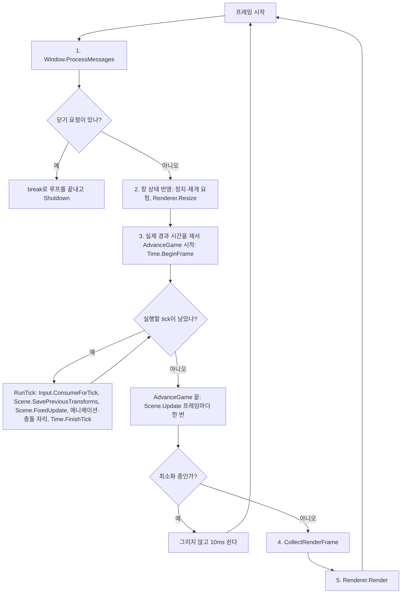

# 03-3. Update와 FixedUpdate 나누기

목표는 컴포넌트 갱신을 유니티처럼 두 가지로 나누는 것이다. FixedUpdate는 고정 간격마다 돌며 게임 상태를 바꾸고, Update는 프레임마다 한 번 돌며 화면 연출을 맡는다. 시간 함수 이름을 유니티와 맞추고, 실시간 루프는 루프 안의 if로 끝낸다.

이 단계는 [이슈 15](https://github.com/jung-seung-hwan/kraken-engine-learning/issues/15)이고, 선행은 [단계 3-2](03-2-scene-rendering.md)다. 이 문서는 코드를 쓰기 전에 정한 계약이다. 검증 세션이 이 계약을 처음 설계와 맞대어 본 뒤 학생이 네 가지를 더 정했고, 그 내용도 계약에 넣었다(결정 기록의 두 번째 표).

## 왜 바꾸나

처음 설계는 컴포넌트 로직을 고정 tick에서만 돌리고, 유니티에서는 GameObject–Component 관계만 참고했다. 2026-11-05 대화에서 학생이 유니티의 Update·FixedUpdate 구분을 따르기로 정했다. 그래서 AGENTS.md의 유니티 규칙도 함께 고친다.

처음 설계의 목표인 "입력·애니메이션·판정이 같은 시계로 돈다"는 그대로다. 게임 결과에 영향을 주는 일은 모두 FixedUpdate에서 하기 때문이다. 새로 생기는 Update는 그 시계 밖에서 화면 연출만 맡고, 값은 tick에서 Update 쪽으로 한 방향으로만 흐른다.

## 두 갱신의 계약

| | FixedUpdate | Update |
| --- | --- | --- |
| 언제 | tick마다. 프레임마다 0번 이상 | 프레임마다 한 번. 모든 tick이 끝난 뒤, 렌더 데이터를 모으기 전 |
| 읽는 시간 | `FixedDeltaTime()`. 늘 같은 값이다. 창 모드 0.02초, `--demo` 0.1초. 여기서 `DeltaTime()`을 읽어도 같은 값이다 | `DeltaTime()`. 이번 프레임의 게임 시간이다. 배속을 적용하고, 정지면 0, 따라잡기 상한을 넘지 않는다 |
| 하는 일 | 게임 상태를 바꾸는 일: 이동, 공격. 단계 4의 애니메이션 진행과 단계 5의 판정도 같은 tick 안에서 하지만, 컴포넌트가 아니라 Scene.FixedUpdate가 끝난 뒤 Application의 tick 단계에서 한다 | 게임 결과에 영향을 주지 않는 화면 연출 |
| 입력 | 누름·뗌·유지와 마우스 이동량. tick마다 한 번 소비한 값 | 지금은 읽지 않는다 |
| 바꾸는 것 | 게임 상태: Transform, 객체 생성·삭제·Clear, SetActive·SetEnabled, 다른 갱신이 읽는 값 | 연출에만 쓰는 자기 멤버 값. 게임 상태는 바꾸지 않는다 |
| 정지 중 | 불리지 않는다 | 계속 불린다. `DeltaTime()`은 0이다 |
| 유니티 | `FixedUpdate` | `Update` |

- **값은 tick에서 Update 쪽으로 한 방향으로만 흐른다.** Update는 tick이 만든 상태를 읽어 연출할 뿐, FixedUpdate가 읽는 값을 바꾸지 않는다. 예를 들어 Update에서 `DeltaTime()`을 쌓아 쿨다운을 줄이고 FixedUpdate가 그 값을 보고 공격을 허락한다고 하자. Update는 그 프레임의 tick이 다 끝난 뒤에 돌기 때문에, 쿨다운이 끝났음을 tick이 알아채는 시점이 프레임 길이에 따라 달라진다. 같은 입력이라도 FPS에 따라 공격이 나가는 tick이 달라진다.
- **Update에서는 객체 생성·삭제·Clear, SetActive·SetEnabled를 하지 않는다.** 모두 다음 tick에서 FixedUpdate를 받는 대상을 바꾸는 게임 상태다. Scene.Update가 끝날 때 삭제 예약을 반영하는 코드는 이 규칙을 어겼을 때 목록이 꼬이지 않게 하는 안전장치로만 남긴다.
- **Transform은 FixedUpdate에서만 바꾼다.** 보간은 직전 tick과 현재 tick 사이를 섞어 그린다. Update에서 Transform을 바꾸면 그 변화가 보간과 단계 5의 충돌 검사 밖에서 일어난다. 어기면 tick이 2번 이상인 프레임, 곧 30 FPS 이하에서만 흔들림이 보여서 눈으로 잡기 어렵다. 그래도 이번에는 코드로 막지 않고 문서와 주석의 규칙으로 둔다. Update에서 Transform을 처음 바꾸고 싶어지는 곳은 단계 6의 카메라라서, 그때 다시 정한다.
- **누름·뗌은 FixedUpdate에서만 읽는다.** Input은 tick마다 한 번 소비한다. Update에서 그 값을 읽으면, tick이 0번인 프레임에서는 지난 tick의 누름을 한 번 더 보게 된다. tick이 여러 번인 프레임에서는 마지막 tick의 값만 보게 된다.
- **Update의 입력은 쓸 곳이 생길 때 더한다.** 처음 필요해지는 때는 단계 6에서 카메라를 마우스로 돌릴 때다. 그때 "누르고 있는지"와 "이번 프레임 마우스 이동량"만 더하고, 누름·뗌은 더하지 않는다. 카메라의 방향도 Transform이고 보간 대상이라서, 그때 Transform 규칙과 보간을 함께 정한다.
- **정지 중에도 Update를 부른다.** 정지 메뉴나 UI처럼 정지 중에도 돌아야 하는 화면 일이 있기 때문이다. 유니티도 같다. 다만 정지 중에는 `DeltaTime()`이 0이라서, `DeltaTime()`을 곱해 움직이는 연출은 정지 중에 멈춘다. 정지 중에도 시간에 따라 움직이려면 정지·배속을 적용하지 않은 시간(유니티의 `Time.unscaledDeltaTime`)이 필요하다. 그 시간을 컴포넌트에 알려 주는 일은 쓸 곳이 생길 때 더한다.

## 시간 이름

유니티의 이름과 뜻을 그대로 따른다.

| 지금 | 바뀐 이름 | 뜻 | 유니티 |
| --- | --- | --- | --- |
| `TickSeconds()` | `FixedDeltaTime()` | tick 하나의 길이 | `Time.fixedDeltaTime` |
| 없음 | `DeltaTime()` | 이번 프레임의 게임 시간. 배속을 적용하고, 정지면 0, 상한을 넘지 않는다. tick 안에서 읽으면 `FixedDeltaTime()` | `Time.deltaTime` |
| `BeginFrame`의 `deltaTime` | `unscaledDeltaTime` | 배속·정지를 적용하기 전 실제 시간. Application만 넣는다 | `Time.unscaledDeltaTime` |
| Time 생성자의 `tickSeconds` | `fixedDeltaTime` | tick 하나의 길이 | |

- "tick"이라는 말은 그대로 쓴다. tick은 FixedUpdate가 한 번 도는 고정 간격이다. 그래서 `ConsumeForTick`, `FinishTick`, `maxTicksPerFrame`의 이름은 바꾸지 않는다.
- **tick 안의 `DeltaTime()`**: tick 안(BeginFrame 뒤, 그 프레임의 tick을 다 마치기 전)에서 읽으면 `FixedDeltaTime()`을 돌려준다. 유니티도 FixedUpdate 안에서 `Time.deltaTime`을 읽으면 `fixedDeltaTime`을 준다. 그래서 유니티 습관대로 FixedUpdate에서 `속도 × DeltaTime()`을 써도 FPS와 관계없이 맞다. 프레임 값을 그대로 주면 tick마다 프레임 길이만큼 움직여서, 속도가 1일 때 초당 이동량이 60Hz에서 약 0.83, 30 FPS에서 약 1.67이 된다. Time은 BeginFrame이 정한 tick을 아직 다 마치지 않았는지(`m_ticksLeft`)로 tick 안인지 안다. 그래서 FixedUpdate 안뿐 아니라 tick과 tick 사이도 tick 안이다. BeginFrame 없이 `Scene.FixedUpdate`만 부르는 시험에서는 tick 안으로 보지 않아서, 마지막 프레임의 값(첫 프레임 전에는 0)이 나온다. 같은 함수가 부르는 곳에 따라 다른 값을 주는 셈이라 Time.h 주석에 이유를 적었다.
- **`DeltaTime()`의 상한**: 한 프레임의 `DeltaTime()`은 `maxTicksPerFrame × FixedDeltaTime()`을 넘지 않는다. 창 모드에서는 0.1초다. 창을 끌다 놓은 프레임처럼 아주 긴 프레임에서 연출이 크게 튀지 않게 하고, FixedUpdate가 따라잡는 상한과 맞추기 위해서다. 유니티의 Maximum Allowed Timestep과 같은 생각이다.
- 03-1 문서에는 "`deltaTime`은 유니티 `Time.deltaTime`과 뜻이 다르다"는 설명이 있다. 01-lifecycle 문서에도 "GameObject에 동작 Component를 붙이는 관계만 적용한다"는 문장이 있다. 둘 다 그때의 기록이다. 이제는 `DeltaTime()`이 유니티 `Time.deltaTime`과 같은 뜻이다.

## 고정 간격 0.02초

- 창 모드의 tick 길이를 1/60초에서 0.02초로 바꾼다. 1초에 50번이고, 유니티 기본값과 같다.
- 화면은 3-2의 보간 덕분에 모니터 주사율대로 부드럽게 그려진다.
- PlayerControl의 위치 로그 간격은 30 tick에서 25 tick으로 바꾼다. 0.02초 × 25 = 0.5초라서 지금처럼 0.5초마다 찍힌다.
- `--demo`의 tick은 0.1초 그대로 둔다. 단계 2와 같은 게임 결과를 회귀 검사로 쓰기 때문이다.

## 한 프레임의 흐름



- 순서는 유니티와 같다. 한 프레임 안에서 FixedUpdate를 필요한 만큼 돌린 뒤 Update를 한 번 부르고, 그다음 그린다.
- BeginFrame부터 Update까지는 Application의 `AdvanceGame` 함수 하나다. 창 모드와 `--demo`가 같은 함수를 쓴다. 그래서 CI가 돌리는 데모 출력으로 창 모드의 순서도 확인한다.
- Update는 최소화 중에도 부른다. 최소화는 정지라서 그때 tick은 0번이고 `DeltaTime()`은 0이다.
- `--demo`는 프레임마다 tick들 뒤, Render 앞에 `6. Update` 줄을 찍는다. 그래서 Render 줄의 번호가 6에서 7로 바뀐다. 데모의 컴포넌트는 Update를 재정의하지 않으므로 나머지 출력은 3-2와 같다.

## 루프 종료

```cpp
while (true)
{
    m_window->ProcessMessages();
    if (m_window->IsCloseRequested())
        break;
    // 창 상태 반영, tick, Update, 그리기
}
```

- 지금은 `while (m_window->ProcessMessages())`처럼 메시지 처리와 종료 판단이 한 줄에 섞여 있다. 둘을 나눠서 루프가 언제 끝나는지 눈에 보이게 한다. 게임 루프에서 흔히 쓰는 모양이다.
- `Window::ProcessMessages`는 메시지만 처리하고 값을 돌려주지 않는다. 닫기 요청은 `IsCloseRequested()`로 묻는다.

## Scene·GameObject·Component

- **Component**: 지금의 `Update()`는 이름만 `FixedUpdate()`로 바뀐다. 새 `Update()`를 더한다. 둘 다 기본은 아무것도 하지 않는 가상 함수다.
- **GameObject**: `FixedUpdate()`와 `Update()`가 각각 켜진 컴포넌트의 같은 이름 함수를 부른다. 비활성이거나 삭제를 기다리는 객체는 부르지 않는다. 갱신 도중 붙인 컴포넌트는 같은 종류의 다음 갱신부터 불린다. 지금 Update의 규칙 그대로다. 그래서 tick에서 붙인 컴포넌트는 같은 프레임의 Update를 첫 FixedUpdate보다 먼저 받을 수 있다.
- **Scene**: `FixedUpdate()`는 tick마다, `Update()`는 프레임마다 Application이 부른다. 갱신 도중에는 FixedUpdate·Update 어느 것도 다시 시작할 수 없고(예외를 던진다), 둘 다 끝날 때 삭제 예약을 반영한다. Update 끝의 반영은 위의 규칙을 어겼을 때를 위한 안전장치다. 생성은 지금처럼 요청 즉시 반영한다. 단계 4에서 생성·삭제 반영을 tick 끝으로 옮길 때도 경계는 tick 끝 하나이고, Update 끝의 반영은 안전장치로 남는다.
- 두 갱신은 순회 규칙이 같다. 그래서 GameObject와 Scene은 순회를 private 함수 하나(`RunComponents`, `RunObjects`)에 두고, `fixedStep` 값으로 FixedUpdate와 Update 중 무엇을 부를지 고른다.
- **창구 규칙**: `FixedUpdate`, `Update`, `SavePreviousTransforms`는 Application만 부르고, `ObjectAt`은 수집 함수만 부른다. 컴포넌트 소멸자에서는 `CreateObject`, `Clear`, `FixedUpdate`, `Update`를 부르지 않는다.

## 단계 3-3에서 바뀌는 기존 코드

- Component, GameObject, Scene: `Update`를 `FixedUpdate`로 바꾸고, 프레임마다 도는 `Update`를 더한다.
- PlayerControl, LogComponent: `Update`를 `FixedUpdate`로 바꾼다. PlayerControl은 `FixedDeltaTime()`을 곱한다. LogComponent의 로그 글자도 `FixedUpdate`로 바꾼다. 데모의 Kraken은 꺼져 있어 이 로그를 찍지 않으므로, 이 글자 때문에 데모 출력이 바뀌지는 않는다.
- Time: 이름을 바꾸고 `DeltaTime()`과 그 상한을 더한다. tick 안에서는 `DeltaTime()`이 `FixedDeltaTime()`을 준다.
- Application: 창 모드 tick 0.02초, 위치 로그 25 tick, 루프 종료를 if로. 한 프레임의 게임 진행(BeginFrame, tick들, `Scene.Update`)을 `AdvanceGame`으로 묶어 창 모드와 데모가 같이 쓴다. 데모의 `AdvanceDemoTime`은 없어지고, 시간 줄은 `PrintDemoTime`이 찍는다. 데모에 `6. Update` 줄을 더하고 Render 줄은 7번이 된다.
- Window: `ProcessMessages`는 값을 돌려주지 않고, `IsCloseRequested()`를 더한다.
- 시험: 기존 시험 컴포넌트의 `Update`를 `FixedUpdate`로 바꾸고, 실제 시간을 담는 매개변수 이름 `deltaTime`을 `unscaledDeltaTime`으로 바꾼다. 아래 검증을 더한다. 시험 컴포넌트는 모두 `override`를 쓰므로, 기본 클래스 이름을 바꿨을 때 빠뜨린 곳은 새 `Update`를 더하기 전에 컴파일 오류로 드러난다.
- 문서: AGENTS.md의 유니티 규칙, 구조 문서의 프레임 흐름과 차이 표, README, 로드맵, 이슈 목록.

## 결정 기록

2026-11-05 대화에서 학생이 정했다.

| 질문 | 선택 | 이유 |
| --- | --- | --- |
| 갱신 구분 | 프레임마다 Update, 고정 간격 FixedUpdate | 학생이 유니티 구조를 따르기로 했다 |
| 지금 tick에서 하던 일 | FixedUpdate로 옮긴다 | 동작, 판정 타이밍, 데모 출력이 그대로다 |
| 누름·뗌 같은 한 번짜리 입력 | FixedUpdate에서만 읽는다 | tick 소비와 맞아서 놓치거나 두 번 읽지 않는다 |
| Update에서 읽는 입력 | 지금은 없다. 단계 6에서 유지 여부와 프레임 마우스 이동량만 더한다 | 쓸 곳이 생기기 전에 만들지 않는다 |
| 시간 이름 | `FixedDeltaTime()`, `DeltaTime()`, `unscaledDeltaTime` | 유니티와 같은 뜻이다 |
| `DeltaTime()` 상한 | `maxTicksPerFrame × FixedDeltaTime()` | 긴 프레임에서 연출이 튀지 않고, FixedUpdate와 같은 상한이다 |
| 정지 중 Update | 부른다. `DeltaTime()`은 0 | 유니티와 같고, 정지 메뉴나 UI처럼 정지 중에도 돌아야 하는 화면 일을 위해서다 |
| 고정 간격 | 창 모드 0.02초, `--demo` 0.1초 | 유니티 기본값이다. 데모는 회귀 비교를 위해 그대로 둔다 |
| 루프 종료 | 루프 안의 if에서 break | 종료 조건이 눈에 보인다 |
| AGENTS.md | 유니티 규칙 문장을 고친다 | 규칙과 코드가 달라 헷갈리지 않게 한다 |

같은 날, 검증 세션의 단계 3-3 계획 점검을 본 뒤 학생이 정했다.

| 질문 | 선택 | 이유 |
| --- | --- | --- |
| Update에서 바꿔도 되는 것 | 연출에만 쓰는 자기 멤버 값뿐이다. Transform, 객체 생성·삭제·Clear, SetActive·SetEnabled, FixedUpdate가 읽는 값은 바꾸지 않는다. 값은 tick에서 Update 쪽으로만 흐른다 | 규칙이 가장 짧고, FPS에 따라 게임 결과가 달라지는 길을 막는다 |
| Scene.Update 끝의 삭제 반영 | 안전장치로만 남긴다 | 규칙을 어겨도 목록이 꼬이지 않는다. 단계 4에서도 반영 경계는 tick 끝 하나다 |
| tick 안의 `DeltaTime()` | `FixedDeltaTime()`을 준다 | 유니티와 같다. 유니티 예제를 옮겨 와도 FPS와 관계없이 맞다 |
| Transform 규칙 검사 | 문서와 주석의 규칙만 둔다 | Update를 쓰는 게임 컴포넌트가 아직 없다. 단계 6의 카메라 때 다시 정한다 |
| Update 호출 확인 | 프레임 진행을 `AdvanceGame` 하나로 묶고, 데모에 Update 줄을 찍는다 | CI가 돌리는 데모로 창 모드와 같은 순서를 확인한다. 데모 기준 출력은 Update 7줄과 Render 번호만 바뀐다 |

## 알려진 한계

- 게임 컴포넌트 가운데 Update를 쓰는 것은 아직 없다. 호출 시점과 횟수는 시험용 컴포넌트로, 창 모드와 같은 호출 위치는 데모 출력의 Update 줄로 확인한다.
- Update에서 게임 상태를 바꾸지 않는다는 규칙과 누름·뗌을 읽지 않는다는 규칙은 코드로 막지 않는다. 어겨도 낮은 FPS에서만 드러날 수 있다.
- Update에서 읽을 입력이 아직 없다. 단계 6에서 더한다.
- 정지 중에 시간에 따라 움직이는 연출은 아직 만들 수 없다. 정지·배속을 적용하지 않은 시간을 컴포넌트에 알려 주지 않기 때문이다.
- tick이 0.02초라서 60Hz 화면에서도 1초에 10프레임은 tick이 0번이다. Transform은 보간해서 그리지만, 보간하지 않는 값(단계 4의 포즈 같은 것)은 50Hz로 끊겨 보일 수 있다. 단계 4에서 포즈를 보간할지 정한다.
- 정지 중에 누른 키와 마우스 이동은 재개한 첫 tick에 한꺼번에 전달된다. 지금은 최소화하면 포커스를 잃어 입력이 비워지므로 드러나지 않는다. 정지 메뉴가 생기는 단계에서 재개할 때 입력을 버릴지 정한다.
- 0.02초 tick은 1/60초보다 조금 길어서, 입력이 화면에 반영되기까지 최대 지연이 약 3ms 늘어난다.

## 꼭 필요한 문법만 읽기

- `while (true)`와 `break`: 조건 없이 도는 반복문이다. 안에서 `break`를 만나면 반복을 끝내고 반복문 다음 줄로 간다.
- `std::min`: `<algorithm>`의 함수로, 두 값 가운데 작은 값을 돌려준다. `DeltaTime()`의 상한을 둘 때 쓴다.

## 읽기 순서

읽기 전에: tick은 FixedUpdate가 도는 고정 간격이다. Application의 `RunTick`, `UpdateAnimation`은 tick 안의 단계 이름이고, 컴포넌트의 `Update`와는 다르다.

1. src/Component.h: FixedUpdate와 Update의 약속.
2. src/Time.h / Time.cpp: `FixedDeltaTime()`, `DeltaTime()`, 상한.
3. src/Scene.h / Scene.cpp, src/GameObject.cpp: 두 갱신을 나눠 부르는 곳.
4. src/Application.cpp: `RunWindow`의 루프 종료, 한 프레임의 게임 진행을 묶은 `AdvanceGame`, tick 하나인 `RunTick`.
5. src/PlayerControl.cpp: 게임 로직이 FixedUpdate로 옮긴 모습.

## 실행

```powershell
msbuild NereidesEngine2.sln /p:Configuration=Debug /p:Platform=x64
./bin/x64/Debug/NereidesEngine2.exe
./bin/x64/Debug/NereidesEngine2.exe --demo
./bin/x64/Debug/NereidesEngine2.exe --lifecycle-tests
./bin/x64/Debug/NereidesEngine2.exe --input-time-tests
./bin/x64/Debug/NereidesEngine2.exe --window-tests
./bin/x64/Debug/NereidesEngine2.exe --render-tests
```

## 검증 계획

| 명령 | 기대 결과 |
| --- | --- |
| Debug·Release 빌드 | 경고 수준 4에서 경고 없이 성공 |
| `--demo` | 3-2 출력에 프레임마다 `6. Update` 줄이 더해지고 Render 줄 번호가 7로 바뀐 것 말고는 같다. 종료 코드 0 |
| `--lifecycle-tests` | 기존 5개에 아래 3개를 더해 통과 |
| `--input-time-tests` | 기존 17개에 아래 2개를 더해 통과 |
| `--window-tests` | 8개 통과. 닫기 시험은 `IsCloseRequested()`로 확인 |
| `--render-tests` | 9개 통과 |

더하는 시험:

1. 수명: `Scene.FixedUpdate`는 FixedUpdate만, `Scene.Update`는 Update만 부른다. 비활성 객체와 꺼진 컴포넌트는 둘 다 부르지 않는다.
2. 수명(안전장치): Update에서는 생성·삭제·Clear를 하지 않기로 했지만, 해도 Scene이 FixedUpdate와 같은 경계 규칙으로 처리한다. Update 안의 삭제 요청과 Clear는 Update가 끝난 뒤 반영되고, Update 도중 만든 객체와 붙인 컴포넌트는 다음 Update부터 불린다.
3. 수명: Update가 예외를 던져도 그 전에 받은 삭제 요청은 반영되고, 다음 갱신을 시작할 수 있다. 갱신 도중 다른 갱신을 시작하면 거부하고, 그 뒤에도 Scene을 계속 쓸 수 있다.
4. 입력·시간: `DeltaTime()`은 실제 시간에 배속을 곱한 값이다. 정지면 0이고, 긴 프레임은 배속을 적용한 뒤 `maxTicksPerFrame × FixedDeltaTime()`에서 자른다. tick 안(BeginFrame 뒤, tick을 다 마치기 전)에서는 `FixedDeltaTime()`이다.
5. 입력·시간: 프레임마다 FixedUpdate는 tick 수만큼, Update는 한 번 불린다. tick이 0번인 프레임과 3번인 프레임, 정지한 프레임으로 확인한다. 같은 프레임에서 FixedUpdate가 읽은 `DeltaTime()`은 tick 길이이고, Update가 읽은 값은 프레임 시간이다.

처음 계획은 수명 1개였는데, 코드를 쓰고 리뷰를 받으며 2번과 3번을 더했다. Scene의 갱신 중복 방지가 FixedUpdate와 Update에 함께 걸리게 됐고, 두 갱신이 같은 순회 규칙을 따른다는 계약을 Update 쪽에서도 확인하기 위해서다. 4번과 5번의 tick 안 `DeltaTime()` 확인은 검증 보고서를 본 뒤의 결정으로 더했다.

창 모드는 로컬에서 확인한다.

| 조작 | 기대 결과 |
| --- | --- |
| 인자 없이 실행 | 3-2와 같은 장면. 콘솔에 0.5초마다 Player 위치가 찍힌다 |
| W를 누르고 있기 | z가 초당 1씩 는다 |
| 창 닫기 | 루프가 끝나고 Shutdown 로그, 종료 코드 0 |

## 학생 질문

1. tick이 0번인 프레임과 3번인 프레임에서 FixedUpdate와 Update는 각각 몇 번 불리는가?
2. 공격 입력(누름)을 Update에서 읽으면 어떤 문제가 생길 수 있는가?
3. 정지 중에도 Update가 불리는 이유는 무엇이고, 그때 `DeltaTime()`은 얼마인가?

변형 과제: Update만 재정의한 컴포넌트를 만들어 프레임마다 `DeltaTime()`을 더해 보고, 정지·배속에서 그 합이 어떻게 달라지는지 설명한다.
정답 변경은 기본 예제에 포함하지 않는다. 학생 이해 상태는 미확인이다.

## 검증 기록

2026-11-05, Windows 11 개발 PC의 VS2022 MSBuild로 Debug·Release x64를 빌드했다. 리뷰와 검증 보고서 뒤의 결정까지 반영한 뒤 두 구성을 다시 빌드해 아래 명령을 모두 다시 돌렸고, 표는 그 결과다.

| 명령 | 기대 결과 | 실제 결과 |
| --- | --- | --- |
| `msbuild NereidesEngine2.sln -p:Configuration=Debug -p:Platform=x64`, Release도 같게 | 경고 없이 성공 | 두 구성 모두 종료 코드 0, 경고 0 |
| `--lifecycle-tests` | 8개 통과 | 두 구성 모두 `Lifecycle tests PASS (8 cases)` |
| `--input-time-tests` | 19개 통과 | 두 구성 모두 `Input/time tests PASS (19 cases)` |
| `--window-tests` | 8개 통과 | 두 구성 모두 `Window message tests PASS (8 cases)` |
| `--render-tests` | 9개 통과 | 두 구성 모두 `Render tests PASS (9 cases)` |
| `--demo` | 3-2 출력에 Update 줄 추가와 Render 번호 변경만 다르다. 종료 코드 0 | 두 구성 모두 종료 코드 0이고 두 출력이 같다. 3-1 출력 기록(3-2도 같았다)과 비교하면 차이는 7개 프레임마다 `6. Update` 줄 하나가 더해지고 Render 줄이 `7.`이 된 것뿐이다. 위치·공격·시간 값은 모두 같다 |

창 모드는 스크립트로 창 메시지를 보내고 화면을 캡처해 확인했다. 결정 반영 뒤의 빌드로 Debug·Release를 돌렸다. 그 뒤 두 번째 리뷰 반영은 주석과 시험만 바꿨다. 그 첫 실행들에서는 실제 마우스 커서가 창 위를 지나가 회전값이 바뀌었고, 포커스가 바뀐 순간 키 누름이 일찍 끊긴 구간이 있었다. 포커스를 잃으면 입력을 비우는 동작이다. 그래서 Release로 한 번 더 돌렸고, 아래 표는 그 결과다. 리뷰 전 빌드로 돌린 두 구성의 결과도 같았다.

| 조작 | 기대 결과 | 실제 결과 |
| --- | --- | --- |
| 인자 없이 실행 | 3-2와 같은 장면, 0.5초마다 Player 위치 로그 | 바닥과 두 상자가 보인다. 첫 줄 `Stage 3-3: Update and FixedUpdate` |
| D 4초, W 3초, S 3초, A 3초 누르기 | 누르는 동안 초당 1씩 이동 | 로그 한 줄마다 0.5씩 바뀐다(예: x 0.58 → 1.08 → 1.58, D 4초 뒤 x 2.02). 0.5초 간격 로그와 초당 1 이동이 맞다. Player가 Kraken 뒤에 가려졌다가 다시 보인다 |
| 넓은 창·좁은 창, 최소화 뒤 복원 | 3-2와 같다 | 비율 유지, `game time paused`·`resumed` 로그, 복원 뒤 그대로 그린다 |
| 창 닫기 | if에서 루프를 끝내고 Shutdown, 종료 코드 0 | `Shutdown`과 객체 정리 로그, 종료 코드 0 |
| 최소화 1.5초 뒤 복원하고 W 2초 | 복원하면 게임 시간이 다시 흘러 움직인다 | `resumed` 로그 뒤 z가 0에서 2.00까지 오른다 |

- 마우스 회전은 3-2와 같이 스크립트로 확인하지 못했다. 스크립트로 보낸 WM_MOUSEMOVE는 커서가 창 밖에 있어서 TrackMouseEvent가 바로 WM_MOUSELEAVE를 보내므로 기준점만 다시 잡힌다. 직접 실행해서 확인할 항목이다.
- 게임 컴포넌트 가운데 Update를 재정의한 것이 아직 없어서, 창 모드에서는 Update 호출이 화면에 드러나지 않는다. 호출 시점과 횟수는 시험 5번이 시험용 컴포넌트로 확인하고, 호출 위치는 창 모드와 같은 `AdvanceGame`을 쓰는 데모 출력의 `6. Update` 줄로 확인한다.
- CI는 PR을 만든 뒤 확인한다.
