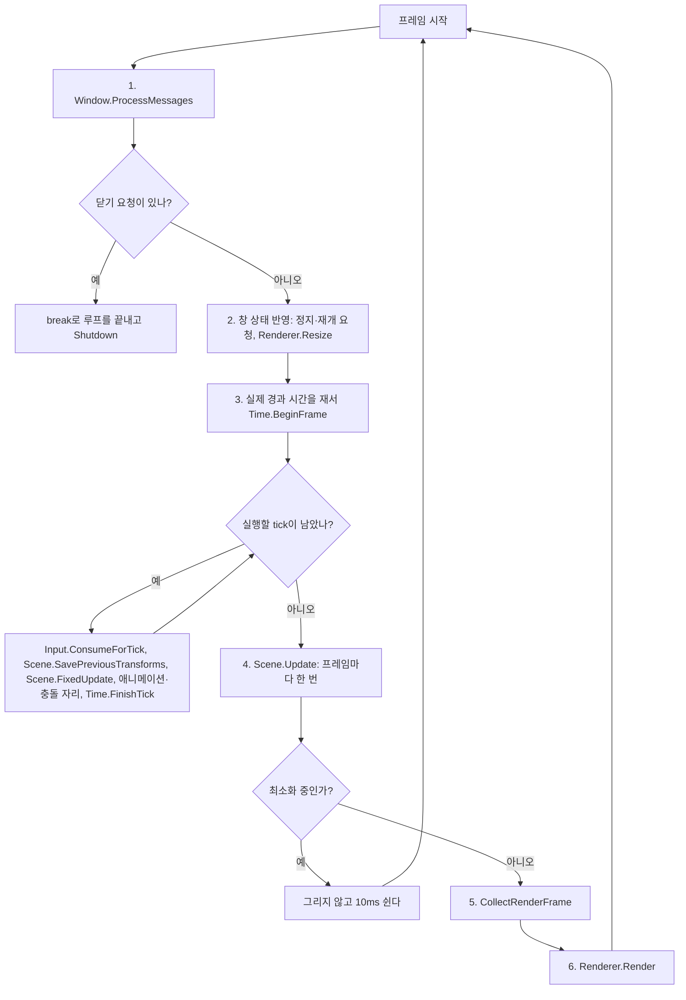

# 03-3. Update와 FixedUpdate 나누기

목표는 컴포넌트 갱신을 유니티처럼 두 가지로 나누는 것이다. FixedUpdate는 고정 간격마다 돌며 게임 상태를 바꾸고, Update는 프레임마다 한 번 돌며 화면 연출을 맡는다. 시간 함수 이름을 유니티와 맞추고, 실시간 루프는 루프 안의 if로 끝낸다.

이 단계는 [이슈 15](https://github.com/jung-seung-hwan/kraken-engine-learning/issues/15)이고, 선행은 [단계 3-2](03-2-scene-rendering.md)다. 이 문서는 코드를 쓰기 전에 정한 계약이다.

## 왜 바꾸나

처음 설계는 컴포넌트 로직을 고정 tick에서만 돌리고, 유니티에서는 GameObject–Component 관계만 참고했다. 2026-11-05 대화에서 학생이 유니티의 Update·FixedUpdate 구분을 따르기로 정했다. 그래서 AGENTS.md의 유니티 규칙도 함께 고친다.

처음 설계의 목표인 "입력·애니메이션·판정이 같은 시계로 돈다"는 그대로다. 게임 결과에 영향을 주는 일은 모두 FixedUpdate에서 하기 때문이다. 새로 생기는 Update는 그 시계 밖에서 화면 연출만 맡는다.

## 두 갱신의 계약

| | FixedUpdate | Update |
| --- | --- | --- |
| 언제 | tick마다. 프레임마다 0번 이상 | 프레임마다 한 번. 모든 tick이 끝난 뒤, 렌더 데이터를 모으기 전 |
| 읽는 시간 | `FixedDeltaTime()`. 늘 같은 값이다. 창 모드 0.02초, `--demo` 0.1초 | `DeltaTime()`. 이번 프레임의 게임 시간이다. 배속을 적용하고, 정지면 0, 따라잡기 상한을 넘지 않는다 |
| 하는 일 | 게임 상태를 바꾸는 일: 이동, 공격, 단계 4의 애니메이션 진행, 단계 5의 판정 | 게임 결과에 영향을 주지 않는 화면 연출 |
| 입력 | 누름·뗌·유지와 마우스 이동량. tick마다 한 번 소비한 값 | 지금은 읽지 않는다 |
| Transform | 바꿔도 된다 | 바꾸지 않는다 |
| 정지 중 | 불리지 않는다 | 계속 불린다. `DeltaTime()`은 0이다 |
| 유니티 | `FixedUpdate` | `Update` |

- **Transform은 FixedUpdate에서만 바꾼다.** 보간은 직전 tick과 현재 tick 사이를 섞어 그린다. Update에서 Transform을 바꾸면 그 변화가 보간과 단계 5의 충돌 검사 밖에서 일어난다.
- **누름·뗌은 FixedUpdate에서만 읽는다.** Input은 tick마다 한 번 소비한다. Update에서 그 값을 읽으면, tick이 0번인 프레임에서는 지난 tick의 누름을 한 번 더 보게 된다. tick이 여러 번인 프레임에서는 마지막 tick의 값만 보게 된다.
- **Update의 입력은 쓸 곳이 생길 때 더한다.** 처음 필요해지는 때는 단계 6에서 카메라를 마우스로 돌릴 때다. 그때 "누르고 있는지"와 "이번 프레임 마우스 이동량"만 더하고, 누름·뗌은 더하지 않는다.
- **정지 중에도 Update를 부른다.** 정지 메뉴나 UI처럼 정지 중에도 움직여야 하는 연출이 있기 때문이다. 유니티도 같다.

## 시간 이름

유니티의 이름과 뜻을 그대로 따른다.

| 지금 | 바뀐 이름 | 뜻 | 유니티 |
| --- | --- | --- | --- |
| `TickSeconds()` | `FixedDeltaTime()` | tick 하나의 길이 | `Time.fixedDeltaTime` |
| 없음 | `DeltaTime()` | 이번 프레임의 게임 시간. 배속을 적용하고, 정지면 0, 상한을 넘지 않는다 | `Time.deltaTime` |
| `BeginFrame`의 `deltaTime` | `unscaledDeltaTime` | 배속·정지를 적용하기 전 실제 시간. Application만 넣는다 | `Time.unscaledDeltaTime` |
| Time 생성자의 `tickSeconds` | `fixedDeltaTime` | tick 하나의 길이 | |

- "tick"이라는 말은 그대로 쓴다. tick은 FixedUpdate가 한 번 도는 고정 간격이다. 그래서 `ConsumeForTick`, `FinishTick`, `maxTicksPerFrame`의 이름은 바꾸지 않는다.
- **`DeltaTime()`의 상한**: 한 프레임의 `DeltaTime()`은 `maxTicksPerFrame × FixedDeltaTime()`을 넘지 않는다. 창 모드에서는 0.1초다. 창을 끌다 놓은 프레임처럼 아주 긴 프레임에서 연출이 크게 튀지 않게 하고, FixedUpdate가 따라잡는 상한과 맞추기 위해서다. 유니티의 Maximum Allowed Timestep과 같은 생각이다.
- 03-1 문서에는 "`deltaTime`은 유니티 `Time.deltaTime`과 뜻이 다르다"는 설명이 있다. 그건 그때의 기록이다. 이제는 `DeltaTime()`이 유니티 `Time.deltaTime`과 같은 뜻이다.

## 고정 간격 0.02초

- 창 모드의 tick 길이를 1/60초에서 0.02초로 바꾼다. 1초에 50번이고, 유니티 기본값과 같다.
- 화면은 3-2의 보간 덕분에 모니터 주사율대로 부드럽게 그려진다.
- PlayerControl의 위치 로그 간격은 30 tick에서 25 tick으로 바꾼다. 0.02초 × 25 = 0.5초라서 지금처럼 0.5초마다 찍힌다.
- `--demo`의 tick은 0.1초 그대로 둔다. 단계 2와 같은 출력을 회귀 검사로 쓰기 때문이다.

## 한 프레임의 흐름



- 순서는 유니티와 같다. 한 프레임 안에서 FixedUpdate를 필요한 만큼 돌린 뒤 Update를 한 번 부르고, 그다음 그린다.
- Update는 최소화 중에도 부른다. 최소화는 정지라서 그때 `DeltaTime()`은 0이다.
- `--demo`도 프레임마다 `Scene.Update`를 부른다. 데모의 컴포넌트는 Update를 재정의하지 않으므로 출력은 그대로다.

## 루프 종료

```cpp
while (true)
{
    m_window->ProcessMessages();
    if (m_window->IsCloseRequested())
        break;
    // 창 상태 반영, tick, Update, 그리기
}
```

- 지금은 `while (m_window->ProcessMessages())`처럼 메시지 처리와 종료 판단이 한 줄에 섞여 있다. 둘을 나눠서 루프가 언제 끝나는지 눈에 보이게 한다. 게임 루프에서 흔히 쓰는 모양이다.
- `Window::ProcessMessages`는 메시지만 처리하고 값을 돌려주지 않는다. 닫기 요청은 `IsCloseRequested()`로 묻는다.

## Scene·GameObject·Component

- **Component**: 지금의 `Update()`는 이름만 `FixedUpdate()`로 바뀐다. 새 `Update()`를 더한다. 둘 다 기본은 아무것도 하지 않는 가상 함수다.
- **GameObject**: `FixedUpdate()`와 `Update()`가 각각 켜진 컴포넌트의 같은 이름 함수를 부른다. 비활성이거나 삭제를 기다리는 객체는 부르지 않는다. 갱신 도중 붙인 컴포넌트는 다음 갱신부터 불린다. 지금 Update의 규칙 그대로다.
- **Scene**: `FixedUpdate()`는 tick마다, `Update()`는 프레임마다 Application이 부른다. 갱신 도중에는 FixedUpdate·Update 어느 것도 다시 시작할 수 없고(예외를 던진다), 둘 다 끝날 때 삭제 예약을 반영한다. 생성은 지금처럼 요청 즉시 반영하고, 단계 4에서 tick 끝으로 옮긴다.
- 두 갱신은 순회 규칙이 같다. 그래서 GameObject와 Scene은 순회를 private 함수 하나(`RunComponents`, `RunObjects`)에 두고, `fixedStep` 값으로 FixedUpdate와 Update 중 무엇을 부를지 고른다.
- **창구 규칙**: `FixedUpdate`, `Update`, `SavePreviousTransforms`는 Application만 부르고, `ObjectAt`은 수집 함수만 부른다. 컴포넌트 소멸자에서는 `CreateObject`, `Clear`, `FixedUpdate`, `Update`를 부르지 않는다.

## 단계 3-3에서 바뀌는 기존 코드

- Component, GameObject, Scene: `Update`를 `FixedUpdate`로 바꾸고, 프레임마다 도는 `Update`를 더한다.
- PlayerControl, LogComponent: `Update`를 `FixedUpdate`로 바꾼다. PlayerControl은 `FixedDeltaTime()`을 곱한다. LogComponent의 로그 글자도 `FixedUpdate`로 바꾼다. 데모의 Kraken은 꺼져 있어 이 로그를 찍지 않으므로 데모 출력은 그대로다.
- Time: 이름을 바꾸고 `DeltaTime()`과 그 상한을 더한다.
- Application: 창 모드 tick 0.02초, 위치 로그 25 tick, 루프 종료를 if로, 프레임마다 `Scene.Update`.
- Window: `ProcessMessages`는 값을 돌려주지 않고, `IsCloseRequested()`를 더한다.
- 시험: 바뀐 이름을 반영하고, 아래 검증을 더한다.
- 문서: AGENTS.md의 유니티 규칙, 구조 문서의 프레임 흐름과 차이 표, README, 로드맵, 이슈 목록.

## 결정 기록

2026-11-05 대화에서 학생이 정했다.

| 질문 | 선택 | 이유 |
| --- | --- | --- |
| 갱신 구분 | 프레임마다 Update, 고정 간격 FixedUpdate | 학생이 유니티 구조를 따르기로 했다 |
| 지금 tick에서 하던 일 | FixedUpdate로 옮긴다 | 동작, 판정 타이밍, 데모 출력이 그대로다 |
| 누름·뗌 같은 한 번짜리 입력 | FixedUpdate에서만 읽는다 | tick 소비와 맞아서 놓치거나 두 번 읽지 않는다 |
| Update에서 읽는 입력 | 지금은 없다. 단계 6에서 유지 여부와 프레임 마우스 이동량만 더한다 | 쓸 곳이 생기기 전에 만들지 않는다 |
| 시간 이름 | `FixedDeltaTime()`, `DeltaTime()`, `unscaledDeltaTime` | 유니티와 같은 뜻이다 |
| `DeltaTime()` 상한 | `maxTicksPerFrame × FixedDeltaTime()` | 긴 프레임에서 연출이 튀지 않고, FixedUpdate와 같은 상한이다 |
| 정지 중 Update | 부른다. `DeltaTime()`은 0 | 유니티와 같고, 정지 중 연출을 위해서다 |
| 고정 간격 | 창 모드 0.02초, `--demo` 0.1초 | 유니티 기본값이다. 데모는 회귀 비교를 위해 그대로 둔다 |
| 루프 종료 | 루프 안의 if에서 break | 종료 조건이 눈에 보인다 |
| AGENTS.md | 유니티 규칙 문장을 고친다 | 규칙과 코드가 달라 헷갈리지 않게 한다 |

## 알려진 한계

- Update는 아직 쓰는 컴포넌트가 없다. 시험이 호출 시점과 횟수를 확인한다.
- Update에서 읽을 입력이 아직 없다. 단계 6에서 더한다.
- 0.02초 tick은 1/60초보다 조금 길어서, 입력이 화면에 반영되기까지 최대 지연이 약 3ms 늘어난다.

## 꼭 필요한 문법만 읽기

- `while (true)`와 `break`: 조건 없이 도는 반복문이다. 안에서 `break`를 만나면 반복을 끝내고 반복문 다음 줄로 간다.
- `std::min`: `<algorithm>`의 함수로, 두 값 가운데 작은 값을 돌려준다. `DeltaTime()`의 상한을 둘 때 쓴다.

## 읽기 순서

1. src/Component.h: FixedUpdate와 Update의 약속.
2. src/Time.h / Time.cpp: `FixedDeltaTime()`, `DeltaTime()`, 상한.
3. src/Scene.h / Scene.cpp, src/GameObject.cpp: 두 갱신을 나눠 부르는 곳.
4. src/Application.cpp: 루프 종료와 한 프레임의 순서.
5. src/PlayerControl.cpp: 게임 로직이 FixedUpdate로 옮긴 모습.

## 실행

```powershell
msbuild NereidesEngine2.sln /p:Configuration=Debug /p:Platform=x64
./bin/x64/Debug/NereidesEngine2.exe
./bin/x64/Debug/NereidesEngine2.exe --demo
./bin/x64/Debug/NereidesEngine2.exe --lifecycle-tests
./bin/x64/Debug/NereidesEngine2.exe --input-time-tests
./bin/x64/Debug/NereidesEngine2.exe --window-tests
./bin/x64/Debug/NereidesEngine2.exe --render-tests
```

## 검증 계획

| 명령 | 기대 결과 |
| --- | --- |
| Debug·Release 빌드 | 경고 수준 4에서 경고 없이 성공 |
| `--demo` | 3-2와 같은 출력, 종료 코드 0 |
| `--lifecycle-tests` | 기존 5개에 아래 2개를 더해 통과 |
| `--input-time-tests` | 기존 17개에 아래 2개를 더해 통과 |
| `--window-tests` | 8개 통과. 닫기 시험은 `IsCloseRequested()`로 확인 |
| `--render-tests` | 9개 통과 |

더하는 시험:

1. 수명: `Scene.FixedUpdate`는 FixedUpdate만, `Scene.Update`는 Update만 부른다. 비활성 객체와 꺼진 컴포넌트는 둘 다 부르지 않는다.
2. 수명: Update 안의 삭제 요청은 Update가 끝난 뒤 반영된다. 갱신 도중 다른 갱신을 시작하면 거부하고, 그 뒤에도 Scene을 계속 쓸 수 있다.
3. 입력·시간: `DeltaTime()`은 실제 시간에 배속을 곱한 값이다. 정지면 0이고, 긴 프레임은 `maxTicksPerFrame × FixedDeltaTime()`에서 자른다.
4. 입력·시간: 프레임마다 FixedUpdate는 tick 수만큼, Update는 한 번 불린다. tick이 0번인 프레임과 3번인 프레임, 정지한 프레임으로 확인한다.

코드를 쓰면서 수명 시험을 하나 더 나눴다(2번). Scene의 갱신 중복 방지가 FixedUpdate와 Update에 함께 걸리게 바뀌었기 때문이다.

창 모드는 로컬에서 확인한다.

| 조작 | 기대 결과 |
| --- | --- |
| 인자 없이 실행 | 3-2와 같은 장면. 콘솔에 0.5초마다 Player 위치가 찍힌다 |
| W를 누르고 있기 | z가 초당 1씩 는다 |
| 창 닫기 | 루프가 끝나고 Shutdown 로그, 종료 코드 0 |

## 학생 질문

1. tick이 0번인 프레임과 3번인 프레임에서 FixedUpdate와 Update는 각각 몇 번 불리는가?
2. 공격 입력(누름)을 Update에서 읽으면 어떤 문제가 생길 수 있는가?
3. 정지 중에도 Update가 불리는 이유는 무엇이고, 그때 `DeltaTime()`은 얼마인가?

변형 과제: Update만 재정의한 컴포넌트를 만들어 프레임마다 `DeltaTime()`을 더해 보고, 정지·배속에서 그 합이 어떻게 달라지는지 설명한다.
정답 변경은 기본 예제에 포함하지 않는다. 학생 이해 상태는 미확인이다.

## 검증 기록

2026-11-05, Windows 11 개발 PC의 VS2022 MSBuild로 Debug·Release x64를 빌드했다.

| 명령 | 기대 결과 | 실제 결과 |
| --- | --- | --- |
| `msbuild NereidesEngine2.sln -p:Configuration=Debug -p:Platform=x64`, Release도 같게 | 경고 없이 성공 | 두 구성 모두 종료 코드 0, 경고 0 |
| `--lifecycle-tests` | 7개 통과 | 두 구성 모두 `Lifecycle tests PASS (7 cases)` |
| `--input-time-tests` | 19개 통과 | 두 구성 모두 `Input/time tests PASS (19 cases)` |
| `--window-tests` | 8개 통과 | 두 구성 모두 `Window message tests PASS (8 cases)` |
| `--render-tests` | 9개 통과 | 두 구성 모두 `Render tests PASS (9 cases)` |
| `--demo` | 3-2와 같은 출력, 종료 코드 0 | 두 구성 모두 종료 코드 0. 3-1 출력 기록(3-2도 같았다)과 바이트 단위로 같다 |

창 모드는 스크립트로 창 메시지를 보내고 화면을 캡처해 확인했다. 두 구성 모두 같은 결과다.

| 조작 | 기대 결과 | 실제 결과 |
| --- | --- | --- |
| 인자 없이 실행 | 3-2와 같은 장면, 0.5초마다 Player 위치 로그 | 바닥과 두 상자가 보인다. 첫 줄 `Stage 3-3: Update and FixedUpdate` |
| D 4초, W 3초, S 3초, A 3초 누르기 | 누르는 동안 초당 1씩 이동 | 로그 한 줄마다 0.5씩 바뀐다(예: x 0.60 → 1.10 → 1.60). 0.5초 간격 로그와 초당 1 이동이 맞다. Player가 Kraken 뒤에 가려졌다가 다시 보인다 |
| 넓은 창·좁은 창, 최소화 뒤 복원 | 3-2와 같다 | 비율 유지, `game time paused`·`resumed` 로그, 복원 뒤 그대로 그린다 |
| 창 닫기 | if에서 루프를 끝내고 Shutdown, 종료 코드 0 | `Shutdown`과 객체 정리 로그, 종료 코드 0 |

- 마우스 회전은 3-2와 같이 스크립트로 확인하지 못했다. 스크립트로 보낸 WM_MOUSEMOVE는 커서가 창 밖에 있어서 TrackMouseEvent가 바로 WM_MOUSELEAVE를 보내므로 기준점만 다시 잡힌다. 직접 실행해서 확인할 항목이다.
- Update를 재정의한 컴포넌트가 아직 없어서, 창 모드에서는 Update 호출이 화면에 드러나지 않는다. 호출 시점과 횟수는 시험 4번이 확인한다.
- CI는 PR을 만든 뒤 확인한다.
