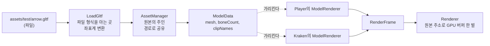

# 04-1. 모델 원본 읽기와 공유

목표는 모델 파일 하나를 읽어 엔진의 메시 원본으로 바꾸고, 여러 객체가 그 원본을 함께 쓰게 하는 것이다. 원본의 주인은 새로 만드는 AssetManager다. 이번 단계는 뼈를 움직이지 않고 파일에 든 모양(바인드 포즈) 그대로 그린다. 재생과 스키닝은 [단계 4-2](../issues/04-2-animation-playback.md)다.

이 단계는 [이슈 5](https://github.com/jung-seung-hwan/Nereides-Engine2/issues/5), [PR 18](https://github.com/jung-seung-hwan/Nereides-Engine2/pull/18)이고, 선행은 [단계 3-3](03-3-update-split.md)이다. 이슈 5는 처음에 단계 4 전체였는데, 학생이 단계 3처럼 둘로 나누기로 해서 4-1로 고쳐 썼다. 4-2는 [이슈 17](https://github.com/jung-seung-hwan/Nereides-Engine2/issues/17)이다.

코드를 쓰기 전에 검증 세션이 단계 4 전환 점검을 했다. 결론은 조건부 진행이고, 3-3 코드에서 고칠 것은 없었다. 조건은 4-1 설계에 세 가지를 정해 적는 것이었다: tick 끝 반영이 덮는 구간과 생성 규칙, 불러온 원본의 소유·수명과 Renderer 캐시 열쇠, 좌표계 변환. 셋 다 아래 "결정 기록"에 있다.

## 먼저 볼 구조



| 누가 | 무엇을 | 소유 |
| --- | --- | --- |
| `LoadGltf` (src/GltfLoader.cpp) | glTF 파일을 읽어 `ModelData`를 만든다. 파일 형식(cgltf)을 아는 유일한 곳이다. 좌표계 변환도 여기서 한다 | 아무것도 소유하지 않는다. 만든 값을 돌려준다 |
| `AssetManager` (src/AssetManager.h) | 경로로 모델을 읽어 두고, 같은 경로는 같은 원본을 돌려준다 | `ModelData`들을 프로그램 끝까지 소유한다 |
| `ModelData` (src/GltfLoader.h) | 메시(3-2의 `MeshData`), 뼈 개수, 클립 이름 | AssetManager가 소유 |
| `ModelRenderer` | 3-2 그대로 `MeshData` 주소를 가리킨다 | 가리키기만 한다 |
| `Application` | Initialize에서 모델을 읽어 컴포넌트에 넘긴다 | AssetManager를 소유한다 |

## 입력·출력·소유자·호출 시점

- **입력**: 저장소 루트 기준 상대 경로(예: `assets/test/arrow.gltf`). 파일은 glTF 2.0(.gltf 또는 .glb). 정점에 위치와 법선이 있고, 삼각형 목록(mode 4)이며, 인덱스가 있어야 한다.
- **출력**: `ModelData`. 엔진 좌표계로 바꾼 정점·인덱스, 뼈 개수, 클립 이름. 파일 안의 메시가 여럿이면 하나로 합친다.
- **소유자**: AssetManager. Application의 멤버이고, Renderer·Scene보다 먼저 선언돼 더 오래 산다. 원본은 실행 중에 내리지 않는다.
- **호출 시점**: 창 모드의 `BuildWindowScene`에서 장면을 만들기 전에 한 번. 게임 도중에는 읽지 않는다. 컴포넌트는 AssetManager를 모른다. Scene이 알려 주는 서비스는 Input·Time 둘 그대로다.
- **오류**: 없는 파일(`file not found`), glTF가 아닌 파일(`not a glTF file`), 지원하지 않는 데이터(`unsupported data (...)`)를 경로와 함께 `std::runtime_error`로 던진다. main이 받아 `Error: Cannot load model '...'`로 찍고 종료 코드 1을 낸다.

## 좌표계 변환

glTF는 **오른손 좌표계**이고 앞면은 **반시계 방향**이다. 우리 엔진은 **왼손 좌표계**이고 앞면은 **시계 방향**이다(3-2). 둘 다 +Y가 위, +Z가 앞이다.

오른손을 왼손으로 바꾸려면 축 하나를 뒤집으면 된다. 어느 축을 뒤집느냐에 따라 "앞"이 달라진다.

| 뒤집는 축 | 결과 | 누가 쓰나 |
| --- | --- | --- |
| X | 앞(+Z)이 그대로 +Z. PlayerControl이 W로 가는 방향과 같다 | 우리 엔진 |
| Z | 앞이 -Z가 된다. 카메라 쪽을 보는 모델이 된다 | 셜록 엔진(`Model.cpp`의 flipZ) |

우리는 X를 뒤집는다. 축을 뒤집으면 삼각형이 도는 방향도 뒤집히므로(거울), 인덱스의 둘째와 셋째를 바꿔 다시 시계 방향으로 만든다. 법선도 X를 뒤집는다. 이 변환은 `LoadGltf` 한 곳에서만 하고, 4-2의 뼈 기본 자세·역바인드 행렬·클립 키에도 같은 규칙을 쓴다. 메시만 바꾸고 뼈를 그대로 두면 4-1 화면은 맞아 보이는데 4-2에서 팔다리가 거울처럼 돈다.

노드 변환도 로더가 적용한다. glTF의 메시는 노드에 붙어 있고, 노드에는 이동·회전·크기가 있을 수 있다.
- 노드의 월드 행렬은 cgltf가 열 우선(column-major) 16개로 준다. 이동 값이 13~15번째인데, DirectXMath의 행 벡터 관례에서도 이동은 넷째 행(`_41~_43`), 곧 같은 자리다. 그래서 16개를 차례로 넣고 **전치하지 않는다**. 처음 코드는 전치를 한 번 더 해서 이동이 엉뚱한 자리에 들어갔고, 리뷰가 잡았다. 시험 모델이 스킨 노드뿐이라 안 드러났기에, 뼈 없는 받침 노드(이동 + 비균등 크기)를 더해 시험에 넣었다.
- 법선은 위치용 행렬로 돌리면 안 된다. 크기가 축마다 다르면 면과 수직이 아니게 된다. 역행렬의 전치가 법선용 행렬이다.
- 노드 변환 자체가 거울(행렬식이 음수)이면 삼각형 방향이 한 번 더 뒤집히므로, 그때는 인덱스 순서를 바꾸지 않는다.
- 스킨이 달린 노드는 규격대로 노드 변환을 무시한다.
- 파일이 가리키는 장면의 뿌리 노드부터 자식을 따라가며 읽는다(재귀). 장면에 없는 노드는 그리지 않는다.

확인 방법: 시험 모델은 한쪽(glTF의 -X)에만 날개가 있다. 변환 뒤에는 엔진의 +X 쪽에 있어야 하고, 모든 삼각형이 3-2의 상자와 같은 외적 검사(`(b-a)×(c-a)·법선 > 0`)를 통과해야 한다. 받침은 노드의 이동 (0, -0.3, 0.2)와 크기 (2, 1, 1)만큼 옮겨지고 늘어나 있어야 한다. `--asset-tests`가 모두 확인한다.

## 외부 로더 cgltf

- **역할**: glTF의 JSON과 이진 버퍼를 읽어 C 구조체(`cgltf_data`)로 펼쳐 준다. 우리는 그 구조체에서 정점·인덱스·뼈·클립을 꺼내 엔진 값으로 옮긴다. 셜록 엔진도 같은 라이브러리를 쓴다.
- **의존성**: `third_party/cgltf/cgltf.h` 한 파일(버전 1.15, MIT 라이선스, 같은 폴더의 LICENSE). 헤더 하나짜리 C 라이브러리라서 vcpkg 없이 빌드된다. 셜록을 붙일 때 vcpkg가 들어오면 그쪽으로 옮길 수 있다.
- **포함 규칙**: 프로젝트에서 `GltfLoader.cpp` 한 파일만 `CGLTF_IMPLEMENTATION`을 정의하고 포함한다. 다른 파일은 포함하지 않는다. 외부 코드라 경고 수준 4의 경고를 내지 않도록, 포함하는 동안만 `#pragma warning(push, 3)`로 수준을 낮추고 C4996(fopen 같은 C 함수 경고)을 끈다.
- **include 경로**: `third_party` 폴더를 더했다. `src`는 넣지 않는다. `src`를 넣으면 우리 `Time.h`가 C 표준의 `time.h`와 부딪힌다(검증 보고서).

## 에셋 위치와 경로 기준

- 저장소에는 작은 시험 모델 `assets/test/arrow.gltf`(10KB)만 둔다. `tools/make_test_model.py`가 만든다. JSON 하나이고, 정점·인덱스 같은 이진 값은 base64로 안에 들어 있다. 메모장으로 열어 `nodes`, `meshes`, `skins`, `animations`를 읽어 볼 수 있다. 화살표(스킨, 뼈 2개, 클립 1개)와 받침(뼈 없음, 노드 변환 있음) 두 메시가 들어 있다.
- 팀의 큰 모델(검, 크라켄 촉수)은 커밋하지 않는다. 필요해지면 `assets/` 아래 별도 폴더에 두고 `.gitignore`에 넣는다. FBX는 Blender로 glTF로 바꿔서 쓴다.
- 경로 기준은 저장소 루트다. `AssetManager::FindRootFolder`가 현재 폴더에 `assets`가 있으면 그곳을, 없으면 실행 파일 위치에서 위로 올라가며 `assets`가 있는 폴더를 찾는다. VS 디버거와 CI는 저장소 루트에서 실행하므로 현재 폴더가 맞고, `bin\x64\Debug`의 exe를 직접 열어도 찾는다.
- 요청 경로는 상대 경로여야 한다. 절대 경로와 루트 밖으로 나가는 `..`은 거부한다. `./a\b`와 `a/b`는 같은 파일이므로, 정리한 모양(`lexically_normal`, `/` 구분자)을 공유의 열쇠로 쓴다.

## Scene의 tick 끝 반영

3-3까지는 삭제 예약을 `Scene.FixedUpdate`가 끝날 때 반영하고, 생성은 요청 즉시 목록에 넣었다. 검증 세션이 확인 프로그램으로 보인 문제: FixedUpdate 뒤의 tick 단계(4-2의 애니메이션, 단계 5의 충돌·결과 전달)가 객체를 차례로 도는 도중에 생성이나 Clear를 부르면 목록이 바로 바뀌어 순회가 끊긴다(`out_of_range`).

이번 단계에서 처음 설계대로 반영을 **tick 끝 한 곳**으로 옮겼다.

- Application이 tick마다 `Scene.BeginTick()` → `SavePreviousTransforms` → `FixedUpdate` → 애니메이션 → 충돌 → `Scene.EndTick()` 순서로 부른다.
- BeginTick부터 EndTick까지 요청된 **생성·삭제·Clear는 모두 EndTick에서** 반영한다. 생성도 예약이다. 새 객체는 대기 목록에 있다가 EndTick에 객체 목록 뒤에 붙는다. 그래서 같은 tick의 애니메이션·충돌 단계는 새 객체를 보지 않고, 새 객체의 첫 FixedUpdate가 다른 어떤 단계보다 먼저다.
- `CreateObject`가 돌려주는 참조는 바로 쓸 수 있다. `unique_ptr`이 가리키는 객체는 벡터 사이를 옮겨도 주소가 그대로다.
- 삭제를 기다리는 객체는 EndTick까지 목록에 남는다. FixedUpdate·수집 함수가 이미 그러듯, 각 단계는 `IsDestroyRequested()`인 객체를 건너뛴다.
- tick 밖에서는 전과 같다. `Scene.Update` 끝의 반영은 안전장치로 남고, 시험 코드처럼 tick 없이 `Scene.FixedUpdate`를 바로 부르면 끝날 때 반영한다. 그래서 기존 수명 시험의 기대값은 바뀌지 않았다.
- 예외: 갱신이 예외를 던져도 반영 경계는 그대로다. tick 밖이면 그 자리에서 반영하고(3-3과 같다), tick 안이면 EndTick까지 기다린다. Application은 tick 안의 예외를 잡지 않으므로 프로그램이 끝난다(main이 `Error:`를 찍는다). 예외를 잡는 쪽(시험 코드)은 EndTick을 불러야 다음 tick을 시작할 수 있다. 처음 코드는 tick 안에서도 그 자리에서 반영했는데, 리뷰에서 "예외를 잡고 tick을 이어 가면 EndTick 전에 목록이 바뀐다"는 지적을 받아 바꿨다.
- 소멸자에서 온 요청: 구조 문서는 단계 4에서 "받아 두었다가 처리"하기로 적어 두었는데, 지금 규칙(소멸자에서 CreateObject·Clear를 부르지 않는다)을 유지하고 그 문장을 고쳤다. 단계 2 재검증 때 그 길이 크래시로 끝났고, 지금까지 필요한 곳이 없었다.

## 단계 4-1에서 바뀌는 기존 코드

- 프로젝트: C++17 → C++20(`stdcpp20`). 셜록 엔진이 C++20이라 미리 맞춘다. 기존 코드는 고치지 않고 빌드됐다.
- `NereidesEngine2.vcxproj`: include 경로에 `third_party`, 새 파일 6개, 시험 모델과 스크립트를 목록에 넣음.
- Scene: `BeginTick`·`EndTick`·`IsInTick`, 대기 목록 `m_pendingObjects`, `RemoveDestroyedObjects`를 `ApplyPendingChanges`(생성 반영 + 삭제 반영)로 바꿈. tick 안에서 만들고 같은 tick에 삭제 요청한 객체는 목록에 들어가지 않고 EndTick에서 바로 사라진다.
- Application: `AssetManager m_assets`(Time 뒤, Window 앞), `m_boxMesh` 제거, 창 모드의 Player·Kraken이 같은 모델 원본을 씀. `RunTick`에 BeginTick·EndTick. 첫 줄 "Stage 4-1: model assets".
- main: `--asset-tests`.
- CI: `--asset-tests` 단계 추가. 저장소 루트에서 실행하므로 시험 모델을 찾는다.
- 데모(`--demo`) 출력은 3-3과 같다. 데모는 모델을 읽지 않고, tick 안에서 생성·삭제를 하지 않기 때문이다.

## 결정 기록

2026-11-06 대화에서 학생이 정했다.

| 질문 | 선택 | 이유 |
| --- | --- | --- |
| 단계 4 나누기 | 4-1 모델 원본, 4-2 재생. 이슈 5를 4-1로 고쳐 쓰고 4-2는 새 이슈 | 단계 3처럼 PR 하나의 크기를 줄인다 |
| 모델 형식과 로더 | glTF 2.0 + cgltf | 셜록 엔진(`Arsene1025/SherlockEngine`)이 같은 조합이다. 처음엔 FBX를 생각했지만 셜록 저장소를 확인하고 맞추기로 했다 |
| C++ 표준 | C++20 | 셜록과 같다 |
| 에셋 위치 | 작은 시험 모델만 커밋 | AGENTS.md의 대용량 에셋 금지. 큰 모델은 git에서 뺀다 |
| 셜록 연결 시점 | 단계 6 뒤·7 전 | 전투까지 우리 렌더러로 만들고, 실행 패키지(7) 전에 바꾼다 |
| 브랜치 이름 | 단계 4부터 `stage/<단계>-<주제>`, `student/<단계>-<주제>` | 이슈 번호가 없어 단계를 바로 알 수 있다. 1~3-3은 열린 PR이 쓰므로 유지 |

검증 보고서의 "반드시 정할 것"과 설계 세부는 코드 확장 세션이 아래처럼 정했고, 학생이 PR에서 본다.

| 질문 | 선택 | 이유 |
| --- | --- | --- |
| tick 끝 반영의 구간 | BeginTick~EndTick 전체. 생성도 예약 | 처음 설계와 같다. FixedUpdate 뒤의 단계가 안전하게 객체를 돈다 |
| 소멸자에서 온 요청 | 금지 규칙 유지, 구조 문서의 계획 문장을 고침 | 필요한 곳이 없고, 단계 2에서 위험이 확인됐다 |
| 원본 소유·수명 | AssetManager가 끝까지 소유, 내리지 않음. 주소로 가리킴 | 규칙이 하나(선언 순서)로 끝난다. `shared_ptr`는 내리는 코드가 생길 때 다시 본다 |
| 좌표계 변환 | X 뒤집기 + 인덱스 순서 바꾸기, 로더 한 곳 | 앞(+Z)이 그대로다. 셜록은 Z를 뒤집는데, 우리 모델은 우리 로더가 읽으므로 셜록 연결과 무관하다 |
| cgltf 두는 곳 | `third_party/cgltf/` 헤더 한 파일 | CI 설정이 그대로다. vcpkg는 셜록 연결 때 |
| AssetManager를 부르는 쪽 | Application, Initialize에서 한 번 | 컴포넌트가 아는 서비스가 둘(Input·Time) 그대로다. 게임 도중 읽기는 긴 프레임을 만든다(검증 보고서 P5) |
| 스킨 정점 데이터 | 4-1은 위치·법선만. 뼈 번호·가중치는 4-2에서 정점 형식과 함께 | 4-1 화면과 Renderer를 바꾸지 않는다. 뼈 개수·클립 이름은 4-1이 읽어 4-2 준비가 됐는지 보여 준다 |
| 메시가 여럿인 파일 | 장면의 뿌리부터 따라가며 노드별 월드 변환을 적용해 하나로 합침. 스킨 노드는 규격대로 노드 변환 무시 | 색이 하나뿐이라 나눌 이유가 없다. 스킨 하나까지만 지원 |
| 시험 모델 | 직접 만든 화살표(날개 한쪽, 뼈 2개, 클립 1개)와 받침(노드 변환 있음) | 좌우가 구분되고, 노드 변환 경로도 시험하며, 4-2까지 쓴다. 라이선스 문제가 없다 |
| tick 안의 예외 | 요청은 EndTick까지 기다린다. 예외를 잡는 쪽이 EndTick을 부른다 | 반영 경계가 EndTick 하나라는 규칙을 예외 때도 지킨다 |

## 알려진 한계

- 텍스처·재질·색을 파일에서 읽지 않는다. 색은 3-2처럼 ModelRenderer가 정한다.
- 스킨이 둘 이상인 파일, 삼각형 목록이 아닌 파일, 인덱스나 법선이 없는 파일, 위치·법선이 VEC3가 아닌 파일, 크기가 0인 노드는 "unsupported data"다.
- 시험 모델은 이동·비균등 크기 노드까지만 다룬다. 회전이 섞인 노드의 법선, 거울(음수 크기) 노드의 앞면, 장면에 들어 있지 않은 노드 제외는 코드에는 있지만 시험이 없다. 실제 팀 모델을 쓸 때 확인한다.
- 스킨 메시는 노드 변환을 무시하므로(glTF 규격), 뼈대 쪽에 크기나 회전이 있는 파일은 4-1 화면과 4-2의 기본 자세 스키닝 결과가 다를 수 있다. 4-2 시험에 "모든 뼈가 기본 자세일 때 4-1 화면과 같다"를 넣는다.
- 원본을 실행 중에 내리지 않는다. 내리면 Renderer가 원본 주소로 기억한 GPU 버퍼가 낡은 것이 된다.

## 꼭 필요한 문법만 읽기

- `std::filesystem::path`: 경로를 `/`로 이어 붙이고(`root / "assets"`), 폴더가 있는지 본다. `<filesystem>`.
- `static` 멤버 함수(`AssetManager::FindRootFolder`): 객체 없이 부르는 함수. 객체를 만들기 전에 기준 폴더를 알아야 해서 static이다.
- C 라이브러리 포함: `cgltf.h`는 C로 쓰였다. 함수 이름이 `cgltf_`로 시작하고, 결과를 `cgltf_result`로 돌려준다. 성공은 `cgltf_result_success`다.
- `cgltf_free`와 `try { } catch (...) { 정리; throw; }`: C 라이브러리가 준 메모리는 우리가 돌려줘야 한다. 예외가 나도 돌려주도록 `catch (...)`에서 정리한 뒤 `throw;`로 같은 예외를 다시 던진다.
- `#pragma warning(push, 3)` / `pop`: 그 사이에서만 경고 수준을 바꾼다.
- 재귀(`AppendNodeTree`): 노드의 자식 안에 또 자식이 있을 수 있어서, 함수가 자식마다 자기 자신을 다시 부른다. 자식이 없는 노드에서 멈춘다.
- `XMMatrixInverse`·`XMMatrixDeterminant`: 역행렬과 행렬식. 법선용 행렬과 거울 판정에 쓴다. 지금은 "역행렬의 전치로 법선을 돌린다", "행렬식이 음수면 거울이다"까지만 알면 된다.
- 시험의 `TempFolder`: 만들 때 임시 폴더를 만들고, 없어질 때(시험이 예외로 끝나도) 폴더를 지우는 작은 구조체. 소멸자가 정리를 맡는 방식이다.
- `std::vector<std::unique_ptr<ModelData>>`: 벡터가 커져 안의 요소가 옮겨져도, `unique_ptr`이 가리키는 객체의 주소는 변하지 않는다. 주소를 가리키는 쪽(ModelRenderer, Renderer 캐시)이 있어서 이 성질이 필요하다. Scene의 GameObject 목록과 같은 이유다.

## 읽기 순서

1. docs/stages/04-1-model-assets.md(이 문서)의 구조 그림과 좌표계 변환.
2. src/AssetManager.h / AssetManager.cpp: 원본의 주인, 경로로 공유, 기준 폴더.
3. src/GltfLoader.h / GltfLoader.cpp: 파일 → ModelData. `AppendNodeMesh`의 X 뒤집기와 인덱스 순서.
4. src/Scene.h / Scene.cpp: `BeginTick`·`EndTick`·`ApplyPendingChanges`. src/Application.cpp의 `RunTick`과 `BuildWindowScene`.
5. assets/test/arrow.gltf를 메모장으로 열어 `nodes`·`skins`·`animations`를 본다. tools/make_test_model.py가 그 값을 어떻게 만들었는지 본다.
6. src/AssetTests.cpp, src/LifecycleTests.cpp의 `TestTickBoundary`.

## 실행

```powershell
msbuild NereidesEngine2.sln /p:Configuration=Debug /p:Platform=x64
./bin/x64/Debug/NereidesEngine2.exe
./bin/x64/Debug/NereidesEngine2.exe --demo
./bin/x64/Debug/NereidesEngine2.exe --lifecycle-tests
./bin/x64/Debug/NereidesEngine2.exe --input-time-tests
./bin/x64/Debug/NereidesEngine2.exe --window-tests
./bin/x64/Debug/NereidesEngine2.exe --render-tests
./bin/x64/Debug/NereidesEngine2.exe --asset-tests
```

## 검증 계획

| 명령 | 기대 결과 |
| --- | --- |
| Debug·Release 빌드 | 경고 수준 4에서 경고 없이 성공. cgltf의 경고도 없어야 한다 |
| `--demo` | 3-3과 같은 104줄. 종료 코드 0 |
| `--lifecycle-tests` | 기존 8개에 아래 3개를 더해 11개 통과 |
| `--input-time-tests`, `--window-tests`, `--render-tests` | 19, 8, 9개 통과(변경 없음) |
| `--asset-tests` | 4개 통과 |

더하는 시험:

1. 수명(tick 경계): tick 안에서 만든 객체는 EndTick까지 목록에 없고 다음 tick부터 불린다. tick 안의 삭제 요청은 EndTick까지 목록에 남는다. FixedUpdate 뒤의 단계가 객체를 도는 도중 생성·Clear를 불러도 목록 크기가 그대로이고 EndTick에 반영된다. 겹친 BeginTick과 짝 없는 EndTick은 거부한다.
2. 수명(tick 안 예외): FixedUpdate가 예외를 던져도 그 전의 삭제 요청은 EndTick까지 기다리고, EndTick에 반영되며, 다음 tick이 정상이다.
3. 수명(같은 tick에 생성·삭제): tick 안에서 만들고 바로 삭제 요청한 객체는 목록에 들어가지 않고 한 번도 불리지 않는다.
4. 에셋(읽기): 시험 모델이 정점 96, 인덱스 144, 뼈 2, 클립 "bend" 1개로 읽힌다.
5. 에셋(좌표계·노드 변환): 변환 뒤 화살표가 +Z를 향하고 날개가 +X 쪽이며, 받침이 노드의 이동·크기만큼 옮겨지고, 모든 삼각형이 외적 검사를 통과하고 법선 길이가 1이다.
6. 에셋(공유): 같은 경로 두 번, 다른 표기(`./assets\test/...`)로 한 번 더 → 모두 같은 주소, 읽기 1회.
7. 에셋(오류): 없는 파일, `..`이 든 경로, 절대 경로, glTF 아닌 파일, 점(mode 0) 모델이 각각 경로와 이유가 적힌 메시지로 실패하고, 실패한 모델은 목록에 남지 않는다.

창 모드는 로컬에서 확인한다.

| 조작 | 기대 결과 |
| --- | --- |
| 인자 없이 실행 | 바닥 위에 파란 화살표(Player)와 두 배 크기의 빨간 화살표(Kraken), 각각 아래에 받침. 둘 다 +Z(카메라에서 먼 쪽)를 향하고 날개가 +X(화면 오른쪽)에 있다. 콘솔에 `Load model: ...` 한 줄 |
| W·A·S·D | 3-3과 같이 이동 |
| 창 크기 변경, 최소화·복원, 닫기 | 3-3과 같다 |

## 학생 질문

1. AssetManager가 가진 원본과 ModelRenderer가 가리키는 것은 무엇이 다른가? 객체 하나를 지우면 무엇이 남는가?
2. glTF의 삼각형을 그대로 그리면 왜 뒷면이 보이는가? 로더가 무엇을 바꾸는가?
3. 생성·삭제 반영을 Scene.FixedUpdate 끝에서 tick 끝으로 옮기면 애니메이션 단계에 무엇이 보장되는가?

변형 과제: 같은 시험 모델을 가리키는 세 번째 객체를 다른 위치·크기로 추가하고, 원본을 읽는 로그가 몇 번 찍히는지 확인해 이유를 설명한다.
정답 변경은 기본 예제에 포함하지 않는다. 학생 이해 상태는 미확인이다.

## 리뷰 기록

코드를 쓴 뒤 GPT(Codex CLI, gpt-6-sol medium, 읽기 전용)와 Gemini(Antigravity CLI, gemini-3.8-flash-high, plan)에게 같은 diff와 이 문서를 주고 독립적으로 리뷰를 받았다. 그 뒤 두 리뷰를 A·B로 익명화해 반영 diff와 함께 다시 주고 교차 확인을 받았다. 모든 항목은 코드와 대조한 뒤에 반영 여부를 정했다. 프롬프트와 결과는 저장소 밖 `.ai-review/`에 있다.

| 지적 | 누가 | 판정과 반영 |
| --- | --- | --- |
| 노드 월드 행렬을 전치 한 번 더 해서 이동이 엉뚱한 자리에 들어간다 | GPT, Gemini | 맞음. 전치 제거. 받침 노드를 시험 모델에 더해 시험으로 잡히게 함 |
| 비균등 크기 노드에서 법선이 틀어진다 | GPT, Gemini | 맞음. 역행렬의 전치로 법선을 돌림 |
| tick 안 예외 때 그 자리에서 반영하면 EndTick 전에 목록이 바뀐다 | GPT | 맞음. tick 안이면 EndTick까지 기다리도록 바꾸고 시험 수정 |
| 예외 뒤 `m_inTick`이 남아 Scene을 못 쓴다 | Gemini | 틀림(교차 확인에서 GPT·Gemini 모두 동의). 예외를 잡는 쪽이 EndTick을 부르면 복구되고, Application은 tick 안의 예외를 잡지 않는다. Scene.h에 규칙을 적음 |
| 거울(음수 크기) 노드에서 앞면이 또 뒤집힌다 | GPT | 맞음. 행렬식이 음수면 인덱스 순서를 바꾸지 않음 |
| 장면에 없는 노드까지 합친다 | GPT, Gemini | 맞음. 장면 뿌리부터 재귀 순회 |
| 임시 시험 폴더 이름이 고정이고 실패 때 안 지워진다 | GPT, Gemini | 맞음. 프로세스 번호+시각 이름, 소멸자에서 정리 |
| 절대 경로·`..`을 검사하지 않는다 / 표기가 다른 같은 경로를 두 번 읽는다 | GPT / Gemini | 맞음. `has_root_path`·`..` 거부, `lexically_normal`+`generic_string`을 열쇠로. 교차 확인에서 `is_absolute`만으로는 ``를 못 막는다는 지적까지 반영 |
| 크기 0인 노드의 역행렬 | GPT(교차 확인) | 맞음. 행렬식이 0이면 unsupported data |
| 위치·법선 접근자 형식(VEC3) 미검사 | Gemini | 맞음. 검사 추가 |
| 같은 tick에 생성·삭제, Update 중 생성 시험 | GPT, Gemini | 앞의 것은 추가. Update 중 생성은 3-3의 `TestUpdateBoundary` 둘째 경우가 이미 확인한다 |
| 스크립트 주석의 Z/X 상충, 로더의 행렬 주석 오류 | GPT, Gemini | 맞음. 고침 |
| `RunObjects`가 삭제 요청 객체를 건너뛰지 않는다 | Gemini(교차 확인) | 틀림. `GameObject::RunComponents`가 `m_destroyRequested`면 컴포넌트를 부르지 않는다 |
| 회전·거울 노드, 장면 밖 노드의 시험이 없다 | GPT, Gemini(교차 확인) | 맞음. 이번에는 알려진 한계로 적고, 팀 모델을 쓸 때 확인한다 |

비용: 리뷰 87KB 프롬프트에 GPT 38,559/2,130 토큰, 교차 확인 55KB에 28,908/2,296 토큰. Gemini는 토큰을 보고하지 않는다.

## 검증 기록

2026-11-06, Windows 11 개발 PC의 VS2022 MSBuild로 Debug·Release x64를 빌드했다. GPT·Gemini 리뷰와 교차 확인을 반영한 뒤 두 구성을 다시 빌드해 아래 명령을 모두 다시 돌렸고, 표는 그 결과다.

| 명령 | 기대 결과 | 실제 결과 |
| --- | --- | --- |
| `msbuild NereidesEngine2.sln /p:Configuration=Debug /p:Platform=x64`, Release도 같게 | 경고 없이 성공 | 두 구성 모두 종료 코드 0, 경고 0 |
| `--lifecycle-tests` | 11개 통과 | 두 구성 모두 `Lifecycle tests PASS (11 cases)` |
| `--input-time-tests` | 19개 통과 | 두 구성 모두 `Input/time tests PASS (19 cases)` |
| `--window-tests` | 8개 통과 | 두 구성 모두 `Window message tests PASS (8 cases)` |
| `--render-tests` | 9개 통과 | 두 구성 모두 `Render tests PASS (9 cases)` |
| `--asset-tests` | 4개 통과 | 두 구성 모두 `Asset tests PASS (4 cases)`, `Load model: assets/test/arrow.gltf (vertices=96 triangles=48 bones=2 clips=1)` |
| `--demo` | 3-3과 같은 출력 | 두 구성 모두 종료 코드 0, 104줄, SHA-256이 3-3 검증 보고서의 값(`583F23F5…60A52BFE`)과 같다 |

창 모드는 Release 실행 파일을 스크립트로 띄워 창 메시지를 보내고 화면을 캡처해 확인했다.

| 조작 | 기대 결과 | 실제 결과 |
| --- | --- | --- |
| 인자 없이 실행 | 파란·빨간 화살표와 받침, 읽기 로그 1줄 | 첫 줄 `Stage 4-1: model assets`, `Load model` 한 줄, 바닥 위에 두 화살표. 화살촉이 먼 쪽(+Z), 날개가 화면 오른쪽(+X), 받침이 화살표 아래에 X로 길게 놓여 있다 |
| D 4초, W·S·A 3초씩 | 3-3과 같은 이동 | 0.5초마다 위치 로그가 0.5씩 바뀐다. Player가 Kraken 뒤로 갔다가 돌아온다 |
| 1200×400, 500×700, 최소화 뒤 복원 | 3-3과 같다 | 비율 유지, 정지·재개 로그, 복원 뒤 그대로 |
| 창 닫기 | Shutdown, 종료 코드 0 | 객체 정리 로그 4줄, 종료 코드 0 |

- 마우스 회전은 3-2·3-3과 같은 이유로 스크립트로 확인하지 못했다.
- CI는 PR을 만든 뒤 확인한다.
