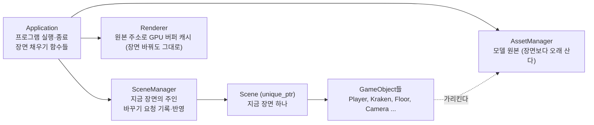
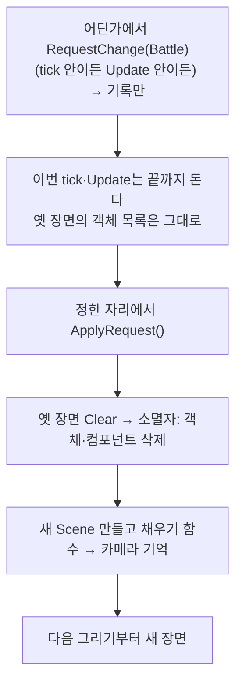

# 04-2. SceneManager와 장면 바꾸기

목표는 장면(Scene)을 하나 더 두고 바꿀 수 있게 하는 것이다. 창 모드는 타이틀 장면으로 시작하고, 키를 누르면 전투 장면(4-1의 Player·Kraken·바닥·카메라)으로 넘어간다. 장면의 주인은 새로 만드는 SceneManager다. 재생과 스키닝은 [단계 4-3](../issues/04-3-animation-playback.md)으로 미뤘다.

이 단계는 [이슈 19](https://github.com/jung-seung-hwan/Nereides-Engine2/issues/19)이고, 선행은 [단계 4-1](04-1-model-assets.md)이다. 처음 설계는 "Scene 하나면 충분하다"였는데, 2026-11-09 학생이 바꿨다: "필요해 타이틀도 있고 화면 전환도 있기때문에 무조건 있게 설계하자", "4-2 전에 먼저", "4-2로, 재생은 4-3". 이 단계를 재생보다 먼저 두는 이유는 Application의 Scene 소유를 한 번만 바꾸고, 4-3의 Animator와 단계 5의 Collider를 "장면이 지워졌다 다시 만들어진다"는 전제로 설계하기 위해서다. 단계 6의 재시작은 전투 장면을 다시 불러오는 것으로 할 수 있다.

> 상태: 설계 문서 초안. 설계 검증 세션의 단계 전환 점검 결과와 학생 결정(아래 "결정 기록")을 받은 뒤 코드를 쓴다.

## 먼저 볼 구조



| 누가 | 무엇을 | 소유 |
| --- | --- | --- |
| `SceneManager` (src/SceneManager.h, 새 파일) | 지금 장면 하나를 갖는다. 바꾸기 요청을 기록해 두었다가 정한 시점에 옛 장면을 지우고 새 장면을 만든다. 지금 장면의 카메라 주소를 기억한다 | `std::unique_ptr<Scene>` 하나를 소유한다 |
| `SceneId` (src/SceneManager.h) | 장면 번호. `Title`, `Battle`, `Demo`. 파일 이름이나 문자열이 아니다 | 값이다 |
| `Application` | SceneManager를 갖고, 장면마다 채우는 함수(`BuildTitleScene`, `BuildBattleScene`, `BuildDemoScene`)를 갖는다. 정한 시점에 SceneManager의 반영 함수를 부른다 | SceneManager, AssetManager, 바닥 메시, Window, Renderer |
| `Scene` | 4-1 그대로. 자기가 소유한 GameObject를 갱신·정리한다 | GameObject들 |
| 타이틀의 행동 컴포넌트 (이름은 결정 1에 따라) | 키를 읽고 전투 장면으로 바꾸기를 요청한다 | 아무것도 소유하지 않는다 |

장면은 파일이 아니라 코드다. 타이틀용 채우기 함수, 전투용 채우기 함수가 따로 있고, 지금의 `BuildWindowScene`이 전투용의 시작이다. 유니티의 `SceneManager.LoadScene("Battle")`가 씬 파일을 읽는 자리에서, 우리는 `switch (id)`로 채우기 함수를 고른다. 씬 파일·에디터는 만들지 않는다(AGENTS.md).

## 입력·출력·소유자·호출 시점

### SceneManager
- **입력**: `RequestChange(SceneId)`. 요청을 기록만 하고 아무것도 바꾸지 않는다. 누가 부르는지는 결정 1.
- **출력**: `Scene& Current()`(지금 장면), `const CameraComponent* Camera()`(지금 장면의 카메라, 없으면 nullptr), `bool HasRequest()`.
- **소유자**: Application. 멤버 선언 순서는 Input, Time, AssetManager, 바닥 메시, Window, Renderer, **SceneManager**. Scene이 Input·Time을 참조하고 ModelRenderer가 원본을 가리키므로, 그보다 뒤에 선언해 먼저 정리된다(4-1의 "선언 순서로 정리 순서를 정한다"와 같은 규칙).
- **호출 시점**: Application이 프레임마다 한 번, 정한 자리(결정 2)에서 `ApplyRequest()`를 부른다. 요청이 없으면 돌아온다. 요청이 있으면 ① 옛 장면 `Clear()`로 모든 객체에 삭제 요청 → ② `unique_ptr`를 새 Scene으로 바꾼다(옛 Scene의 소멸자가 객체·컴포넌트를 지운다) → ③ Application의 채우기 함수가 새 장면을 채우고 카메라 주소를 돌려준다 → ④ 요청을 비운다. 로그 한 줄: `Scene change: Title -> Battle`.
- **오류**: 장면을 바꾸는 도중(옛 장면의 소멸자 안)에 들어온 `RequestChange`는 `std::logic_error`다. 4-1의 "컴포넌트 소멸자에서 CreateObject·Clear 금지"와 같은 규칙이고 이유도 같다: 지우는 도중에 목록을 바꾸면 정리가 꼬인다.

### 장면 채우기 함수 (Application)
- **입력**: 비어 있는 새 `Scene&`. AssetManager·바닥 메시·상수는 Application의 멤버라 그대로 쓴다.
- **출력**: 그 장면의 카메라 컴포넌트 주소(데모 장면은 nullptr. 데모는 그리지 않는다).
- **호출 시점**: `ApplyRequest()` 안에서 한 번. 모델 원본은 `AssetManager.LoadModel`이 같은 경로를 돌려주므로 장면을 몇 번 바꿔도 `Load model` 로그는 처음 한 번뿐이다.
- `BuildTitleScene`: 바닥, 화살표 모델 하나(천천히 도는 것은 선택), 카메라, 그리고 키를 기다리는 행동 컴포넌트. 글자·로고는 없다(2D 그리기가 엔진에 없다. 언제 넣을지는 따로 정한다).
- `BuildBattleScene`: 지금 `BuildWindowScene` 그대로.
- `BuildDemoScene`: 지금 `Initialize`의 데모 분기 그대로. 데모 출력(SHA-256)은 4-1과 같아야 한다.

### 새 장면의 첫 프레임
새로 만든 객체는 `HasPreviousTransform()`이 false라 보간 없이 지금 값으로 그려진다(GameObject.h). 장면을 바꾼 뒤 따로 할 일은 없다.

## 장면을 바꾸는 흐름



요청과 반영을 나누는 이유는 4-1의 tick 끝 반영과 같다. 요청한 그 자리에서 장면을 지우면, 요청을 부른 컴포넌트와 그 객체가 함수 도중에 사라진다(자기 발을 자르는 것). 그래서 요청은 기록만 하고, 아무도 객체를 돌고 있지 않은 한 곳에서만 반영한다.

## 유니티와 비교

| 유니티 | 여기 | 다른 이유 |
| --- | --- | --- |
| `SceneManager.LoadScene("Battle")` — 씬 파일을 읽고 **다음 프레임**에 바뀐다 | `RequestChange(SceneId::Battle)` — 코드로 채우고, 바뀌는 자리는 결정 2 | 씬 파일·에디터가 없다. 학생이 바뀌는 자리를 고른다 |
| `DontDestroyOnLoad`로 씬을 넘어 사는 객체 | 없다. 장면을 넘어 사는 것은 Application의 멤버(AssetManager 원본, Renderer 캐시)뿐이다 | 객체는 모두 장면의 것이다. 필요한 값이 생기면 그때 Application 멤버로 둔다 |
| 여러 씬을 겹쳐 올림(Additive) | 없다. 장면은 항상 하나다 | 이 프로토타입에 필요 없다 |

## 단계 4-2에서 바뀌는 기존 코드

| 파일 | 바뀌는 것 |
| --- | --- |
| `src/Application.h/.cpp` | `Scene m_scene` → `SceneManager m_scenes`. `m_camera` 멤버는 SceneManager로 옮긴다. `Initialize`는 첫 장면(창: Title, 데모: Demo)을 요청하고 바로 반영한다. `BuildWindowScene` → `BuildBattleScene`, 타이틀·데모 채우기 함수 추가. 루프의 정한 자리에서 `ApplyRequest()`. `Shutdown`은 지금 장면을 `Clear()`한다 |
| `src/SceneManager.h/.cpp` | 새 파일 |
| 타이틀 행동 컴포넌트 | 새 파일. 결정 1에 따라 이름과 요청 방법이 정해진다 |
| `src/Scene.h` | 결정 1이 (가)면 서비스 하나가 더해진다(`GetSceneManager()`). (나)면 바뀌지 않는다 |
| `src/main.cpp`, `.vcxproj`, `.filters`, `build.yml` | 새 시험 `--scene-tests` |
| `docs/architecture.md` | 구조 그림의 "Scene 하나"를 SceneManager → Scene으로. "처음 설계와 다른 점" 표에 장면 수 항목 |

## 결정 기록

### 학생이 정할 것 (답 대기)

| 번호 | 물음 | 안 | 추천과 이유 | 학생 답 |
| --- | --- | --- | --- | --- |
| 1 | 바꾸기 요청은 누가 부르나 | (가) 컴포넌트가 부른다. Scene이 알려 주는 서비스가 Input·Time에 **SceneManager**를 더해 셋이 된다. 타이틀의 행동 컴포넌트가 키를 읽고 `GetScene().GetSceneManager().RequestChange(Battle)` (나) Application만 부른다. Application이 타이틀 장면일 때 Input을 직접 보고 요청한다 | (가). 단계 6의 "죽으면 재시작"도 HP를 아는 컴포넌트가 요청하면 된다. Application이 게임 규칙(어느 키, 언제)을 알 필요가 없다. 대신 3-2에서 정한 "서비스는 둘뿐" 문장을 고친다 | 미정 |
| 2 | 언제 바꾸나 | (가) 프레임 끝: 모든 tick과 Update가 끝난 뒤, 렌더 데이터 수집 전. 요청한 프레임에 새 장면이 바로 그려진다 (나) 다음 프레임 시작: 유니티처럼 요청한 프레임은 옛 장면을 한 번 더 그리고, 다음 프레임의 첫 tick 전에 바꾼다 | (가). 어디서 요청해도 객체를 도는 도중이 아니고, 옛 장면을 한 번 더 그릴 이유가 없다. 둘 다 "요청은 기록, 반영은 한 곳"인 점은 같다 | 미정 |
| 3 | 지금 장면과 같은 장면을 요청하면 | (가) 다시 만든다(재시작) (나) 무시한다 | (가). 단계 6의 재시작이 `RequestChange(Battle)` 한 줄이 된다 | 미정 |
| 4 | 한 프레임에 요청이 두 번 오면 | (가) 마지막 것 (나) 첫 것 (다) 오류 | (가). 유니티도 마지막 `LoadScene`이 이긴다. 로그로 덮어쓴 것을 알린다 | 미정 |

### 엔진 쪽에서 정하는 것

| 항목 | 결정 | 이유 |
| --- | --- | --- |
| 장면 번호 | `enum class SceneId { Title, Battle, Demo }` | 문자열은 오타가 잡히지 않는다. 장면이 셋뿐이다 |
| 장면 소유 | `std::unique_ptr<Scene>` | 새 Scene으로 바꿔야 옛 장면의 소멸자가 확실히 돈다. 4-1의 "바꿀 수 있는 소유"와 같은 도구다 |
| 채우기 함수의 자리 | Application의 멤버 함수, `switch (id)` | AssetManager·바닥 메시·상수에 닿아야 한다. 함수 포인터·콜백 없이 switch 하나다 |
| 타이틀에서 전투로 가는 키 | Space | 이미 있는 키다. 새 키를 더하는 것은 학생 변형 과제와 겹치지 않게 뒤로 둔다 |
| 바꾸는 도중의 요청 | `std::logic_error` | 소멸자 규칙과 같다 |
| 데모 모드 | Demo 장면 하나, 바꾸지 않는다 | 데모 출력을 4-1과 같게 둬 회귀 검사로 쓴다 |

## 알려진 한계

- 타이틀에 글자·로고가 없다. 2D 그리기(글자·이미지)는 엔진에도 로드맵에도 없다. 언제 넣을지 학생 답을 기다린다.
- 장면을 바꾸는 사이의 화면 효과(페이드, 로딩 화면)가 없다. 바꾸는 데 걸리는 시간은 한 프레임 안이다(원본을 다시 읽지 않으므로).
- 장면을 넘어 값을 전달하는 길(점수, 이긴 쪽)이 없다. 단계 6에서 필요하면 Application 멤버로 둔다.
- 장면마다 다른 모델을 읽는 것은 가능하지만, 이 단계의 타이틀은 4-1의 화살표 모델을 그대로 쓴다.

## 꼭 필요한 문법만 읽기

- `std::unique_ptr<Scene>`를 `= std::make_unique<Scene>(...)`로 **다시 대입**하면, 갖고 있던 옛 Scene이 먼저 지워지고 새 Scene이 들어간다. 4-1까지는 unique_ptr을 만들고 옮기기만 했고, 이번에 처음 "바꿔 끼운다".
- `enum class SceneId`는 3-1의 `RunMode`와 같은 모양이다. `switch`로 고른다.
- 생성자가 없는 `Scene`은 `std::make_unique<Scene>(input, time)`처럼 인자를 넘겨 만든다.

## 읽기 순서

1. 이 문서의 "먼저 볼 구조"와 "장면을 바꾸는 흐름".
2. `src/SceneManager.h` — 갖는 것과 함수 넷.
3. `src/Application.cpp`의 `Initialize`, 채우기 함수 셋, 루프의 `ApplyRequest()` 자리.
4. 타이틀의 행동 컴포넌트.
5. `src/SceneManager.cpp`의 `ApplyRequest`.
6. 시험 코드 `src/SceneTests.cpp`.

## 실행

```bash
NereidesEngine2.exe --scene-tests
```

```bash
NereidesEngine2.exe --demo
```

창 모드(인자 없음): 타이틀 장면이 보이고, Space를 누르면 전투 장면으로 바뀐다. 콘솔에 `Scene change: Title -> Battle`이 한 줄 찍히고 `Load model`은 한 번뿐이다.

## 검증 계획

| 번호 | 무엇을 | 어떻게 | 기대 |
| --- | --- | --- | --- |
| 1 | 요청만으로는 바뀌지 않는다 | `RequestChange` 뒤 `Current()` 주소 비교 | 같은 주소, `HasRequest()` true |
| 2 | 반영하면 옛 장면이 지워진다 | 옛 장면에 LogComponent, `ApplyRequest()` | 소멸자 로그가 찍히고 새 장면은 채우기 함수의 객체만 있다 |
| 3 | tick 안의 요청은 tick을 끊지 않는다 | FixedUpdate 안에서 요청하는 컴포넌트, `BeginTick`~`EndTick` | tick이 끝까지 돌고 객체 수가 그대로, 반영은 `ApplyRequest()`에서 |
| 4 | 같은 장면 다시 요청 | 결정 3에 따라 | (가)면 새 주소, (나)면 같은 주소 |
| 5 | 한 프레임에 두 번 요청 | 결정 4에 따라 | (가)면 마지막 장면 |
| 6 | 바꾸는 도중의 요청 | 소멸자에서 요청하는 컴포넌트 | `std::logic_error` |
| 7 | 데모 출력 회귀 | `--demo` SHA-256 | 4-1과 같다 |
| 8 | 창 모드 | window-check 스크립트에 Space 입력 추가 | 타이틀 → 전투, `Scene change` 1줄, `Load model` 1번, 닫기·최소화·크기 변경 그대로 |
| 9 | 빌드 | Debug·Release 경고 0 | 기존 시험 모두 PASS |

## 학생 질문

1. SceneManager가 장면을 바꾸면 사라지는 것과 남는 것은 무엇인가? (객체·컴포넌트·모델 원본·GPU 버퍼)
2. 바꾸기 요청을 그 자리에서 바로 반영하면 어떤 문제가 생기는가? 왜 한 곳에서만 반영하는가?
3. 단계 6의 재시작을 이 SceneManager로 하려면 어느 함수를 어디서 부르면 되는가?

변형 과제: 전투 장면에서 키 하나로 타이틀로 돌아가게 하고, 돌아갈 때마다 `Load model` 로그가 몇 번 찍히는지 확인해 이유를 설명한다.

## 리뷰 기록

아직 없음. 코드를 쓴 뒤 GPT·Gemini 리뷰와 교차 확인을 받는다.

## 검증 기록

아직 없음.
